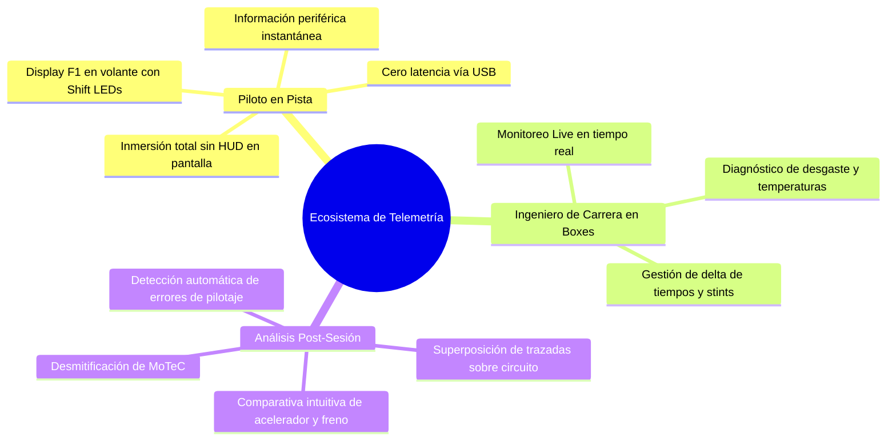
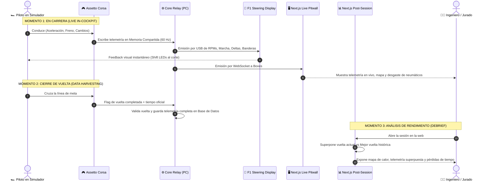
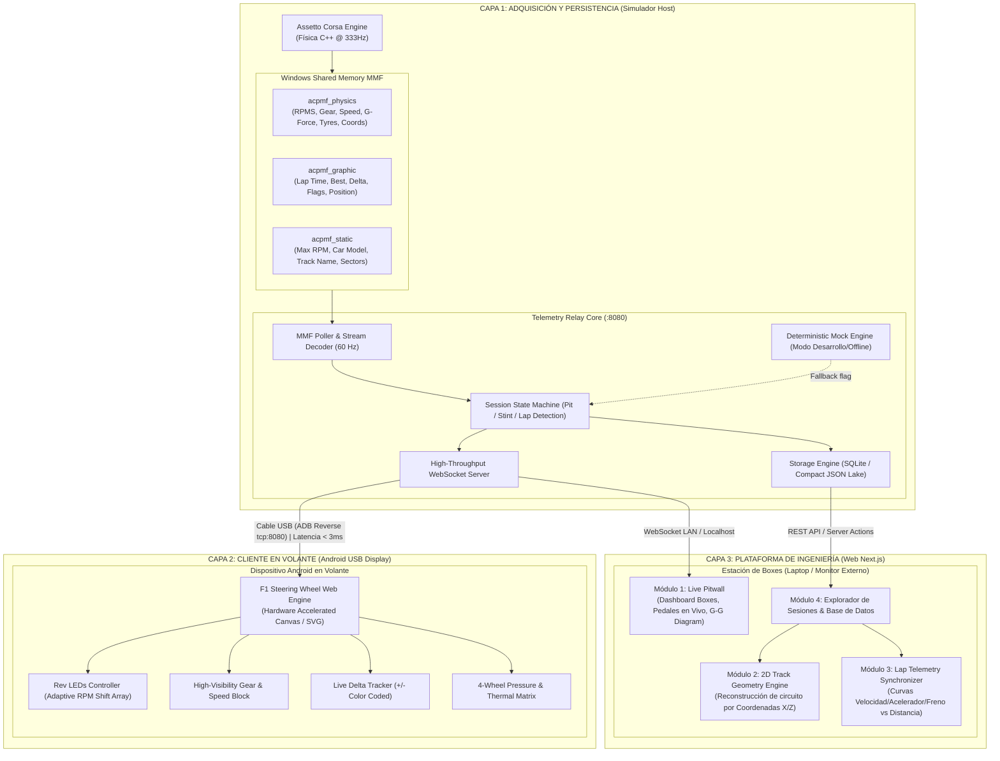

# 🏛️ Visión Integral, Concepto y Arquitectura del Sistema (Overview)

> **Proyecto:** Sistema Integral de Telemetría y Análisis de Rendimiento en Pista para SimRacing  
> **Ámbito:** Proyecto Final / Presentación FAPPE 2026  
> **Audiencia:** Jurado Evaluador de FAPPE, Docentes Universitarios, Ingenieros de Software y Usuarios de SimRacing

---

## 1. La Problemática en SimRacing y Motorsport Amateur

En el automovilismo de competición contemporáneo (Fórmula 1, WEC, IndyCar), la telemetría no es un accesorio cosmético: **es la herramienta nuclear que decide carreras**. Un monoplaza de F1 cuenta con más de 300 sensores que transmiten datos por segundo para que tanto el piloto en el volante como una brigada de ingenieros en el muro de boxes (*pitwall*) tomen decisiones críticas en fracciones de segundo.

Sin embargo, en el mundo del **SimRacing competitivo y de formación**:
1. **Sobrecarga cognitiva del piloto y campo visual recortado:** El piloto depende del HUD del propio juego en pantalla única, el cual suele ser invasivo, tapar la visión del vértice de curva (*apex*) o forzar al ojo a buscar datos periféricos como marchas o tiempos en vez de fijar la vista en el punto de frenada.
2. **Volantes profesionales prohibitivos:** Un volante de simulación réplica de F1 con pantalla LCD integrada (como un Fanatec Podium, Cube Controls o Moza FSR) tiene costos que oscilan entre **$700 USD y $2.000 USD**, lo que resulta inaccesible para la gran mayoría de estudiantes y entusiastas.
3. **Ausencia de análisis post-sesión accesible y orientado a la técnica de manejo:** Las herramientas profesionales de análisis existentes (como MoTeC i2Pro) fueron diseñadas en la década de los 90 para ingenieros aeroespaciales y de competición: requieren exportar manualmente archivos `.ld`, configuraciones complejas de canales matemáticos y ofrecen interfaces crípticas poco pedagógicas. El piloto amateur no logra responder rápidamente preguntas básicas como: *¿Dónde freno antes? ¿Estoy haciendo trail-braking correctamente? ¿Estoy sobrecalentando el neumático delantero derecho por exceso de ángulo de giro?*
4. **Falta del rol de "Ingeniero de Carrera" colaborativo:** En sesiones de práctica o eventos con público/jurado, el acompañante se limita a ser un espectador pasivo en vez de poder monitorear el desgaste del coche o aconsejar al piloto en tiempo real.

---

## 2. El Concepto del Software y la Propuesta de Valor Agregado

Este proyecto introduce un **ecosistema de software en tiempo real y post-sesión**, desacoplado y de costo cero en hardware adicional (reutilizando cualquier smartphone Android existente):

### 2.1. Ejes de Valor Agregado del Proyecto

* **Democratización de Hardware (Smartphone repurposing):** Convierte cualquier teléfono inteligente en desuso o secundario en una pantalla de telemetría de competición con refresco de 60 FPS, conectada por un simple cable USB con latencia inferior a los 3 milisegundos, compitiendo de igual a igual con volantes comerciales de gama alta.
* **Telemetría Didáctica e Intuitiva:** Sustituye los gráficos áridos de MoTeC por visualizaciones modernas tipo *F1 TV Broadcast*: mapas de calor sobre el circuito (zonas rojas de frenada profunda, amarillas de transición/trail-braking, verdes de aceleración total) y gráficas sincronizadas donde un clic en cualquier curva de velocidad resalta el punto exacto en el mapa 2D.
* **Doble Experiencia Interactiva para la FAPPE (Factor Wow):** No es solo sentarse a dar vueltas en un simulador; es una **demostración de ingeniería colaborativa en vivo**. Mientras un evaluador conduce en el habitáculo sintiendo la respuesta visual de los RPM LEDs en el volante, otro integrante o miembro del jurado oficia de **Ingeniero de Pista** desde una laptop externa viendo el desgaste térmico de las gomas y el ritmo de carrera en tiempo real.

---

## 3. Modelo Operativo: Los Tres Momentos del Usuario

El ciclo de uso del software está pensado de punta a punta:

1. **Momento 1: En Carrera (In-Cockpit Live):** El piloto conduce sin distracciones. En su volante, el display móvil le indica el momento milimétrico de cambiar de marcha a través de los Rev LEDs, el delta de tiempo con su mejor marca y el estado térmico de los frenos y neumáticos.
2. **Momento 2: Cierre de Vuelta y Captura:** Al cruzar la meta, el Core Relay detecta el pulso de fin de vuelta, extrae los miles de puntos de datos acumulados (fuerzas G, coordenadas espaciales, inputs de pedales) y los consolida en una estructura indexada de sesión.
3. **Momento 3: Debrief de Ingeniería (Post-Session):** Piloto e ingeniero abren la aplicación Next.js y observan la comparativa de la última vuelta contra la vuelta rápida: se visualiza exactamente cuántos metros antes se frenó en una chicana, si hubo bloqueo de ruedas o si se abrió el acelerador demasiado tarde en la salida de curva.

---

## 4. Arquitectura de Software y Desglose de Componentes

Para lograr robustez, desacoplamiento y cero impacto en los recursos gráficos del juego, el sistema se divide en **tres capas independientes**:

### 4.1. Capa de Adquisición y Persistencia (Backend Relay)
- **Tecnología:** Node.js v22 (con bibliotecas de lectura Win32 MMF) o daemon en Python.
- **Principio de Diseño:** Lectura no bloqueante. Se lee la memoria compartida mediante punteros nativos de Windows, garantizando que el consumo de procesador sea inferior al 1.5% del CPU para no quitarle recursos al cálculo de físicas ni a la GPU del simulador.
- **Motor Mock de Telemetría:** Un generador incorporado capaz de reproducir con precisión milimétrica una vuelta sintética pregrabada en un circuito (como Monza o Spa). Permite a los desarrolladores de frontend y móvil trabajar sin necesidad de tener el simulador abierto.

### 4.2. Capa de Instrumentación In-Cockpit (F1 Steering Wheel Display)
- **Tecnología:** PWA optimizada para ejecución en navegador móvil Chrome con aceleración por hardware (Canvas 2D / CSS GPU layers) a 60 FPS fijos.
- **Ergonomía Visual:**
  - **Paleta de Alto Contraste:** Fondos oscuros absolutos (`#000000`) ideales para paneles OLED/AMOLED, eliminando reflejos indeseados.
  - **Algoritmo Adaptativo de Shift Lights:** La escala de luces no es fija; lee el `maxRpm` de la memoria estática del auto actual y calibra automáticamente el 80% (verde), 90% (rojo) y 97% (azul destellante de corte) para el cambio de marcha perfecto.
  - **Manejo de Ciclo de Vida Móvil:** Invocación de la `Screen WakeLock API` para impedir que el teléfono suspenda la pantalla tras inactividad táctil.

### 4.3. Capa de Ingeniería y Análisis (Next.js Telemetry Platform)
- **Tecnología:** Next.js (App Router), TailwindCSS, Recharts / uPlot, Lucide Icons.
- **Capacidades Analíticas:**
  - **Normalización de Dominio (Distancia vs Tiempo):** En ingeniería de pista, las telemetrías nunca se comparan por tiempo (porque una vuelta más lenta desfasa los puntos de la pista). El sistema normaliza todas las muestras en función de la **distancia recorrida en metros ($0$ a $L_{pista}$)**, permitiendo que el punto de frenada de dos vueltas coincida exactamente en el mismo metro de la pista.
  - **Reconstrucción Geométrica del Circuito:** El sistema toma las coordenadas espaciales $(X, Z)$ registradas por el physics engine y genera el dibujo vectorial del circuito en tiempo real, trazando un gradiente de color según la velocidad o la intensidad de frenada.

---

## 5. Especificaciones de Calidad y Rendimiento

| Métrica / Parámetro | Objetivo de Diseño | Justificación Técnica |
| :--- | :--- | :--- |
| **Latencia Display Volante** | $< 5\text{ ms}$ | El ojo humano percibe retrasos mayores a 16ms entre el sonido del motor y el LED de RPM. |
| **Frecuencia de Muestreo** | $60\text{ Hz}$ en física | Captura detalles sutiles de inputs (pulsos de ABS, correcciones rápidas de dirección). |
| **Consumo de CPU en Simulador** | $< 2\%$ | No debe producir caídas de frames (*stuttering*) en Assetto Corsa. |
| **Independencia de Red Externa** | $100\%$ Local / Offline | La presentación en la FAPPE no puede depender de acceso a Internet ni de redes WiFi públicas. |
| **Tiempo de Recuperación por Desconexión** | $< 1\text{ segundo}$ | Si se mueve el cable USB durante el manejo, la interfaz debe reanudarse al instante sin intervención manual. |

---

## 6. Impacto Académico y Defensa del Proyecto

Para la presentación ante los evaluadores de la FAPPE, este desarrollo integra múltiples competencias troncales de la carrera:

1. **Sistemas Operativos y Bajo Nivel:** Uso de memoria compartida (*Shared Memory MMF*), sincronización de procesos y llamadas nativas Win32.
2. **Redes y Comunicaciones de Tiempo Real:** Protocolos WebSocket sobre enlace físico ADB USB, serialización de datos compacta y gestión de contrapresión (*backpressure*).
3. **Ingeniería de Software y Arquitectura:** Desacoplamiento en microservicios/módulos especializados, patrones publicador-suscriptor y diseño orientado a contratos API.
4. **Desarrollo Web Moderno y UX:** Aplicaciones reactivas de alto rendimiento, aceleración gráfica por GPU en entornos web y diseño de dashboards de ingeniería con análisis de datos.
