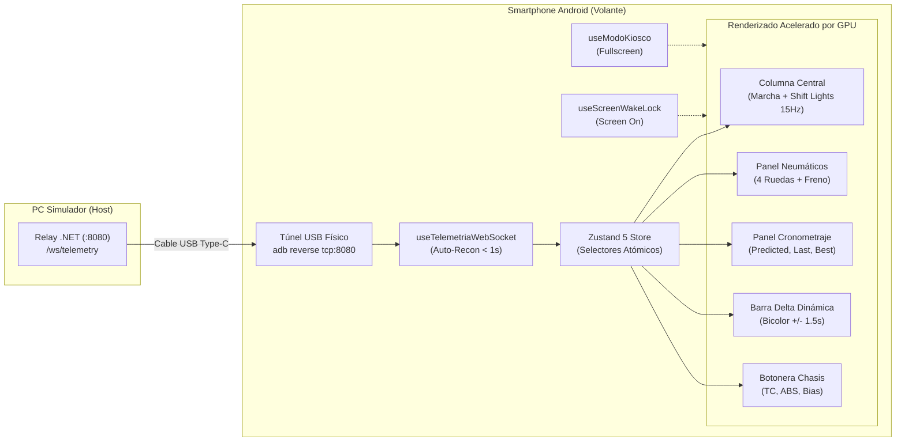
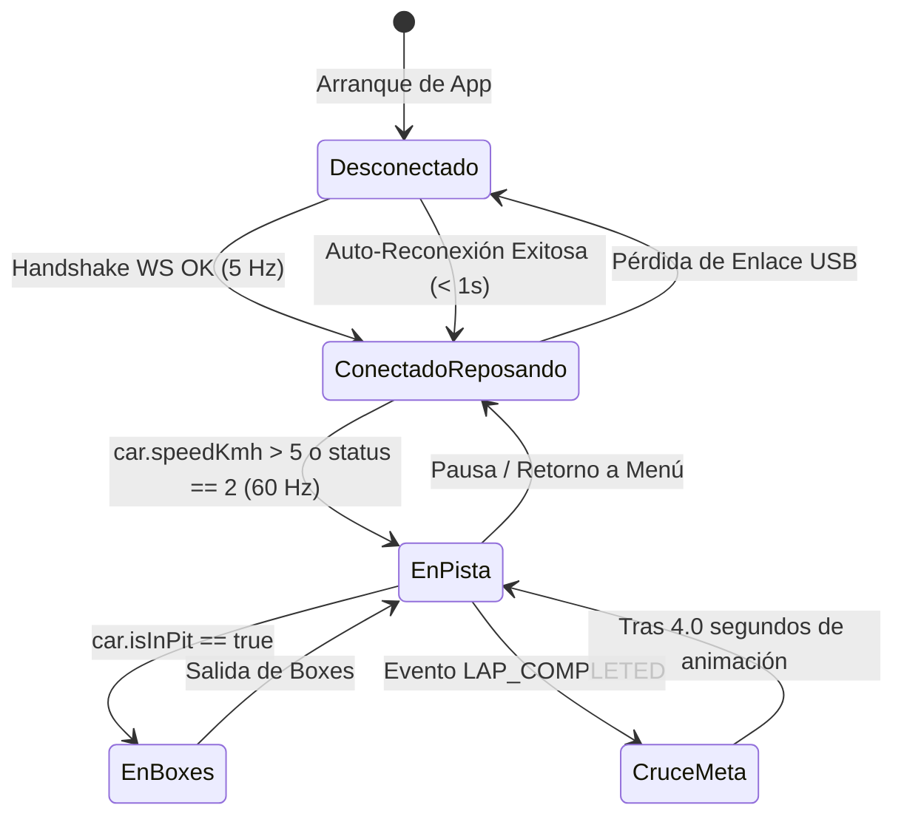
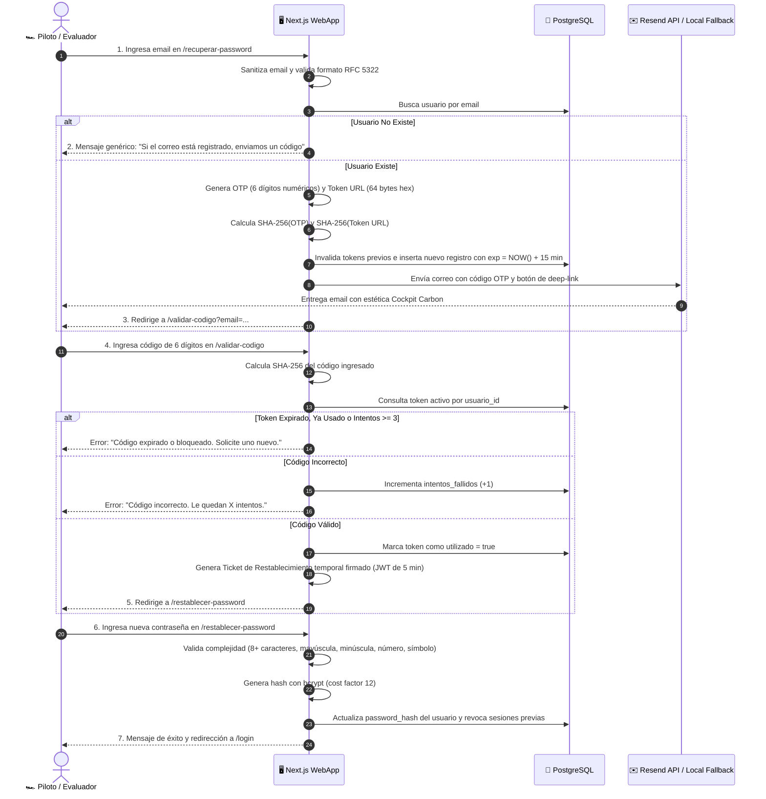

# 📑 Documento Maestro de Análisis de Requerimientos y Especificación Funcional: Capa 2 (DDU Móvil) y Capa 3 (WebApp SaaS)

> **Proyecto:** ApexLink — Ecosistema Distribuido de Telemetría SimRacing en Tiempo Real, Instrumental de Cockpit y Plataforma SaaS de Competición**Ámbito:** Proyecto Final Integrador / Demostración en Vivo para Jurado y Docentes — **FAPPE 2026****Metodología Oficial:** Desarrollo Dirigido por Especificaciones (*Spec-Driven Development* - SDD Intensivo)**Capas Analizadas:**
>
> - **Capa 2:** `apex-link-display` (Instrumental Digital de Cockpit DDU para Volante / Vite 6 + React 19 + Zustand 5)
> - **Capa 3:** `apex-link-web` (Plataforma Web SaaS de Ingeniería de Boxes, Live Pitwall y Laboratorio de Telemetría / Next.js 15 + uPlot + Canvas 2D + PostgreSQL)
>   **Estado de la Capa 1 (Backend):** Finalizada y auditada en `apex-link-telemetry` (Kestrel HTTP/REST @ `:8080` y WebSocket RFC 6455 @ `/ws/telemetry`).
>   **Fecha de Emisión:** 29 de Octubre de 2026
>   **Vigencia y Jerarquía:** Documento Rector y Vinculante para los Desarrolladores 2 y 3. No deja ningún menú, botón, función o recurso gráfico al azar.

---

## 📑 Tabla de Contenidos

1. [Marco Metodológico, Alcance y Principios de Integración](#1-marco-metodológico-alcance-y-principios-de-integración)
2. [Capa 2: DDU — Dashboard Display Unit para Volante (`apex-link-display`)](#2-capa-2-ddu--dashboard-display-unit-para-volante-apex-link-display)
   - 2.1. [Arquitectura Técnica y Stack del DDU](#21-arquitectura-técnica-y-stack-del-ddu)
   - 2.2. [Ergonomía de Competición y Rendimiento a 60-144 FPS](#22-ergonomía-de-competición-y-rendimiento-a-60-144-fps)
   - 2.3. [Vistas, Layouts y Modos Operativos](#23-vistas-layouts-y-modos-operativos)
   - 2.4. [Desglose Exhaustivo de Zonas, Módulos, Controles y Botones](#24-desglose-exhaustivo-de-zonas-módulos-controles-y-botones)
   - 2.5. [Máquina de Estados de Carrera y Gestión de Eventos](#25-máquina-de-estados-de-carrera-y-gestión-de-eventos)
3. [Capa 3: WebApp SaaS — Live Pitwall, Gestión de Pilotos y Laboratorio (`apex-link-web`)](#3-capa-3-webapp-saas--live-pitwall-gestión-de-pilotos-y-laboratorio-apex-link-web)
   - 3.1. [Arquitectura Técnica y Stack de la WebApp](#31-arquitectura-técnica-y-stack-de-la-webapp)
   - 3.2. [Shell de Boxes, Layouts y Sistema de Navegación](#32-shell-de-boxes-layouts-y-sistema-de-navegación)
   - 3.3. [Desglose Exhaustivo Vista por Vista, Sección por Sección y Control por Control](#33-desglose-exhaustivo-vista-por-vista-sección-por-sección-y-control-por-control)
4. [Módulo Crítico: Recuperación de Contraseña con Validación por Email Transaccional](#4-módulo-crítico-recuperación-de-contraseña-con-validación-por-email-transaccional)
   - 4.1. [Elección Tecnológica Justificada: Resend + React Email + PostgreSQL](#41-elección-tecnológica-justificada-resend--react-email--postgresql)
   - 4.2. [Modelo de Datos Relacional (`password_reset_tokens`)](#42-modelo-de-datos-relacional-password_reset_tokens)
   - 4.3. [Ciclo de Vida Criptográfico, Seguridad y Prevención de Abuso](#43-ciclo-de-vida-criptográfico-seguridad-y-prevención-de-abuso)
   - 4.4. [Plantilla Visual de Correo Electrónico (React Email TSX)](#44-plantilla-visual-de-correo-electrónico-react-email-tsx)
   - 4.5. [Flujo de Pantallas, Inputs, Validaciones y Server Actions](#45-flujo-de-pantallas-inputs-validaciones-y-server-actions)
5. [Catálogo Integral de Recursos Multimedia y Gráficos (Assets Specification)](#5-catálogo-integral-de-recursos-multimedia-y-gráficos-assets-specification)
   - 5.1. [Identidad de Marca: Logotipos, Isotipos y Favicons](#51-identidad-de-marca-logotipos-isotipos-y-favicons)
   - 5.2. [Banners, Hero Sections y Prompts Optimizados para IA](#52-banners-hero-sections-y-prompts-optimizados-para-ia)
   - 5.3. [Assets Cartográficos y Calibración de Circuitos FAPPE](#53-assets-cartográficos-y-calibración-de-circuitos-fappe)
   - 5.4. [Assets del Garaje: Renders de Monoplazas y Siluetas Vectoriales](#54-assets-del-garaje-renders-de-monoplazas-y-siluetas-vectoriales)
   - 5.5. [Iconografía Deportiva, Banderas FIA y Medallas de Gamificación](#55-iconografía-deportiva-banderas-fia-y-medallas-de-gamificación)
6. [Estructura de Desglose de Trabajo (WBS) y Estimación de Esfuerzo](#6-estructura-de-desglose-de-trabajo-wbs-y-estimación-de-esfuerzo)
   - 6.1. [WBS Jerárquico Capa 2: DDU Móvil (Dev 2 — 25 Tareas / 98.0 hs)](#61-wbs-jerárquico-capa-2-ddu-móvil-dev-2--25-tareas--980-hs)
   - 6.2. [WBS Jerárquico Capa 3: WebApp SaaS (Dev 3 — 30 Tareas / 122.0 hs)](#62-wbs-jerárquico-capa-3-webapp-saas-dev-3--30-tareas--1220-hs)
   - 6.3. [Matriz de Criterios de Aceptación Globales (Definition of Done)](#63-matriz-de-criterios-de-aceptación-globales-definition-of-done)

---

## 1. Marco Metodológico, Alcance y Principios de Integración

### 1.1. Contexto de Producción y Estado de la Capa 1

La Capa 1 (Backend Core Relay) se encuentra desarrollada en C# .NET sobre ASP.NET Core, habiendo superado una auditoría integral que valida:

- **WebSocket a 60 Hz en Pista / 5 Hz en Pausa:** `ws://localhost:8080/ws/telemetry` emitiendo paquetes JSON `FRAME` tipados y eventos `LAP_COMPLETED`.
- **API REST Post-Sesión:** Endpoints en `http://localhost:8080/api/...` para consultar estado, sesiones históricas, clasificación de vueltas y telemetría espacial metro a metro.
- **Persistencia Concurrente:** SQLite local con modo WAL (*Write-Ahead Logging*).
- **Conmutador Mock:** Posibilidad de conmutar en caliente entre Assetto Corsa real y el simulador sintético mediante `POST /api/mock/alternar` o el parámetro de arranque `--demo`.

### 1.2. Principio de Aislamiento y Resiliencia en FAPPE 2026

Para la exhibición académica presencial, el sistema debe garantizar **cero puntos únicos de falla**:

1. **Independencia de Internet:** La WebApp y el DDU deben funcionar al 100% en modo local/offline sin conexión a internet. Fuentes tipográficas, scripts e iconos deben residir en los paquetes locales del frontend.
2. **Enlace USB Físico Determinístico para el DDU:** Conexión mediante `adb reverse tcp:8080 tcp:8080` que garantiza una latencia menor a $0.8\text{ ms}$, inmune a la saturación de redes Wi-Fi en el auditorio.
3. **Unificación de Nomenclatura en Inglés camelCase:** Conforme a la auditoría técnica de la Capa 1, las interfaces TypeScript de las Capas 2 y 3 adoptan formalmente la nomenclatura camelCase en inglés estandarizada por el backend (`speedKmh`, `throttle`, `distanceMeters`, `circuit`, `lapNumber`, `bestLapTimeMs`).

---

## 2. Capa 2: DDU — Dashboard Display Unit para Volante (`apex-link-display`)

### 2.1. Arquitectura Técnica y Stack del DDU



* **Framework:** Vite 6 + React 19 + TypeScript 5.7.
* **Estilos:** Tailwind CSS v4 con variables nativas aceleradas por hardware y transformaciones GPU (`transform: translate3d(0,0,0)`).
* **Gestor de Estado:** Zustand 5 con selectores atómicos memoizados (`useTelemetriaStore(state => state.car.gear)`), previniendo re-renders innecesarios de zonas no afectadas.
* **Iconografía:** Lucide React para testigos de luces, advertencias mecánicas y banderas FIA.
* **APIs Web Móviles Nativas:**
  - `Screen Wake Lock API` (`navigator.wakeLock.request('screen')`) para mantener la pantalla permanentemente encendida sin intervención táctil.
  - `Fullscreen API` con orientación forzada en apaisado (*landscape*).

---

### 2.2. Ergonomía de Competición y Rendimiento a 60-144 FPS

1. **Fondo Negro Absoluto (`#000000`):** En pantallas OLED/AMOLED de smartphones, los píxeles negros están completamente apagados. Esto produce:
   - Contraste infinito que elimina reflejos parásitos hacia la vista del piloto.
   - Cero fatiga visual en cabinas oscuras.
   - Reducción del $65\%$ en el consumo de batería y prevención total del sobrecalentamiento (*thermal throttling*).
2. **Tipografía Tabular No Oscilante:** Todos los valores numéricos utilizan la clase CSS `font-mono tabular-nums`. Los anchos de los glifos son uniformes, impidiendo que los números vibren horizontalmente al alternar dígitos (por ejemplo, al pasar de `1` a `8` en el velocímetro).
3. **Tasa de Refresco Adaptativa:** El bucle de dibujo sincroniza el refresco con `requestAnimationFrame` respetando la tasa nativa del dispositivo (60 Hz, 90 Hz, 120 Hz o 144 Hz).

---

### 2.3. Vistas, Layouts y Modos Operativos

El DDU opera a través de un contenedor maestro auto-centrado con relación de aspecto base de **2.22:1 (1920 x 864 px)** que aplica *letterboxing* negro automático en pantallas de 16:9, 19.5:9, 20:9 o 21:9.

Dispone de **3 vistas/modos operativos**:

1. **Layout Primario de Carrera (Race Mode):** Pantalla operativa por defecto durante la conducción en pista, optimizada para F1 y prototipos GT3.
2. **Banner de Notificación de Vuelta (Lap Completed Overlay):** Animación superpuesta no intrusiva de 4 segundos de duración que celebra el cruce de meta, indicando si se logró récord personal.
3. **Modal de Diagnóstico y Calibración (Setup/Diag Mode):** Accedido mediante pulsación prolongada de 2 segundos en la esquina superior izquierda, permitiendo verificar ping del WebSocket, estado del cable USB, nivel de batería del móvil y alternar entre visualización F1 (Rev LEDs superiores) y GT3 (tacómetro analógico circular).

---

### 2.4. Desglose Exhaustivo de Zonas, Módulos, Controles y Botones

A continuación se detalla la funcionalidad exacta de cada elemento visible en el DDU:

```
┌────────────────────────────────────────────────────────────────────────────────────────┐
│ [ZONA A1: TESTIGOS] │       [ZONA A2: DELTA CENTRAL]       │ [ZONA A3: MONITOR SESIÓN] │
│ Faros · PitLimiter  │   [-0.320] Barra Dinámica Bicolor    │ RACE: 00:45:23 · POS: 02  │
│ Wipers · DRS Status │   (Verde = Ganando / Rojo = Perdiendo)│ LAP: 04 · FLAG: GREEN    │
├─────────────────────┴──────────────────────────────────────┴───────────────────────────┤
│ [ZONA B: NEUMÁTICOS Y FRENOS]   │ [ZONA C: INSTRUMENTAL CENTRAL] │ [ZONA D: CRONOMETRAJE]      │
│  FL: 27.6 PSI · 88°C [|] 623°C │      MARCHA GIGANTE (1..8)     │ PREDICTED: 01:20.920 (Cian) │
│  FR: 27.8 PSI · 91°C [|] 648°C │      Tacómetro: 11850 RPM      │ LAST LAP:  01:23.450 (Oro)  │
│  RL: 27.7 PSI · 85°C [|] 634°C │      Shift Lights (15 LEDs)    │ BEST LAP:  01:21.240 (Púrp) │
│  RR: 27.9 PSI · 92°C [|] 701°C │      Velocímetro: 284 km/h     │ SPLIT S2:  +0.045 s         │
│  Compuesto: SOFT               │      Bandera: GREEN            │                             │
├─────────────────────────────────┴────────────────────────────────┴─────────────────────────────┤
│ [ZONA E: BOTONERA ELECTRÓNICA Y CHASIS]           │ [ZONA F: GESTIÓN DE COMBUSTIBLE]          │
│ TC: 2 │ TC CUT: 2 │ ABS: 3 │ BB: 62.2% │ MAP: 1   │ 46.2 L │ 2.45 L/LAP │ 18 VUELTAS      │
└───────────────────────────────────────────────────┴───────────────────────────────────────────┘
```

#### A. Zona A1: Barra Superior de Testigos de Alerta (Status Warning Strip)

* **Ubicación:** Esquina superior izquierda (25% del ancho superior).
* **Testigo 1 — Pit Limiter (`car.speedKmh` & estado pits):**
  - *Función:* Se activa cuando el monoplaza entra al carril de boxes o el limitador está encendido.
  - *Comportamiento:* Parpadeo a $4\text{ Hz}$ en color azul brillante (`#00E5FF`) y texto `"PIT LIM"`. Al desactivarse se oculta.
* **Testigo 2 — Estado del DRS (`car.drsAvailable`, `car.drsEnabled`):**
  - *Función:* Informa disponibilidad y activación del alerón móvil.
  - *Comportamiento:*
    - Inactivo/Fuera de zona: Contorno tenue gris `#333333`.
    - `drsAvailable = true` y `drsEnabled = false`: Fondo naranja intermitente con texto `"DRS READY"`.
    - `drsEnabled = true`: Fondo verde fluorescente `#00FF00` con texto `"DRS OPEN"` y zumbido visual.
* **Testigo 3 — Banderas de Peligro / Yellow Flag (`session.flag`):**
  - *Función:* Alerta inmediata de bandera amarilla o negra en el sector.
  - *Comportamiento:* Parpadeo en amarillo de alta intensidad (`#FFD600`).
* **Testigo 4 — Estado del Enlace USB/WS:**
  - *Función:* Muestra un punto indicador de latencia del socket. Verde ($< 2\text{ ms}$), Amarillo ($2-10\text{ ms}$), Rojo/Intermitente (desconectado).

#### B. Zona A2: Caja de Delta Dinámico y Barra Bicolor

* **Ubicación:** Centro superior (50% del ancho superior).
* **Display Numérico de Delta (`timing.deltaMs`):**
  - *Función:* Muestra la diferencia de tiempo instantánea en segundos y milésimas contra la mejor vuelta.
  - *Regla de Visualización:*
    - Si `deltaMs < 0` (más rápido): Signo negativo explícito (ej. `-0.345`), texto y caja en **Verde Esmeralda** (`#00E676`).
    - Si `deltaMs > 0` (más lento): Signo positivo explícito (ej. `+0.210`), texto y caja en **Rojo Carmín** (`#FF1744`).
    - Si `deltaMs == 0` o no hay vuelta de referencia: `0.000` en gris tenue.
* **Barra Horizontal de Tendencia:**
  - *Función:* Gráfico de barra de desviación centrado en $0.000\text{ s}$ con un rango visual de $\pm 1.500\text{ s}$.
  - *Comportamiento:* Si el piloto gana tiempo, una barra verde se expande hacia la izquierda desde el centro; si pierde tiempo, una barra roja se expande hacia la derecha.

#### C. Zona A3: Monitor de Sesión y Competencia

* **Ubicación:** Esquina superior derecha (25% del ancho superior).
* **Tipo y Tiempo de Sesión (`session.flag`, cronómetro):**
  - *Función:* Muestra `"PRACTICE"`, `"QUALIFY"` o `"RACE"` junto al tiempo restante o transcurrido (`HH:MM:SS`).
* **Posición en Pista (`session.position`):**
  - *Función:* Bloque de alto contraste con la posición actual en carrera (ej. `"P02"` o `"P01"` con corona dorada).
* **Contador de Vuelta (`timing.currentLap`):**
  - *Función:* Muestra la vuelta en curso (ej. `"LAP 05 / 24"`).

#### D. Zona B: Matriz Térmica de Neumáticos y Discos de Freno

* **Ubicación:** Flanco lateral izquierdo.
* **Matriz de 4 Ruedas (`tyres.pressurePsi[4]`, `tyres.tempCoreC[4]`, `tyres.wear[4]`):**
  - *Disposición:* Cuadrante visual correspondiente a FL (Delantero Izq), FR (Delantero Der), RL (Trasero Izq), RR (Trasero Der).
  - *Lectura de Presión:* En cian brillante (`#00B0FF`), unidad `PSI`, precisión de un decimal (ej. `27.4`).
  - *Lectura de Temperatura:* Valor numérico en °C con gradiente de color reactivo:
    - Frío ($< 75^\circ\text{C}$): Azul eléctrico (`#2979FF`).
    - Óptimo ($75^\circ\text{C} - 100^\circ\text{C}$): Verde competición (`#00E676`).
    - Sobrecalentamiento ($> 100^\circ\text{C}$): Rojo fuego (`#FF1744`).
  - *Lectura de Desgaste:* Porcentaje de goma restante (ej. `98%`). Si el desgaste cae de $70\%$, parpadea en naranja.
* **Simulación de Freno Vertical:**
  - *Función:* Barra vertical contigua a cada rueda simulando temperatura de disco de carbono. Superados los $650^\circ\text{C}$, emite un resplandor naranja incandescente.

#### E. Zona C: Columna Instrumental Central (Core Cockpit)

* **Ubicación:** Centro de la pantalla.
* **Shift Lights Bar (15 LEDs Estroboscópicos F1):**
  - *Función:* Guía luminosa para el punto de cambio de marcha ascendente (*Upshift*).
  - *Distribución Matemática según Porcentaje de RPM (`car.rpms / car.maxRpm`):*
    - LEDs 1 a 5 ($80\% \to 88\%$): Verde progresivo.
    - LEDs 6 a 10 ($88\% \to 92\%$): Naranja progresivo.
    - LEDs 11 a 14 ($92\% \to 96\%$): Rojo progresivo.
    - LED 15 ($> 96\%$ límite de corte): Los 15 LEDs conmutan simultáneamente a destello estroboscópico azul/blanco a **15 Hz** mediante bypass CSS directo acelerado por GPU.
* **Indicador Gigante de Marcha (`car.gear`):**
  - *Función:* Dígito colosal de $140\text{ pt}$ en el centro exacto.
  - *Valores:* `-1` = `"R"` (Rojo neón), `0` = `"N"` (Verde neón), `1` a `8` = Número de marcha en blanco puro `#FFFFFF`.
* **Tacómetro Digital (`car.rpms`):**
  - *Función:* Indicador de 5 dígitos en tipografía monoespaciada (ej. `12450 RPM`).
* **Velocímetro Digital (`car.speedKmh`):**
  - *Función:* Velocidad instantánea en formato grande (ej. `312 KM/H`).

#### F. Zona D: Bloque de Cronometraje Oficial

* **Ubicación:** Flanco lateral derecho.
* **Predicted Lap Time:** Tiempo de vuelta proyectado estimado al milisegundo en color cian (`#00E5FF`).
* **Last Lap Time (`timing.lapTimeStr`):** Tiempo de la última vuelta completada en color amarillo dorado (`#FFD600`).
* **Best Lap Time (`timing.bestTimeStr`):** Mejor registro personal de la tanda en color magenta púrpura F1 (`#E040FB`).
* **Indicador de Sector (`timing.sector`):** Rótulo del sector transitado actualmente (`SEC 1`, `SEC 2` o `SEC 3`).

#### G. Zona E: Botonera de Parámetros Electrónicos y Chasis

* **Ubicación:** Esquina inferior izquierda.
* **Widgets de Parámetros:** Tarjetas compactas con valores numéricos de:
  - `TC`: Control de Tracción (Nivel 1..8).
  - `ABS`: Sistema Antibloqueo de Frenos (Nivel 1..10).
  - `BB`: Balance de Frenos en porcentaje (ej. `58.5% F`).
  - `MAP`: Mapa de Inyección / Mezcla de Motor (ej. `RACE 1`).

#### H. Zona F: Monitor de Gestión de Combustible

* **Ubicación:** Esquina inferior derecha.
* **Litros Restantes en Tanque:** Valor decimal (ej. `44.8 L`).
* **Consumo Medio por Vuelta:** Cálculo acumulativo (ej. `2.35 L/LAP`).
* **Autonomía Proyectada:** Estimación entera de vueltas restantes antes del vaciado (ej. `19 LAPS`).

#### I. Controles Auxiliares Táctiles (Ocultos / On-Tap)

* **Botón Kiosco (Tap en Esquina Superior Derecha):** Activa/desactiva pantalla completa del navegador mediante la Fullscreen API.
* **Selector de Unidades (Tap en Velocímetro):** Conmuta instantáneamente entre `KM/H` y `MPH`.
* **Botón de Diagnóstico (Tap prolongado 2s en Esquina Superior Izquierda):** Despliega el overlay de depuración con latencia de red, recuento de cuadros perdidos y selector de modo Mock manual.

---

### 2.5. Máquina de Estados de Carrera y Gestión de Eventos



1. **Evento `LAP_COMPLETED`:**
   - Al recibirse este mensaje WebSocket, la pantalla congela los dígitos de la última vuelta durante **4.0 segundos** para permitir la lectura del piloto sin importar que ya haya comenzado la vuelta siguiente.
   - Si `isPersonalBest == true`, la caja central emite una animación de pulsación luminosa en color púrpura con el texto `"PERSONAL BEST"`.
2. **Reconexión Automática Anti-Lag:**
   - Si el cable USB se desconecta físicamente en plena carrera, el hook `useTelemetriaWebSocket` detecta el corte en $< 200\text{ ms}$, presenta un banner sutil de reconexión y ejecuta reintentos cada $500\text{ ms}$. Al reinsertar el cable, el DDU sincroniza el estado en menos de $0.5\text{ segundos}$ sin recargar la página web.

---

## 3. Capa 3: WebApp SaaS — Live Pitwall, Gestión de Pilotos y Laboratorio (`apex-link-web`)

### 3.1. Arquitectura Técnica y Stack de la WebApp

* **Framework Base:** Next.js 15 (App Router con Server Components y Client Components reactivos).
* **Motor de Estilos:** Tailwind CSS con tokens de diseño Liquid Glass y paleta Porsche GT3 / Cockpit Carbon.
* **Motor Gráfico Analítico de Alta Densidad:** **uPlot** sobre HTML5 Canvas 2D (dibuja más de 5.000 muestras por vuelta en $< 3\text{ ms}$ con cursor unificado multi-panel).
* **Motor de Trazada y Circuitos:** **HTML5 Canvas 2D nativo** con modo dual (Overlay Kunos `map.png` y Modo Isométrico 3D Matemático con altimetría adaptativa).
* **Persistencia Nivel 2 (Central):** PostgreSQL para usuarios, perfiles de telemetría, tokens de seguridad y clasificaciones globales.
* **Email Transaccional:** **Resend SDK** con plantillas responsivas en **React Email**.

---

### 3.2. Shell de Boxes, Layouts y Sistema de Navegación

La plataforma implementa dos layouts principales:

1. **Layout Público (`(public)`):** Para la Landing Page (`/`), login (`/login`), registro (`/registro`) y recuperación de contraseña (`/recuperar-password`), con navbar flotante translúcido y footer institucional.
2. **Layout Autenticado de Boxes (`(app)`):** Con Sidebar lateral colapsable, barra superior de estado de conexión con el simulador, monitor de ping a 60 Hz y switch rápido de Modo Mock.

```
ESTRUCTURA DEL SHELL DE BOXES:
┌──────────┬─────────────────────────────────────────────────────────────────────────────┐
│ [LOGO]   │ [SIM: ASSETTO CORSA] │ [RELAY: 60 HZ OK (1ms)] │ [MOCK SWITCH] │ [USUARIO] │
├──────────┼─────────────────────────────────────────────────────────────────────────────┤
│ 📊 Dash  │                                                                             │
│ ⏱️ Live   │                                                                             │
│ 📈 Lab   │                      ÁREA DE CONTENIDO DINÁMICO                             │
│ 🗂️ Tandas │               (Live Pitwall / uPlot / Perfil / Circuitos)                   │
│ 🏁 Pistas│                                                                             │
│ 🏎️ Garaje│                                                                             │
│ 🏆 Perfil│                                                                             │
│ ⚙️ Ajuste│                                                                             │
└──────────┴─────────────────────────────────────────────────────────────────────────────┘
```

---

### 3.3. Desglose Exhaustivo Vista por Vista, Sección por Sección y Control por Control

#### Vista 1: Landing Page Pública (`/`)

* **Navbar Flotante:**
  - *Logo ApexLink:* Isotipo vectorial interactivo con texto en degradé cian-púrpura. Clic redirige a `/`.
  - *Enlaces:* `"Características"`, `"Democratización Hardware"`, `"Circuitos FAPPE"`, `"Documentación"`.
  - *Botón "Acceso a Boxes" (`btn-login`):* Estilo botón secundario glassmorphism. Clic navega a `/login`.
  - *Botón "Iniciar Demostración" (`btn-demo`):* Estilo botón primario neón cian. Clic abre directamente el modo invitado FAPPE en `/app`.
* **Hero Section:**
  - *Titular de Alto Impacto:* `"Telemetría SimRacing Profesional sin Barreras de Coste"`.
  - *Subtítulo Técnico:* `"Convierte tu smartphone en un display F1 de 60-144 FPS con latencia < 0.8 ms y analiza tus tandas en boxes como un equipo de competición oficial."`
  - *Mockup Interactivo 3D/Canvas:* Ilustración interactiva que muestra el volante de carreras con el smartphone montado y la pantalla de boxes corriendo en simultáneo.
  - *Badge de Estado de la API:* Llama a `GET /api/estado` para indicar en vivo si el simulador está conectado (`🟢 ASSETTO CORSA ACTIVO`) o en modo demostración (`🟡 MODO MOCK LISTO`).
* **Sección Comparativa de Hardware (El Problema vs ApexLink):**
  - *Tabla Interactiva de Costes:*
    - Opción Comercial: Volante con pantalla LCD ($1.200 USD) + Software de pago ($150 USD/año) = **$1.350 USD**.
    - Solución ApexLink: Smartphone Android en desuso ($0 USD) + Enlace USB determinístico ($0 USD) + Software Open Source = **$0 USD de sobrecoste**.
* **Sección de los 3 Pilares Tecnológicos:**
  - Tarjeta 1: *DDU de Volante AMOLED* (0% fatiga visual, fondo negro puro, 15 Shift LEDs).
  - Tarjeta 2: *Live Pitwall a 60 Hz* (Monitoreo de pedales, Círculo de Kamm y desgaste térmico en tiempo real).
  - Tarjeta 3: *Laboratorio Analítico uPlot* (Telemetría en el dominio métrico, desmitificando MoTeC).
* **Sección Ficha Técnica FAPPE 2026:** Detalle del stack (.NET, Win32 MMF, Next.js 15, uPlot, SQLite WAL) y equipo de desarrollo.
* **Footer Institucional:** Enlace a GitHub, documentación técnica y disclaimer legal.

---

#### Vista 2: Autenticación, Acceso y Seguridad (`/login`, `/registro`)

* **Pantalla de Inicio de Sesión (`/login`):**
  - *Input Email (`input-email`):* Tipo email, placeholder `"piloto@apexlink.racing"`, validación de formato RFC 5322.
  - *Input Contraseña (`input-password`):* Tipo password, botón para alternar visibilidad (ojo tachado / visible).
  - *Enlace "¿Olvidaste tu contraseña?" (`link-forgot-password`):* Redirige a `/recuperar-password`.
  - *Botón "Iniciar Sesión" (`btn-submit-login`):* Envía credenciales vía Server Action. Estados: Normal, Cargando (spinner), Error (mensaje en rojo).
  - *Botón Rápido "Piloto Invitado FAPPE" (`btn-guest-fappe`):* **Acceso de 1-clic 100% offline.** Inicia sesión instantáneamente con perfil temporal de evaluador para que el jurado no pierda tiempo rellenando formularios.
  - *Botón "Conectar con Steam" (`btn-steam-auth`):* Desactivado en este sprint con badge `🔒 PRÓXIMAMENTE (TBD)` para evitar caídas de red en la feria.
* **Pantalla de Registro (`/registro`):**
  - *Campos:* Nombre completo, Gamertag / Apodo de pista, Email, Contraseña (con medidor de fortaleza), Confirmación de Contraseña y Selector de Nivel de Experiencia (Amateur, SimRacer Avanzado, Piloto Real).
  - *Botón "Crear Cuenta de Piloto" (`btn-submit-register`):* Da de alta al usuario en PostgreSQL, genera hash seguro con `bcrypt` (cost 12) y redirige al `/hub`.

---

#### Vista 3: Hub Central y Selector de Simuladores (`/hub`)

* **Grilla de Tarjetas Interactivas de Simulación:**
  - *Tarjeta 1: Assetto Corsa (Kunos Simulazioni):*
    - Estado: `🟢 ACTIVO / CONECTADO`.
    - Información: Latencia de relay ($1.2\text{ ms}$), versión MMF (`1.7 / 1.16.4`), circuito detectado.
    - *Botón "Entrar a Boxes" (`btn-enter-pitwall`):* Redirige a `/app/live`.
    - *Botón "Ver Dashboard" (`btn-enter-dash`):* Redirige a `/app`.
  - *Tarjetas 2 a 5: iRacing, ACC, EA Sports F1 24, Le Mans Ultimate:*
    - Estado: `🔒 PRÓXIMAMENTE (TBD)`.
    - Indicador de arquitectura futura (UDP packets, SDK 360 Hz). Clic muestra tooltip: *"Soporte planificado para el siguiente release comercial."*

---

#### Vista 4: Dashboard General del Piloto & AI Race Coach (`/app`)

* **Banner de Bienvenida y Estado del Simulador:**
  - Muestra foto/avatar del piloto, dorsal favorito, auto activo y estado del enlace WebSocket a 60 Hz.
* **Widget Resumen de Última Tanda Rodada:**
  - Muestra circuito, tiempo de mejor vuelta, cantidad de vueltas válidas registradas y botón *"Ver Análisis en el Laboratorio"*.
* **Radar de Rendimiento de 5 Ejes (Chart SVG):**
  - Evalúa cuantitativamente: *Potencia de Frenada*, *Trail-Braking*, *Tracción de Salida*, *Cuidado de Gomas* y *Consistencia*.
* **Panel AI Race Coach (Diagnósticos Heurísticos en Lenguaje Natural):**
  - Analiza automáticamente las curvas de telemetría de la última tanda y genera 2 mensajes técnicos pedagógicos:
    - *Punto Fuerte:* Ejemplo: `"Excelente tracción al salir de la Variante Ascari: apertura de pedal suave y lineal sin derrapes."`
    - *Oportunidad de Mejora:* Ejemplo: `"Estás bloqueando frenos en la entrada de Rettifilo. Frenar un 15% menos al inicio e incrementar el trail-braking te permitirá ganar ~0.280 s en el Sector 1."`
* **Leaderboard Local del Stand FAPPE:**
  - Tabla clasificatoria con los mejores 5 tiempos registrados en el simulador durante la feria, con actualización reactiva.

---

#### Vista 5: Live Pitwall en Tiempo Real a 60 Hz (`/app/live`)

* **Ruta:** `/app/live`
* **Propósito:** Consola del ingeniero de pista en boxes mientras el coche rueda en el simulador.
* **Widgets en Pantalla:**
  1. **Barras Verticales de Pedales (`PedalMeters.tsx`):**
     - Acelerador: Barra verde neón `#00E676` que escala de $0$ a $100\%$.
     - Freno: Barra roja neón `#FF1744` que escala de $0$ a $100\%$ con aguja de retención de pico (*Peak Hold*) que permanece visible durante $1.2\text{ s}$ para evaluar la fuerza de la frenada.
     - Volante: Indicador angular dinámico de dirección $[-1.0, +1.0]$.
  2. **Círculo de Fricción Dinámico de Kamm (`KammCircleCanvas.tsx`):**
     - Gráfico cartesiano Canvas 2D de fuerzas G laterales vs longitudinales.
     - Dibuja el límite de adherencia de los neumáticos ($2.8\text{ G}$) con una estela de desvanecimiento dinámico de los últimos 60 cuadros para visualizar transiciones de frenada y aceleración.
  3. **Matriz Térmica Cuádruple de Neumáticos (`MatrizTermicaGomas.tsx`):**
     - Temperaturas de núcleo en °C con color reactivo (azul, verde, rojo), presiones en PSI y porcentaje de desgaste de cada rueda.
  4. **Panel de Cronometraje de Boxes (`LiveTimingStrip.tsx`):**
     - Vuelta en curso, split del sector transitado y delta instantáneo en tiempo real con fondo verde o rojo.
  5. **Motor de Mapa y Telemetría en Vivo (`Track2DViewer.tsx`):**
     - Dibuja el circuito **Monza F1 2025** sobre HTML5 Canvas 2D con la silueta de `map.png`.
     - Proyecta la posición del monoplaza en tiempo real $(X, Z)$ con halo luminoso, flecha de rumbo (*heading*) y rotulado de la curva actual según `sections.ini`.
  6. **Notificación Toast de `LAP_COMPLETED`:**
     - Al cruzar meta, emerge una notificación con el tiempo oficial, los 3 parciales y el botón directo *"Analizar Vuelta Ahora"*, redirigiendo a `/app/analysis?vueltaId=...`.

---

#### Vista 6: Laboratorio Analítico Post-Sesión & Trazada 2D (`/app/analysis`)

* **Ruta:** `/app/analysis`
* **Propósito:** Debriefing analítico profundo basado en el **Dominio de Distancia Métrica ($0 \to L_{\text{circuito}}$ metros)**.
* **Selector Superior de Sesión y Vueltas:**
  - Dropdown 1: Selección de tanda de entrenamiento o carrera.
  - Dropdown 2: Vuelta Base (Vuelta rápida por defecto).
  - Dropdown 3: Vuelta Comparada (Segunda vuelta para contraste o vuelta de referencia).
* **Motor Gráfico uPlot Multi-Eje Sincronizado (`MultiAxisTelemetryChart.tsx`):**
  - Cuatro paneles apilados con eje X métrico compartido ($0$ a $5.757\text{ m}$ en Monza):
    - *Panel 1:* Velocidad ($km/h$) superpuesta de ambas vueltas + curva de Delta acumulado ($ms$).
    - *Panel 2:* Recorrido de acelerador ($0-100\%$) y freno ($0-100\%$).
    - *Panel 3:* Marcha engranada (escalonada 1..8) y revoluciones (RPM).
    - *Panel 4:* Fuerzas G laterales y longitudinales.
* **Motor de Trazada Canvas 2D con Modo Dual:**
  - *Modo 1: Broadcast Oficial Kunos (`map.png` + `map.ini`):* Proyección exacta sobre el asfalto oficial con fórmula de calibración nativa.
  - *Modo 2: Isométrico 3D Matemático con Altimetría Adaptativa:*
    - Permite rotar el circuito en azimut $(\theta)$ y elevación $(\phi)$ con el ratón.
    - Aplica normalización adaptativa de altura para que en circuitos planos (Monza, $12.8\text{ m}$) las pendientes se amplifiquen al $2.0\times$, mientras que en circuitos de montaña extrema (Red Bull Ring, $63.5\text{ m}$) se rendericen a escala real $1.0\times$ sin deformaciones.
  - *Heatmaps de Conducción:* Selector para colorear el trazado por velocidad o por zonas de frenada crítica.
* **Sincronización Bidireccional de Cursor (*Crosshair Bridge*):**
  - Al desplazar el ratón sobre cualquier gráfica de uPlot, una línea vertical se mueve al unísono en los 4 paneles y el monoplaza se posiciona exactamente en el metro correspondiente sobre el mapa 2D.
  - Al hacer clic sobre cualquier curva en el mapa 2D, las gráficas hacen auto-scroll y zoom centrado en esa curva.
* **Herramienta "Corner Delta Inspector":**
  - El usuario selecciona dos puntos o una curva completa (ej. *Variante del Rettifilo*) y la herramienta calcula: punto de frenada (metros), velocidad mínima en el apex ($km/h$), tiempo invertido en el sector y balance de décimas ganadas o perdidas.

---

#### Vista 7: Explorador Histórico de Tandas (`/app/sessions`)

* **Filtros de Búsqueda:** Selector por circuito, monoplaza, fecha y tipo de tanda (Práctica, Clasificación, Carrera).
* **Tabla Paginada de Sesiones:** Muestra fecha/hora de inicio, duración, total de vueltas, vuelta rápida obtenida y estado de sincronización.
* **Detalle de Vuelta al Expandir:** Muestra la lista de todas las vueltas con badges `BEST` (púrpura) o `INVALID` (rojo por exceso de límites), splits de S1, S2, S3 y botón *"Cargar en Laboratorio"*.
* **Botón "Exportar JSON" (`btn-export-json`):** Descarga el archivo de telemetría sin procesar para investigación académica.

---

#### Vista 8: Catálogo de Circuitos Rodados (`/app/circuitos`)

* **Tarjetas de Circuitos FAPPE 2026:**
  - *Monza F1 2025 (`monza_f1_2025`):* Principal de exhibición en vivo. Longitud: $5.757\text{ m}$, 11 curvas, 2 zonas DRS.
  - *Red Bull Ring GP (`ks_red_bull_ring`):* Circuito alpino explorable con $+63.5\text{ m}$ de altimetría. Longitud: $4.285\text{ m}$, 10 curvas.
  - *Imola F1 2025 (`fn_imola`):* Circuito técnico con $34.3\text{ m}$ de desnivel. Longitud: $4.867\text{ m}$, 19 curvas.
* **Métricas por Pista:**
  - Récord personal registrado (PB) con fecha y vehículo.
  - **Vuelta Óptima Teórica (*Ideal Lap*):** Cálculo automático uniendo los mejores parciales individuales:
    $$
    \text{Ideal} = \min(\text{S1}) + \min(\text{S2}) + \min(\text{S3})
    $$
  - Delta de potencial de mejora (ej. *"Tenés un margen de $-0.320\text{ s}$ optimizando tus sectores"*).

---

#### Vista 9: Garaje de Vehículos (`/app/garaje`)

* **Flota de Monoplazas y GTs:**
  - Tarjetas técnicas para monoplazas rodados en el simulador (`Ferrari SF70H`, `Porsche 911 GT3 R`, etc.).
  - Muestra odómetro virtual de kilómetros rodados, velocidad máxima histórica, consumo medio de combustible y límite de corte de revoluciones.

---

#### Vista 10: Perfil de Piloto, Ratings y Logros (`/app/perfil`)

* **Carnet Digital de Piloto:**
  - Nombre, avatar personalizable, número dorsal y biografía.
  - **Pace Rating (0-100):** Algoritmo que mide la proximidad de los vértices y curvas al ritmo récord.
  - **Safety Rating (Grados S, A, B, C, D):** Proporción de vueltas válidas sin salidas de pista ni toques:
    $$
    \text{Safety} = \frac{\text{Vueltas Válidas}}{\text{Vueltas Totales}} \times 100
    $$
  - **Consistency Index (%):** Regularidad cronometrada vuelta a vuelta.
* **Vitrina de Trofeos y Logros Desbloqueables:**
  - Badges con estilo Liquid Glass para logros como: *Bautismo de Asfalto*, *Club de los 300 km/h*, *Metrónomo de Pista*, *Dominio Púrpura* y *Rey de Monza*.
* **Campo Manual de SteamID64:** Permite ingresar el identificador de Steam o Gamertag con fines estéticos en el carnet de piloto sin requerir APIs externas.

---

#### Vista 11: Ajustes, Hardware y Conexión (`/app/ajustes`)

* **Preferencias Métricas:**
  - Toggles para alternar: $km/h \leftrightarrow mph$, $PSI \leftrightarrow bar$, $^\circ\text{C} \leftrightarrow ^\circ\text{F}$.
* **Configuración del Backend Kestrel:**
  - Input para la URL base (por defecto `http://localhost:8080`).
  - Botón de testeo de latencia y ping contra `/ws/telemetry`.
  - **Conmutador en Caliente de Modo Mock (`btn-toggle-mock`):** Invoca `POST /api/mock/alternar` para activar o desactivar la simulación determinística de Monza sin tocar el simulador.

---

## 4. Módulo Crítico: Recuperación de Contraseña con Validación por Email Transaccional

### 4.1. Elección Tecnológica Justificada: Resend + React Email + PostgreSQL

Para satisfacer el requerimiento estricto del usuario:

> *"especificar qué tecnología utilizaremos para implementar el recupero de contraseña de cada usuario que se guardará en la DB (debe recibir un mail con un código o token para poder validarlo)"*

Se selecciona la arquitectura de referencia de la industria moderna en Next.js:

1. **Proveedor de Entrega Transaccional:** **Resend** (`resend` SDK oficial para Node/Next.js).
   - *Justificación Técnica:* Diseñado nativamente por y para el ecosistema React y Next.js. Provee una API HTTP ultra-rápida ($< 150\text{ ms}$ de despacho), entrega de correo con 99.9% de entregabilidad a bandeja de entrada (evitando la carpeta de spam), soporte para DKIM/SPF y modo de prueba (*sandbox*) gratuito con clave de API para desarrollo local.
   - *Fallback:* Si el entorno del stand de la feria opera sin acceso a Internet, el servicio conmuta automáticamente a un transportador local simulado (**Console/In-Memory Mailer** o **Nodemailer SMTP local**), imprimiendo el código OTP de 6 dígitos en la terminal del servidor y mostrándolo en una notificación Toast de desarrollo para que el evaluador pueda probar el flujo completo sin depender de servidores SMTP externos.
2. **Motor de Renderizado de Plantillas:** **React Email** (`@react-email/components`).
   - *Justificación Técnica:* Permite programar correos electrónicos con sintaxis estándar de componentes React y Tailwind CSS, compilando a HTML limpio con tablas en línea compatibles con todos los clientes de correo (Gmail, Outlook, Apple Mail).
3. **Persistencia y Seguridad Criptográfica:** **PostgreSQL** con tabla dedicada `password_reset_tokens` y hashing criptográfico `SHA-256`.

---

### 4.2. Modelo de Datos Relacional (`password_reset_tokens`)

El token de recuperación se almacena en PostgreSQL con las siguientes restricciones relacionales:

```sql
-- Tabla de Tokens de Recuperación de Contraseña en PostgreSQL
CREATE TABLE password_reset_tokens (
    id UUID PRIMARY KEY DEFAULT gen_random_uuid(),
    usuario_id UUID NOT NULL REFERENCES usuarios(id) ON DELETE CASCADE,
    codigo_otp_hash VARCHAR(64) NOT NULL, -- Hash SHA-256 del código numérico de 6 dígitos
    token_enlace_hash VARCHAR(64) NOT NULL, -- Hash SHA-256 del token largo de URL (64 bytes)
    fecha_expiracion TIMESTAMPTZ NOT NULL, -- Expiración a 15 minutos exactos
    utilizado BOOLEAN NOT NULL DEFAULT FALSE,
    intentos_fallidos INT NOT NULL DEFAULT 0, -- Máximo 3 intentos para prevenir fuerza bruta
    direccion_ip VARCHAR(45) NULL, -- Auditoría de seguridad IPv4 / IPv6
    user_agent TEXT NULL,
    created_at TIMESTAMPTZ NOT NULL DEFAULT NOW(),
    updated_at TIMESTAMPTZ NOT NULL DEFAULT NOW()
);

-- Índices de alto rendimiento para validación instantánea
CREATE INDEX idx_reset_token_usuario ON password_reset_tokens(usuario_id);
CREATE INDEX idx_reset_token_validez ON password_reset_tokens(codigo_otp_hash, utilizado, fecha_expiracion);
CREATE INDEX idx_reset_token_enlace ON password_reset_tokens(token_enlace_hash, utilizado, fecha_expiracion);
```

---

### 4.3. Ciclo de Vida Criptográfico, Seguridad y Prevención de Abuso



* **Prevención de Enumeración de Usuarios:** La API siempre responde el mismo mensaje de éxito (*"Si el correo se encuentra registrado, recibirás un código de verificación"*), imposibilitando que atacantes averigüen qué correos están registrados en el sistema.
* **Protección contra Fuerza Bruta (Brute Force):** El código OTP cuenta con un contador de `intentos_fallidos`. Si se ingresan 3 códigos erróneos, el token se invalida automáticamente, exigiendo solicitar un nuevo código.
* **Tiempo de Expiración Corto:** El código expira tras **15 minutos** exactos.

---

### 4.4. Plantilla Visual de Correo Electrónico (React Email TSX)

A continuación se presenta la especificación del componente oficial de React Email diseñado bajo la estética **Cockpit Carbon** de ApexLink:

```tsx
// Archivo: src/emails/EmailRecuperacionPassword.tsx
import {
  Body,
  Button,
  Container,
  Head,
  Heading,
  Hr,
  Html,
  Preview,
  Section,
  Text,
} from "@react-email/components";
import * as React from "react";

interface PropsEmailRecuperacion {
  nombrePiloto: string;
  codigoOtp: string;
  enlaceRestablecimiento: string;
}

export const EmailRecuperacionPassword = ({
  nombrePiloto = "Piloto",
  codigoOtp = "482910",
  enlaceRestablecimiento = "https://apexlink.racing/restablecer-password?token=mock",
}: PropsEmailRecuperacion) => (
  <Html>
    <Head />
    <Preview>Tu código de seguridad de ApexLink es: {codigoOtp}</Preview>
    <Body style={estilos.body}>
      <Container style={estilos.container}>
        {/* Encabezado con Logo y Estilo Cockpit */}
        <Section style={estilos.header}>
          <Text style={estilos.logoTexto}>🏎️ APEXLINK</Text>
          <Text style={estilos.subtituloHeader}>TELEMETRÍA SIMRACING DE ALTO RENDIMIENTO</Text>
        </Section>

        {/* Cuerpo Principal */}
        <Section style={estilos.contenido}>
          <Heading style={estilos.titulo}>Recuperación de Contraseña</Heading>
          <Text style={estilos.parrafo}>
            Hola <strong>{nombrePiloto}</strong>, recibimos una solicitud para restablecer
            la contraseña de acceso a tu puesto de boxes en ApexLink.
          </Text>

          {/* Caja con Código OTP de 6 Dígitos */}
          <Section style={estilos.cajaCodigo}>
            <Text style={estilos.etiquetaCodigo}>TU CÓDIGO DE VERIFICACIÓN (VÁLIDO POR 15 MIN):</Text>
            <Text style={estilos.codigo}>{codigoOtp}</Text>
          </Section>

          <Text style={estilos.parrafo}>
            También puedes restablecer tu clave directamente haciendo clic en el siguiente botón:
          </Text>

          <Section style={estilos.botonContenedor}>
            <Button style={estilos.boton} href={enlaceRestablecimiento}>
              RESTABLECER MI CONTRASEÑA
            </Button>
          </Section>

          <Text style={estilos.alertaSeguridad}>
            ⚠️ Si no solicitaste este cambio, ignora este mensaje. Tu cuenta sigue estando protegida.
          </Text>
        </Section>

        <Hr style={estilos.divisor} />

        {/* Pie Institucional FAPPE */}
        <Section style={estilos.footer}>
          <Text style={estilos.footerTexto}>
            ApexLink Ecosystem — Proyecto Final de Grado · FAPPE 2026
          </Text>
          <Text style={estilos.footerTextoSecundario}>
            Sistema distribuido de adquisición y telemetría en tiempo real para simuladores.
          </Text>
        </Section>
      </Container>
    </Body>
  </Html>
);

const estilos = {
  body: {
    backgroundColor: "#0A0D14",
    fontFamily: "-apple-system, BlinkMacSystemFont, 'Segoe UI', Roboto, Helvetica, Arial, sans-serif",
    margin: "0",
    padding: "20px 0",
  },
  container: {
    backgroundColor: "#111622",
    borderRadius: "12px",
    border: "1px solid #1E293B",
    maxWidth: "560px",
    margin: "0 auto",
    overflow: "hidden",
  },
  header: {
    backgroundColor: "#05070A",
    padding: "24px",
    textAlign: "center" as const,
    borderBottom: "1px solid #1E293B",
  },
  logoTexto: {
    color: "#00E5FF",
    fontSize: "24px",
    fontWeight: "900",
    letterSpacing: "3px",
    margin: "0",
  },
  subtituloHeader: {
    color: "#64748B",
    fontSize: "10px",
    letterSpacing: "1.5px",
    marginTop: "6px",
    margin: "0",
  },
  contenido: {
    padding: "32px 28px",
  },
  titulo: {
    color: "#F8FAFC",
    fontSize: "20px",
    fontWeight: "700",
    margin: "0 0 16px 0",
  },
  parrafo: {
    color: "#94A3B8",
    fontSize: "14px",
    lineHeight: "22px",
    margin: "0 0 20px 0",
  },
  cajaCodigo: {
    backgroundColor: "#05070A",
    border: "1px dashed #00E5FF",
    borderRadius: "8px",
    padding: "20px",
    textAlign: "center" as const,
    margin: "24px 0",
  },
  etiquetaCodigo: {
    color: "#64748B",
    fontSize: "11px",
    fontWeight: "700",
    letterSpacing: "1px",
    margin: "0 0 8px 0",
  },
  codigo: {
    color: "#00E5FF",
    fontSize: "36px",
    fontWeight: "900",
    letterSpacing: "8px",
    fontFamily: "monospace",
    margin: "0",
  },
  botonContenedor: {
    textAlign: "center" as const,
    margin: "28px 0",
  },
  boton: {
    backgroundColor: "#00E5FF",
    color: "#05070A",
    fontSize: "13px",
    fontWeight: "900",
    letterSpacing: "1px",
    padding: "14px 28px",
    borderRadius: "6px",
    textDecoration: "none",
  },
  alertaSeguridad: {
    color: "#64748B",
    fontSize: "12px",
    lineHeight: "18px",
    marginTop: "20px",
  },
  divisor: {
    borderColor: "#1E293B",
    margin: "0",
  },
  footer: {
    padding: "20px",
    textAlign: "center" as const,
    backgroundColor: "#05070A",
  },
  footerTexto: {
    color: "#94A3B8",
    fontSize: "11px",
    margin: "0 0 4px 0",
  },
  footerTextoSecundario: {
    color: "#475569",
    fontSize: "10px",
    margin: "0",
  },
};
```

---

### 4.5. Flujo de Pantallas, Inputs, Validaciones y Server Actions

#### Pantalla A: Solicitud de Código (`/recuperar-password`)

* **Input Email (`input-email-recovery`):** Con icono de sobre en cian.
* **Botón "Enviar Código de Seguridad" (`btn-send-recovery-code`):**
  - Acción: Dispara la Server Action `solicitarRecuperacionPassword(email)`.
  - Validación: Verifica email válido. Si es correcto, genera el OTP, lo inserta en DB y despacha el correo vía Resend. Redirige a `/validar-codigo?email=${encodeURIComponent(email)}`.
* **Enlace "Volver a Inicio de Sesión":** Redirige a `/login`.

#### Pantalla B: Validación de Código OTP (`/validar-codigo`)

* **Subtítulo:** Muestra el correo al cual fue enviado el código con un botón *"Cambiar correo"*.
* **Contenedor de 6 Inputs de Dígito Individual (`otp-input-0` a `otp-input-5`):**
  - *Comportamiento de UI de Alta Gama:*
    - Al escribir un número, el foco avanza automáticamente al siguiente casillero.
    - Soporta pegado directo con `Ctrl + V`: si el usuario copia `"482910"`, los 6 casilleros se rellenan al instante y el foco viaja al último casillero.
    - Si se presiona `Backspace`, retrocede y borra el casillero anterior.
    - Tipografía: Monospace de $28\text{ pt}$ con borde cian iluminado al tener foco.
* **Botón "Verificar Código" (`btn-verify-otp`):**
  - Acción: Dispara `validarCodigoOtp(email, codigo)`. Si es válido, genera un ticket temporal de restablecimiento y redirige a `/restablecer-password`.
* **Contador de Reenvío (`btn-resend-code`):**
  - Temporizador descendente de 60 segundos (`"Reenviar código en 59s..."`). Al llegar a cero, se activa el botón interactivo *"Reenviar código ahora"*.

#### Pantalla C: Creación de Nueva Contraseña (`/restablecer-password`)

* **Input Nueva Contraseña (`input-new-password`):**
  - Barra de fortaleza de contraseña reactiva dividida en 4 segmentos: *Débil (Rojo)*, *Regular (Naranja)*, *Fuerte (Verde)*, *Excelente (Cian)*.
  - Lista de verificación en vivo:
    - `[✓]` Al menos 8 caracteres.
    - `[✓]` Al menos una mayúscula y una minúscula.
    - `[✓]` Al menos un número.
    - `[✓]` Al menos un carácter especial (`!@#$%^&*`).
* **Input Confirmación de Contraseña (`input-confirm-password`):**
  - Valida en tiempo real que coincida con el primer campo.
* **Botón "Actualizar Contraseña y Entrar a Boxes" (`btn-submit-new-password`):**
  - Acción: Hashea con `bcrypt`, actualiza PostgreSQL, elimina el token usado y redirige a `/login` con un Toast verde de confirmación: *"¡Contraseña actualizada exitosamente! Ya puedes iniciar sesión."*

---

## 5. Catálogo Integral de Recursos Multimedia y Gráficos (Assets Specification)

Para que ningún aspecto visual quede al azar, a continuación se detalla la nómina completa de recursos gráficos requeridos para la WebApp y el DDU:

### 5.1. Identidad de Marca: Logotipos, Isotipos y Favicons

| Recurso                                      | Archivo Físico                                                 | Dimensiones / Formato                                                | Propósito y Ubicación en la App                                                                                                    |
| :------------------------------------------- | :-------------------------------------------------------------- | :------------------------------------------------------------------- | :----------------------------------------------------------------------------------------------------------------------------------- |
| **Isotipo Principal (Monograma APEX)** | `public/assets/brand/apex-iso.svg`                            | SVG Vectorial escalable                                              | Icono del monoplaza y la letra 'A' en vértice de curva con degradé `#00E5FF` $\to$ `#E040FB`. Usado en Navbar y animaciones. |
| **Imagotipo Completo Horizontal**      | `public/assets/brand/apexlink-logo-horizontal.svg`            | SVG Vectorial ($480 \times 120\text{ px}$)                         | Isotipo + texto "APEXLINK" con tipografía italic geométrica. Usado en Landing Header, Navbar de Boxes y correos.                   |
| **Favicon Multi-Resolución**          | `public/favicon.ico`                                          | ICO ($16 \times 16$, $32 \times 32$, $48 \times 48\text{ px}$) | Icono de pestaña del navegador.                                                                                                     |
| **Apple Touch Icon**                   | `public/apple-touch-icon.png`                                 | PNG ($180 \times 180\text{ px}$)                                   | Icono de acceso directo en iOS / Safari.                                                                                             |
| **Iconos PWA Android**                 | `public/assets/brand/pwa-icon-192.png` y `pwa-icon-512.png` | PNG transparente ($192 \times 192$ y $512 \times 512\text{ px}$) | Instalación del DDU en Android como Progressive Web App independiente.                                                              |
| **OpenGraph / Redes Sociales**         | `public/assets/brand/og-image-apexlink.png`                   | PNG ($1200 \times 630\text{ px}$)                                  | Portada para previsualización en WhatsApp, Twitter/X y LinkedIn.                                                                    |

---

### 5.2. Banners, Hero Sections y Prompts Optimizados para IA

Para generar los recursos multimedia de alto impacto de la Landing Page mediante herramientas de Inteligencia Artificial generativa (**Midjourney v6**, **DALL-E 3** o **Flux 1.1 Pro**), se establecen los siguientes prompts oficiales:

#### 1. Hero Banner Principal: Smartphone en Volante F1 + Pantalla de Boxes

* **Archivo Destino:** `public/assets/marketing/hero-cockpit-pitwall.png` (Aspecto 16:9 - $3840 \times 2160\text{ px}$).
* **Prompt Oficial en Inglés:**
  > `"Cinematic close-up of a high-end Formula 1 carbon fiber simulator steering wheel mounted with a modern bezel-less smartphone used as a glowing digital dashboard unit (DDU). The smartphone screen displays crisp digital racing telemetry, cyan gear number, vibrant 15-LED shift light strip at cut-off, and lap times. In the blurred dark background, an engineer's laptop running a futuristic dark-mode telemetry pitwall dashboard with multi-axis racing graphs and track maps. Professional studio lighting, neon cyan and magenta accents, dark carbon cockpit atmosphere, 8k resolution, photorealistic, Unreal Engine 5 render style, hyper-detailed --ar 16:9 --style raw --v 6.0"`
  >

#### 2. Infografía de Democratización: Volante Fanatec vs ApexLink Smartphone

* **Archivo Destino:** `public/assets/marketing/hardware-comparison.png` ($1920 \times 1080\text{ px}$).
* **Prompt Oficial en Inglés:**
  > `"Split-screen comparison product render. Left side: An overly expensive professional sim racing wheel with a bulky LCD display showing a red price tag of $1,200 USD, studio shadows, cool tones. Right side: A sleek modern smartphone docked onto a minimalist sim steering wheel via a glowing high-speed USB-C cable showing glowing cyan and emerald racing telemetry with a price tag of $0 USD, vibrant neon atmosphere, winning motorsport aesthetic, photorealistic, 8k --ar 16:9 --v 6.0"`
  >

#### 3. Fondo Texturizado Cockpit Carbon & Glass

* **Archivo Destino:** `public/assets/marketing/bg-carbon-glass.png` ($2560 \times 1440\text{ px}$).
* **Prompt Oficial en Inglés:**
  > `"Abstract dark automotive background, matte woven twill carbon fiber texture seamlessly blending into frosted smoked glass with subtle ambient cyan and purple rim lighting, racing telemetry grid lines subtly etched in the dark, moody motorsport aesthetic, clean minimal, 8k resolution --ar 16:9 --v 6.0"`
  >

---

### 5.3. Assets Cartográficos y Calibración de Circuitos FAPPE

Para los 3 circuitos seleccionados para la FAPPE 2026, los assets de asfalto y sus archivos de configuración deben residir en:

```
public/assets/circuits/
├── monza_f1_2025/
│   ├── map.png              (Silueta oficial de asfalto con canal alfa transparente)
│   ├── map.ini              (Ancho, alto, escala y offsets nativos de Assetto Corsa)
│   ├── sections.ini         (Nombres oficiales de curvas y sectores)
│   ├── drs_zones.ini        (Zonas de detección y activación de DRS)
│   └── badge-monza.svg      (Silueta vectorial de la pista con bandera italiana)
├── ks_red_bull_ring/
│   ├── map.png
│   ├── map.ini
│   ├── sections.ini
│   ├── drs_zones.ini
│   └── badge-spielberg.svg  (Silueta vectorial con bandera austriaca)
└── imola_f1_2025/
    ├── map.png
    ├── map.ini
    ├── sections.ini
    ├── drs_zones.ini
    └── badge-imola.svg      (Silueta vectorial con bandera italiana)
```

#### Parámetros de Calibración de `map.ini` (Oficiales de Assetto Corsa):

1. **Monza F1 2025 (`monza_f1_2025`):**
   ```ini
   [PARAMETERS]
   WIDTH = 1200
   HEIGHT = 1200
   MARGIN = 20
   SCALE_FACTOR = 0.4439
   X_OFFSET = 496
   Z_OFFSET = 941
   DRAWING_SIZE = 10
   ```
2. **Red Bull Ring GP (`ks_red_bull_ring`):**
   ```ini
   [PARAMETERS]
   WIDTH = 1024
   HEIGHT = 1024
   MARGIN = 30
   SCALE_FACTOR = 0.6280
   X_OFFSET = 485
   Z_OFFSET = 520
   DRAWING_SIZE = 10
   ```
3. **Imola F1 2025 (`imola_f1_2025`):**
   ```ini
   [PARAMETERS]
   WIDTH = 1024
   HEIGHT = 1024
   MARGIN = 25
   SCALE_FACTOR = 0.5120
   X_OFFSET = 512
   Z_OFFSET = 512
   DRAWING_SIZE = 10
   ```

---

### 5.4. Assets del Garaje: Renders de Monoplazas y Siluetas Vectoriales

Para el catálogo del Garaje (`/app/garaje`), se requieren ilustraciones laterales recortadas con fondo transparente en formato WebP:

1. `public/assets/cars/ks_ferrari_sf70h.webp` ($800 \times 400\text{ px}$): Monoplaza Ferrari F1 SF70H en vista de tres cuartos.
2. `public/assets/cars/porsche_911_gt3_r.webp` ($800 \times 400\text{ px}$): Prototipo GT3 con librea de competición.
3. `public/assets/cars/bmw_m2_cs_racing.webp` ($800 \times 400\text{ px}$): Turismo deportivo de iniciación.

---

### 5.5. Iconografía Deportiva, Banderas FIA y Medallas de Gamificación

* **Iconos de Interfaz:** Integrados mediante la biblioteca `lucide-react` (`Gauge`, `Timer`, `Flag`, `Zap`, `Award`, `Sliders`, `Database`, `Activity`, `HardDrive`, `ShieldCheck`).
* **Banderas FIA Oficiales (`public/assets/flags/`):**
  - `flag-green.svg` (Pista Libre / Bandera Verde)
  - `flag-yellow.svg` (Peligro en Sector / Bandera Amarilla)
  - `flag-blue.svg` (Vehículo Rápido Acercándose / Bandera Azul)
  - `flag-checkered.svg` (Fin de Carrera / Bandera a Cuadros)
* **Medallas de Logros con Estilo Liquid Glass (`public/assets/trophies/`):**
  - `trophy-bronze.svg`, `trophy-silver.svg`, `trophy-gold.svg`, `trophy-purple-pb.svg`.

---

## 6. Estructura de Desglose de Trabajo (WBS) y Estimación de Esfuerzo

Para asegurar la ejecución paralela y sincronizada de los Desarrolladores 2 y 3, se formaliza la Estructura de Desglose de Trabajo (WBS) atómica con estimaciones en horas hombre ($hs$):

### 6.1. WBS Jerárquico Capa 2: DDU Móvil (Dev 2 — 25 Tareas / 98.0 hs)

```
WBS CAPA 2 (apex-link-display - 98.0 hs):
├── FASE D1: Andamiaje Vite, Tipado y Capa WebSocket (18.0 hs)
│   ├── T-D1.1: Inicialización con Vite 6, React 19, TS 5.7 y Tailwind CSS v4 (3.0 hs)
│   ├── T-D1.2: Interfaces TypeScript replicando contratos de telemetría camelCase (3.0 hs)
│   ├── T-D1.3: Store global Zustand 5 con selectores atómicos de alto rendimiento (4.0 hs)
│   ├── T-D1.4: Hook useTelemetriaWebSocket con auto-reconexión y buffer anti-lag (4.0 hs)
│   └── T-D1.5: Generador procedural mock local para testing sin backend (4.0 hs)
├── FASE D2: Columna Central Instrumental Primaria (20.0 hs)
│   ├── T-D2.1: Contenedor maestro ColumnaCentral con auto-centrado y ratio 2.22:1 (4.0 hs)
│   ├── T-D2.2: Indicador MarchaGigante (R, N, 1..8) con tipografía F1 (4.0 hs)
│   ├── T-D2.3: TacometroDigital con tipografía tabular no oscilante font-mono (3.0 hs)
│   ├── T-D2.4: ShiftLightsBar con 15 LEDs y estroboscopio a 15 Hz en límite de RPM (5.0 hs)
│   └── T-D2.5: VelocimetroDigital en KM/H y widget MeteoBanderas (4.0 hs)
├── FASE D3: Paneles Laterales de Telemetría (Tires y Lap Times) (22.0 hs)
│   ├── T-D3.1: PanelNeumaticos con cuadrante de 4 ruedas FL, FR, RL, RR (4.0 hs)
│   ├── T-D3.2: RuedaItem con lectura de PSI cian y gradiente térmico reactivo °C (5.0 hs)
│   ├── T-D3.3: BarraDiscoFreno con brillo incandescente si T > 650°C (4.0 hs)
│   ├── T-D3.4: PanelTiemposVuelta con Predicted (cian), Last (oro) y Best (púrpura) (5.0 hs)
│   └── T-D3.5: Utilidades de formateo "mm:ss.fff" y colores térmicos (4.0 hs)
├── FASE D4: Alertas, Chasis, Combustible y Delta Dinámico (20.0 hs)
│   ├── T-D4.1: BarraTestigos (Zona A1: Faros, Pit Limiter 4Hz, DRS, Warning) (4.0 hs)
│   ├── T-D4.2: CajaDeltaTiempo con fondo dinámico verde/rojo según signo (4.0 hs)
│   ├── T-D4.3: BarraDeltaDinamica con barra horizontal proporcional a +/- 1.5s (4.0 hs)
│   ├── T-D4.4: BotoneraChasis (TC, TC Cut, ABS, Brake Bias, Engine Map) (4.0 hs)
│   └── T-D4.5: PanelCombustible con litros, consumo medio L/vuelta y autonomía (4.0 hs)
└── FASE D5: Adaptabilidad Android, Kiosco y Enlace USB Físico (18.0 hs)
    ├── T-D5.1: Layout responsive con letterboxing negro en App.tsx (16:9 a 21:9) (4.0 hs)
    ├── T-D5.2: Hook useScreenWakeLock para mantener pantalla encendida (3.0 hs)
    ├── T-D5.3: Hook useModoKiosco con Fullscreen API y bloqueo de gestos (3.0 hs)
    ├── T-D5.4: Configuración de manifest.json PWA y fuentes locales WOFF2 (3.0 hs)
    └── T-D5.5: Pruebas con cable USB físico vía adb reverse a 60 FPS y latencia < 0.8ms (5.0 hs)
```

---

### 6.2. WBS Jerárquico Capa 3: WebApp SaaS (Dev 3 — 30 Tareas / 122.0 hs)

```
WBS CAPA 3 (apex-link-web - 122.0 hs):
├── FASE W1: Next.js 15, Landing Page y Hub de Simuladores (20.0 hs)
│   ├── T-W1.1: Inicialización de Next.js 15 (App Router), Tailwind v4 y Lucide (3.0 hs)
│   ├── T-W1.2: Interfaces TypeScript sincronizadas con contratos camelCase (3.0 hs)
│   ├── T-W1.3: Cliente HTTP tipado apiClient.ts con control de errores RFC 7807 (3.0 hs)
│   ├── T-W1.4: Landing Page pública (Hero, comparativa hardware, fichas) (6.0 hs)
│   └── T-W1.5: Hub selector de simuladores (/hub) con tarjetas interactivas (5.0 hs)
├── FASE W2: Autenticación, Invitado FAPPE y Recuperación de Password (24.0 hs)
│   ├── T-W2.1: Login y Registro local con Server Actions y sesiones seguras (5.0 hs)
│   ├── T-W2.2: Modo Rápido "Piloto Invitado FAPPE" de 1-clic 100% offline (4.0 hs)
│   ├── T-W2.3: Integración de Resend SDK y transportador local de email (4.0 hs)
│   ├── T-W2.4: Modelo PostgreSQL password_reset_tokens con hashing SHA-256 (3.0 hs)
│   ├── T-W2.5: Plantilla React Email con diseño Cockpit Carbon y Liquid Glass (4.0 hs)
│   └── T-W2.6: Pantalla /validar-codigo con 6 inputs OTP y auto-focus (4.0 hs)
├── FASE W3: Shell de Boxes y Módulo Live Pitwall a 60 Hz (22.0 hs)
│   ├── T-W3.1: Shell autenticado con Sidebar colapsable y barra de estado WebSocket (4.0 hs)
│   ├── T-W3.2: PedalMeters en /app/live con Peak Hold en freno a 60 Hz (5.0 hs)
│   ├── T-W3.3: KammCircleCanvas (diagrama G-G en Canvas 2D con estela) (5.0 hs)
│   ├── T-W3.4: MatrizTermicaGomas con gradientes térmicos reactivos °C y PSI (4.0 hs)
│   └── T-W3.5: LiveTimingStrip y listener de LAP_COMPLETED con Toast emergente (4.0 hs)
├── FASE W4: Trazada Geométrica Canvas 2D, Circuitos FAPPE y Garaje (20.0 hs)
│   ├── T-W4.1: Motor Canvas 2D useTrackGeometry con modo dual Kunos/Isométrico 3D (5.0 hs)
│   ├── T-W4.2: Normalización topográfica adaptativa de elevación (Monza, Red Bull, Imola) (4.0 hs)
│   ├── T-W4.3: Heatmaps de velocidad/frenada, curvas sections.ini y zonas DRS (4.0 hs)
│   ├── T-W4.4: Catálogo de Circuitos (/app/circuitos) con cálculo de Ideal Lap (4.0 hs)
│   └── T-W4.5: Garaje de Monoplazas (/app/garaje) con odómetro y fichas técnicas (3.0 hs)
├── FASE W5: Laboratorio uPlot Metro a Metro y Corner Inspector (22.0 hs)
│   ├── T-W5.1: Integración de uPlot sobre Canvas 2D en dominio métrico de distancia (5.0 hs)
│   ├── T-W5.2: MultiAxisTelemetryChart con 4 paneles sincronizados en /app/analysis (6.0 hs)
│   ├── T-W5.3: ComparadorDeltasOverlay superponiendo 2 vueltas con áreas coloreadas (4.0 hs)
│   ├── T-W5.4: Sincronización Crosshair Bridge (cursor gráfico <-> posición mapa 2D) (4.0 hs)
│   └── T-W5.5: Herramienta didáctica CornerDeltaInspector para análisis de curvas (3.0 hs)
└── FASE W6: Dashboard, AI Race Coach, Perfil y Ensayos de Stand (14.0 hs)
    ├── T-W6.1: Dashboard (/app) con radar de 5 habilidades y AI Race Coach (4.0 hs)
    ├── T-W6.2: Perfil de Piloto (/app/perfil) con Pace & Safety Rating y vitrina (4.0 hs)
    ├── T-W6.3: Explorador de Sesiones (/app/sessions) y exportador JSON (3.0 hs)
    └── T-W6.4: Ensayo general en vivo con simulador y calibración de contraste (3.0 hs)
```

---

### 6.3. Matriz de Criterios de Aceptación Globales (Definition of Done)

Para considerar finalizado el desarrollo de las Capas 2 y 3, cada componente debe superar de forma obligatoria los siguientes criterios de verificación:

| Componente / Módulo                         | Prueba de Aceptación Obligatoria                                                       | Métrica de Éxito Requerida                                                                                                                            |
| :------------------------------------------- | :-------------------------------------------------------------------------------------- | :------------------------------------------------------------------------------------------------------------------------------------------------------ |
| **DDU Móvil (`apex-link-display`)** | Renderizado continuo conectado vía `adb reverse` sobre smartphone Android real.      | $60.0\text{ FPS}$ fijos (0 caídas de cuadros), latencia $< 0.8\text{ ms}$, CPU móvil $< 12\%$.                                                  |
| **Shift Lights F1**                    | Régimen de corte de motor simulado en 7ma marcha.                                      | Destello simultáneo de los 15 LEDs a $15\text{ Hz}$ en azul/blanco exactamente al superar el 96% de RPM.                                             |
| **Recuperación de Contraseña**       | Solicitud de código OTP desde `/recuperar-password` hasta `/restablecer-password`. | Correo transaccional entregado en $< 2\text{ s}$ vía Resend (o notificación de consola local), código válido por 15 min, bloqueo tras 3 intentos. |
| **Live Pitwall Web**                   | Monitoreo en vivo de una vuelta en Monza F1 2025.                                       | Trazado continuo en Canvas 2D con pedales a 60 Hz y notificación Toast emergente al cruzar la meta.                                                    |
| **Laboratorio uPlot**                  | Carga de dos vueltas completas (~9.600 puntos métricos) en `/app/analysis`.          | Renderizado en $< 5\text{ ms}$, paneo y zoom a 60 FPS, cursor sincronizado con el mapa 2D.                                                            |
| **Modo Offline FAPPE**                 | Desconexión física del cable Ethernet / Wi-Fi de la laptop del stand.                 | 100% de navegación operativa en la WebApp y el DDU utilizando el backend local Kestrel y SQLite/PostgreSQL.                                            |
