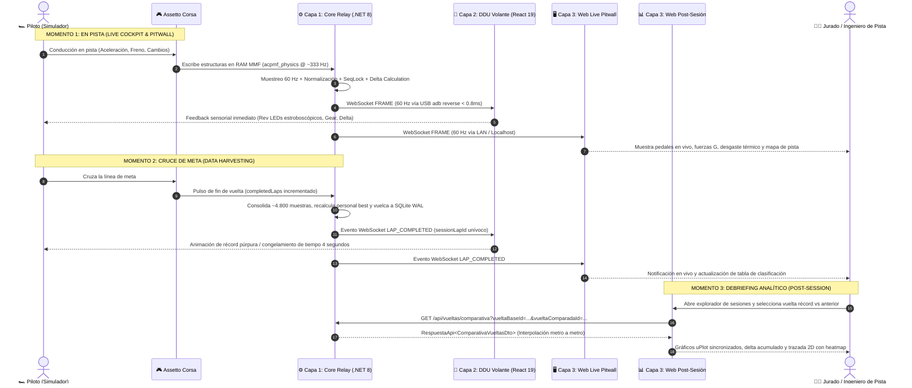
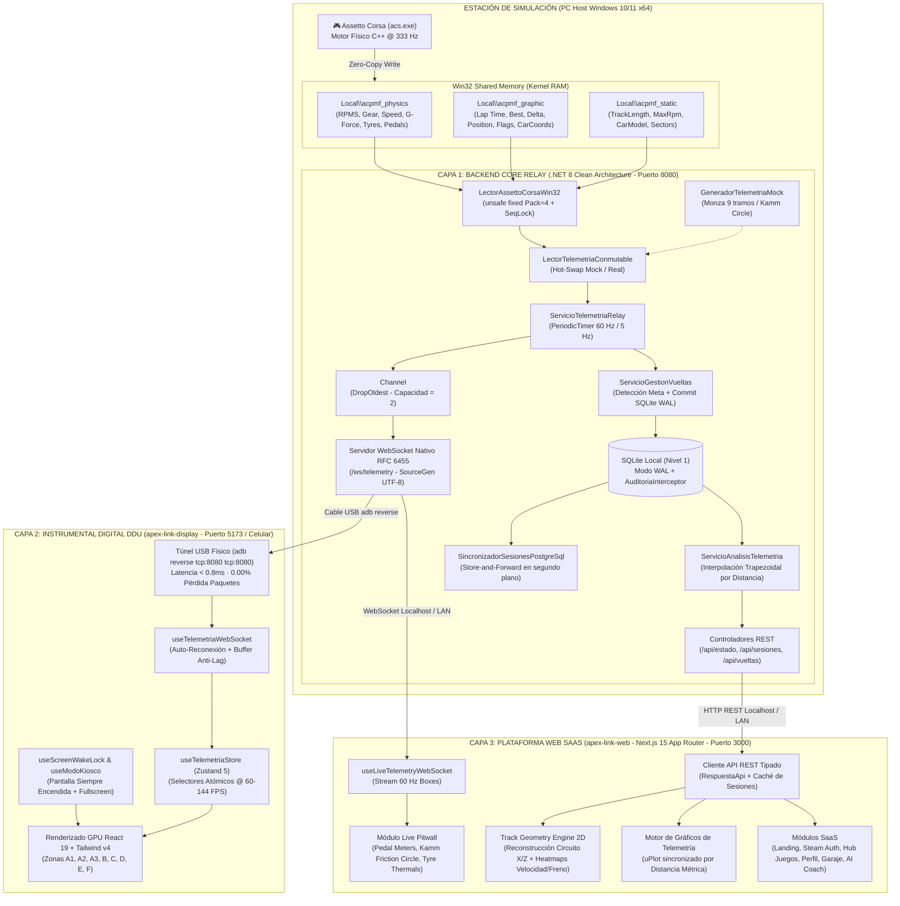

# 🏎️ ApexLink — Brief Integral del Sistema en Tres Capas (API · DDU · WEBAPP)

> **Proyecto:** ApexLink — Ecosistema Distribuido de Telemetría SimRacing en Tiempo Real, Análisis Post-Sesión y Plataforma SaaS de Competición
> **Ámbito:** Proyecto Final Integrador / Demostración en Vivo para Jurado y Docentes — **FAPPE 2026**
> **Metodología Oficial:** Desarrollo Dirigido por Especificaciones (*Spec-Driven Development* - SDD Intensivo)
> **Equipo y Asignación:** 3 Desarrolladores Especializados en Paralelo (Dev 1: Backend/API · Dev 2: DDU Móvil · Dev 3: Plataforma Web SaaS)
> **Estado de Aprobación PoC:** Validado técnica y conceptualmente por los 3 desarrolladores. Código prototipo aislado en `/old`.
> **Vigencia y Jerarquía:** Documento Maestro de Definición de Producto. Consistente 1:1 con `CONTRATOS_TELEMETRIA_Y_API.md`, `DOCUMENTACION_TECNICA.md`, `DOCUMENTACION_TECNICA_MODULO2_DASHBOARD.pdf` y `DOCUMENTACION_TECNICA_MODULO3_WEBAPP.md`.

---

## 📑 Tabla de Contenidos

1. [Visión General del Producto y Propuesta de Valor FAPPE 2026](#1-visión-general-del-producto-y-propuesta-de-valor-fappe-2026)
2. [Los Tres Momentos Operativos del Usuario (User Journey)](#2-los-tres-momentos-operativos-del-usuario-user-journey)
3. [Arquitectura Global del Sistema en 3 Capas Desacopladas](#3-arquitectura-global-del-sistema-en-3-capas-desacopladas)
4. [Especificación Detallada de la Capa 1: Backend Core Relay &amp; API Analítica (Dev 1)](#4-especificación-detallada-de-la-capa-1-backend-core-relay--api-analítica-dev-1)
5. [Especificación Detallada de la Capa 2: DDU — Dashboard Display Unit para Volante (Dev 2)](#5-especificación-detallada-de-la-capa-2-ddu--dashboard-display-unit-para-volante-dev-2)
6. [Especificación Detallada de la Capa 3: WebApp SaaS — Live Pitwall &amp; Gestión de Competición (Dev 3)](#6-especificación-detallada-de-la-capa-3-webapp-saas--live-pitwall--gestión-de-competición-dev-3)
7. [Matriz de Interconexión, Protocolos y Enlaces Físicos](#7-matriz-de-interconexión-protocolos-y-enlaces-físicos)
8. [Estrategia de Desarrollo en Paralelo y Aislamiento por Mock](#8-estrategia-de-desarrollo-en-paralelo-y-aislamiento-por-mock)
9. [Requisitos No Funcionales, SLAs y Restricciones de Calidad](#9-requisitos-no-funcionales-slas-y-restricciones-de-calidad)
10. [Gobernanza Spec-Driven Development (SDD) y Criterios de Aceptación](#10-gobernanza-spec-driven-development-sdd-y-criterios-de-aceptación)

---

## 1. Visión General del Producto y Propuesta de Valor FAPPE 2026

### 1.1. Contexto y Diagnóstico del SimRacing Competitivo

En el automovilismo moderno de alta competencia (Fórmula 1, WEC, IMSA), el rendimiento de un vehículo no se determina únicamente por la pericia mecánica o la potencia bruta del propulsor, sino por la **gestión científica de la información telemétrica**. Un monoplaza de Fórmula 1 moderno aloja cientos de sensores físicos que emiten millones de muestras por vuelta, permitiendo dos dinámicas simultáneas:

1. **Instrumentación en Cockpit:** El piloto procesa información visual crítica en milisegundos mediante la pantalla montada sobre el aro de su volante (*Dashboard Display Unit* - DDU), optimizando el punto de cambio de marcha (*Rev LEDs*), el balance de frenos (*Brake Bias*) y el ritmo de sector (*Delta Time*).
2. **Ingeniería de Pista en Boxes:** El ingeniero de carrera monitorea en vivo el estado térmico y dinámico del coche desde el muro de boxes (*Pitwall*), y realiza sesiones de *Debriefing* analítico contrastando curvas de telemetría y trazadas para identificar décimas de segundo perdidas.

En el ámbito universitario, amateur y de formación de pilotos de SimRacing, esta infraestructura se encuentra históricamente vedada debido a tres barreras estructurales:

* **Costes Prohibitivos de Periféricos:** Un volante comercial de simulación con display LCD integrado (MoTeC, Fanatec Podium, Cube Controls, Ascher Racing) oscila entre **$700 USD y $2.000 USD**, resultando inaccesible para la mayoría de los estudiantes y academias de simulación.
* **Complejidad Críptica de Software de Análisis:** Soluciones profesionales como MoTeC i2Pro datan de paradigmas de la década de 1990; requieren exportaciones manuales en formato binario cerrado (`.ld`), configuración engorrosa de canales matemáticos y curvas desfasadas en el tiempo que confunden al usuario principiante.
* **Pasividad del Espectador en Eventos:** En ferias académicas y demostraciones interactivas, los acompañantes o evaluadores se limitan a observar una pantalla donde alguien conduce, sin tener interacción técnica ni comprensión de lo que sucede bajo el chasis.

### 1.2. La Solución ApexLink

**ApexLink** es un ecosistema distribuido de telemetría en tiempo real, adquisición de bajo nivel y plataforma SaaS de análisis post-sesión de datos cinemáticos diseñado específicamente para eliminar estas tres barreras:

1. **Democratización de Instrumentación Cockpit (Smartphone Repurposing):** Transforma cualquier smartphone convencional con Android (Samsung, Xiaomi, Motorola, etc.) en un DDU réplica de volante de Fórmula 1 y GT3 mediante un enlace físico USB determinístico de ultra baja latencia (**$< 0.8\text{ ms}$**), con panel AMOLED de contraste infinito y tasa de refresco fluida de 60 a 144 Hz.
2. **Puesto de Control Interactivo de Ingeniero de Pista (*Live Pitwall*):** Proporciona una estación web moderna en Next.js donde el jurado o los docentes asumen el rol activo de ingenieros de boxes, monitoreando en vivo la pisada de pedales (acelerador/freno con precisión de sub-píxel), el diagrama de fuerzas G (*Kamm Friction Circle*), la matriz térmica de los neumáticos y los split times mientras el piloto rueda en el simulador.
3. **Plataforma Analítica Didáctica Post-Carrera:** Elimina la barrera de MoTeC al normalizar matemáticamente las telemetrías en el **Dominio de Distancia Métrica ($0 \to L_{\text{circuito}}$ metros)**. Permite superponer dos vueltas con un clic, calcular automáticamente el delta temporal acumulado metro a metro e interactuar bidireccionalmente entre el gráfico de velocidad/pedales y el mapa geométrico 2D del circuito trazado con mapas de calor de frenada.
4. **Plataforma SaaS Completa:** Incorpora landing page comercial, autenticación local y modo rápido *"Piloto Invitado FAPPE"* (Steam OpenID queda clasificado como **TBD / Post-MVP** para erradicar dependencias de internet en la feria), selector multi-simulador (Assetto Corsa activo, demás próximamente), diagnósticos con *AI Race Coach*, ratings de seguridad y ritmo (*Pace & Safety Rating*), garaje y catálogo de circuitos.

---

## 2. Los Tres Momentos Operativos del Usuario (User Journey)

La experiencia de ApexLink se articula en tres momentos secuenciales sin fricción:



---

## 3. Arquitectura Global del Sistema en 3 Capas Desacopladas

ApexLink implementa una arquitectura desacoplada basada en microservicios locales y aplicaciones de cliente ligero:



---

## 4. Especificación Detallada de la Capa 1: Backend Core Relay & API Analítica (Dev 1)

### 4.1. Misión y Responsabilidad Nuclear

La Capa 1 constituye el núcleo de adquisición de datos y persistencia del sistema. Ejecutada como un servicio de alto rendimiento en el sistema operativo host (Windows 10/11 x64), su responsabilidad exclusiva es:

1. Interceptar los bloques de memoria compartida de Assetto Corsa sin intermediarios ni copias innecesarias de memoria (*Zero-Copy*).
2. Proporcionar un motor sintético (*Mock Generator*) de simulación determinística sobre el Autodromo Nazionale Monza para independizar totalmente a los desarrolladores de frontend.
3. Emitir un flujo continuo de telemetría por WebSocket a **60 Hz** en pista y **5 Hz** en reposo bajo estándar RFC 6455.
4. Detectar el cruce de meta, validar vueltas, persistir ~4.800 muestras por vuelta en SQLite (Modo WAL) con garantías *Read-After-Write*.
5. Exponer una API REST analítica con interpolación métrica lineal por distancia para comparativa de vueltas.

### 4.2. Stack Tecnológico de la Capa 1

* **Framework:** C# .NET 8 / ASP.NET Core (Kestrel Server).
* **Patrón de Arquitectura:** Clean Architecture Multicapa:
  - `Telemetria.Dominio`: Modelos puros inmutables (`CuadroTelemetria`, `MetadatosEstaticos`), entidades RBAC (`Usuario`, `Rol`, `Permiso`), enumeraciones y contratos de hardware.
  - `Telemetria.Aplicacion`: Casos de uso, servicios de relay, motor mock, servicio de análisis por distancia, DTOs y serializadores UTF-8.
  - `Telemetria.Infraestructura`: Adaptador nativo Win32 MMF (`unsafe fixed`, `Pack = 4`), interceptores SQLite WAL, repositorios EF Core y sincronizador PostgreSQL.
  - `Telemetria.Api`: Middlewares RFC 7807, manejadores de WebSocket, políticas RBAC `[HasPermission]`, controladores REST y configuración de inyección de dependencias.
* **Persistencia Nivel 1 (Local Edge):** SQLite local configurado con `journal_mode = WAL`, `synchronous = NORMAL`, `foreign_keys = ON`, `busy_timeout = 5000` y `cache_size = -8000`.
* **Persistencia Nivel 2 (Central):** Exportador asíncrono *Store-and-Forward* hacia PostgreSQL central con `NpgsqlBatch`.

### 4.3. Adquisición Win32 MMF sin Bloqueos y SeqLock

* **Alineación Binaria Estricta:** Las estructuras `EstructuraFisicaAC`, `EstructuraGraficaAC` y `EstructuraEstaticaAC` se declaran con `[StructLayout(LayoutKind.Sequential, Pack = 4)]` y bloques de punteros fijos `fixed float` y `fixed char`, calcando el archivo `SharedFileOut.h` de Kunos Simulazioni.
* **Prevención de Lecturas Desgarradas (*Torn Reads*):** Se implementa el algoritmo optimista *SeqLock* verificando que el `PacketId` inicial coincida con el final tras la copia de memoria en microsegundos, realizando hasta 3 reintentos sin bloqueo en caso de colisión de escritura del motor físico.

### 4.4. Cadencia de Reloj Multimedia y Anti-Lag

* Para sortear la imprecisión del temporizador estándar de Windows ($15.6\text{ ms}$), el relay combina `PeriodicTimer` de .NET con la API Win32 `timeBeginPeriod(1)`.
* Para proteger a los clientes contra latencias acumuladas, el búfer de salida implementa `BoundedChannelFullMode.DropOldest` con capacidad acotada a **2 cuadros**, garantizando que el display y el pitwall siempre visualicen el estado físico presente del monoplaza.

---

## 5. Especificación Detallada de la Capa 2: DDU — Dashboard Display Unit para Volante (Dev 2)

### 5.1. Misión y Responsabilidad Nuclear

La Capa 2 (`apex-link-display`) es el cuadro de instrumentos digital de competición montado físicamente sobre el centro del aro o la base del volante. Su misión es la provisión de información sensorial instantánea para el piloto, sin fatiga visual y con cero distracciones:

1. Operar como un **Nodo de Solo Consumo Ultrarrápido (*Thin Display Node*)**: cero persistencia en disco y cero cálculos pesados de físicas.
2. Renderizar con precisión de 60 a 144 FPS acelerado por GPU sobre pantallas de cualquier resolución (16:9 a 21:9).
3. Ofrecer ergonomía de competición: fondo negro absoluto `#000000` (apaga píxeles en matrices AMOLED para cero emisión lumínica y cero calentamiento térmico) con tipografía tabular no oscilante.
4. Conectividad 100% cableada por USB vía túnel inverso ADB (`adb reverse`), eliminando cualquier interferencia de radiofrecuencia en eventos masivos.

### 5.2. Stack Tecnológico de la Capa 2

* **Entorno y Bundler:** Vite 6 + React 19 + TypeScript 5.7.
* **Motor de Estilos:** Tailwind CSS v4 con variables CSS dinámicas y aceleración por GPU (`transform: translate3d`).
* **Gestor de Estado de Alto Rendimiento:** Zustand 5 con selectores atómicos memoizados (evita el antipatrón de re-renderizado global del Virtual DOM, reduciendo en un **96.7%** a **99.9%** la carga computacional).
* **Iconografía:** Lucide React para testigos de luces, banderas y advertencias mecánicas.
* **APIs Web Móviles Nativas:** Screen Wake Lock API (`navigator.wakeLock`) y Fullscreen API (Modo Kiosco Inmersivo).

### 5.3. Desglose Ergonómico de las 6 Zonas Visuales del Dashboard

Basado en la instrumentación profesional de monoplazas F1 y GT3:

```
CANVAS VIRTUAL BASE (1920 x 864 px - Proporción 2.22:1 con Auto-Centrado Responsivo)
┌────────────────────────────────────────────────────────────────────────────────────────┐
│ [ZONA A1: TESTIGOS] │       [ZONA A2: DELTA CENTRAL]       │ [ZONA A3: MONITOR SESIÓN] │
│ Faros · PitLimiter  │   [-0.320] Barra Dinámica Bicolor    │ RACE: 00:45:23 · POS: 02  │
│ Wipers · CheckEng   │   (Verde = Ganando / Rojo = Perdiendo)│ LAP: 04 · TIME: 14:37    │
├─────────────────────┴──────────────────────────────────────┴───────────────────────────┤
│ [ZONA B: NEUMÁTICOS Y FRENOS]   │ [ZONA C: INSTRUMENTAL CENTRAL] │ [ZONA D: CRONOMETRAJE]      │
│  FL: 27.6 PSI · 82°C [|] 623°C │      MARCHA GIGANTE (1..8)     │ PREDICTED: 01:20.920 (Cian) │
│  FR: 27.8 PSI · 91°C [|] 648°C │      Tacómetro: 11850 RPM      │ LAST LAP:  01:23.450 (Oro)  │
│  RL: 27.7 PSI · 85°C [|] 634°C │      Shift Lights (15 LEDs)    │ BEST LAP:  01:21.240 (Púrp) │
│  RR: 27.9 PSI · 92°C [|] 701°C │      Velocímetro: 284 km/h     │                             │
│  Compuesto: DRY 2              │      Bandera: GREEN · Meteo    │                             │
├─────────────────────────────────┴────────────────────────────────┴─────────────────────────────┤
│ [ZONA E: BOTONERA ELECTRÓNICA Y CHASIS]           │ [ZONA F: GESTIÓN DE COMBUSTIBLE]          │
│ TC: 2 │ TC CUT: 2 │ ABS: 3 │ BB: 62.2% │ MAP: 1   │ 46 LITRES │ 2.6 L/LAP │ 17 LAPS AUTONOMY │
└───────────────────────────────────────────────────┴───────────────────────────────────────────┘
```

---

## 6. Especificación Detallada de la Capa 3: WebApp SaaS — Live Pitwall & Gestión de Competición (Dev 3)

### 6.1. Misión y Responsabilidad Nuclear

La Capa 3 (`apex-link-web`) es la plataforma web SaaS de ingeniería de carrera, perfil de piloto y análisis de rendimiento post-sesión. Sus responsabilidades primordiales son:

1. **Experiencia SaaS de Extremo a Extremo:** Flujo integral que abarca Landing Page pública, autenticación local y modo rápido *"Piloto Invitado FAPPE"* (Steam OpenID TBD/Post-MVP), Hub selector de simuladores, perfil gamificado de piloto y ajustes.
2. **Live Pitwall en Tiempo Real (@ 60 Hz):** Consumir el canal WebSocket de 60 Hz para ofrecer un centro de mando en vivo durante la tanda en pista, centrado en el circuito oficial **Monza F1 2025** para la demostración FAPPE.
3. **Reconstrucción Geométrica y Altimetría en HTML5 Canvas 2D:** Renderizador de alta eficiencia que ofrece modo dual: **Modo Broadcast Kunos** con overlay oficial de `map.png` y calibración `map.ini`, y **Modo Isométrico 3D Matemático** con altimetría real y normalización adaptativa de elevación.
4. **Análisis Post-Sesión en el Dominio de Distancia:** Consultar la API REST post-carrera para graficar series densas con uPlot ordenadas estrictamente por distancia métrica ($0 \to L_{\text{circuito}}$ metros).
5. **Herramienta "Corner Delta Inspector":** Calcular instantáneamente la ganancia o pérdida de tiempo, punto de frenada y velocidad en el vértice para cualquier curva seleccionada por el usuario.

### 6.2. Stack Tecnológico de la Capa 3

* **Framework:** Next.js 15 (App Router con Server Components y Client Components optimizados).
* **Tipado:** TypeScript 5.7 bajo contratos estrictos compartidos con el Backend.
* **Estilos y Componentes:** Tailwind CSS, Lucide React, diseño Cockpit Carbon y Glassmorphism.
* **Motor Gráfico de Alta Densidad:** **uPlot** sobre HTML5 Canvas 2D (trazado de 10.000 puntos en $< 3\text{ ms}$ con cursor unificado y zoom a 60 FPS).
* **Motor de Trazada y Circuitos:** **HTML5 Canvas 2D nativo** (decisión oficial de diseño: 0 KB de sobrecarga en bundles frente a librerías 3D pesadas, 144 FPS estables y soporte dual: Overlay `map.png` + Isométrica 3D).
* **Cliente de Datos:** Cliente HTTP tipado con envoltorio `RespuestaApi<T>` y `PaginacionRespuesta<T>`, con control de errores RFC 7807 `ProblemDetails`.

### 6.3. Arquitectura de Módulos SaaS de la Plataforma Web

La WebApp se organiza en 10 módulos funcionales complementarios:

1. **Módulo 0: Landing Page Pública (`/`):** Portal de alto impacto con propuesta de valor de democratización de hardware ($1.200 USD comercial vs $0 USD con Android), showcase interactivo y presentación FAPPE 2026.
2. **Módulo 1: Autenticación Local & Modo Invitado FAPPE (`/login`, `/registro`):** Inicio de sesión local rápido, modo evaluador de 1-clic 100% offline para el stand, y vinculación con Steam OpenID catalogada como **TBD / Post-MVP**.
3. **Módulo 2: Hub Selector de Simuladores (`/hub`):** Gateway multi-juego con Assetto Corsa activo y títulos líderes (*iRacing*, *ACC*, *F1 24*, *Le Mans Ultimate*) catalogados como *"Próximamente"*.
4. **Módulo 3: Dashboard General & AI Race Coach (`/app`):** Panel de bienvenida, resumen de última tanda, radar de 5 habilidades de pilotaje y diagnósticos heurísticos automáticos de telemetría.
5. **Módulo 4: Perfil de Piloto, Ratings y Logros (`/app/perfil`):** Sistema de Pace Rating (0-100), Safety Rating (grados S a D), vitrina de trofeos desbloqueables y estadísticas acumuladas.
6. **Módulo 5: Catálogo de Circuitos y Garaje (`/app/circuitos`, `/app/garaje`):** Fichas de pistas con trazado vectorial, mejor registro y cálculo de Vuelta Óptima Teórica (*Ideal Lap* con suma de mejores S1+S2+S3), junto a odómetro virtual y consumo de combustible.
   - **Alcance FAPPE 2026:** Circuito de demostración principal en vivo: **Monza F1 2025** (`monza_f1_2025`). Circuitos explorables en catálogo: **Red Bull Ring GP** (`ks_red_bull_ring`) e **Imola F1 2025** (`fn_imola`).
7. **Módulo 6: Live Pitwall a 60 Hz (`/app/live`):** Muro de boxes en vivo con pedales acelerador/freno (*Peak Hold*), Círculo de Kamm dinámico (G-G), matriz térmica de 4 ruedas, cronometraje de stint y mapa Canvas 2D en tiempo real sobre **Monza F1 2025** con detección dinámica de curvas (`sections.ini`) y baliza de DRS (`drs_zones.ini`).
8. **Módulo 7: Laboratorio Analítico Post-Sesión & Trazada 2D (`/app/analysis`):** Motor uPlot en dominio métrico ($0 \to L_{\text{pista}}$ metros), overlay comparativo de dos vueltas, mapas de calor continuos de velocidad/frenada y trazada Canvas 2D con normalización topográfica adaptativa de elevación ($\ge 50$m a $1.0\times$, $25-50$m a $1.25\times$, $<25$m a $2.0\times$).
9. **Módulo 8: Explorador Histórico de Tandas (`/app/sessions`):** Navegación paginada de sesiones y clasificación de vueltas con marcas de PB e inválidas.
10. **Módulo 9: Ajustes y Preferencias (`/app/ajustes`):** Unidades métricas (km/h vs mph, PSI vs bar, °C vs °F), personalización de perfil y configuración de conexión con backend Kestrel.

---

## 7. Matriz de Interconexión, Protocolos y Enlaces Físicos

### 7.1. Tabla de Canales y Protocolos de Comunicación

| Canal / Flujo                    | Protocolo            | Endpoint / Puerto                                 | Dirección               | Frecuencia                   | Carga Útil (Payload)                                   | Destinatario Primario                                  |
| :------------------------------- | :------------------- | :------------------------------------------------ | :----------------------- | :--------------------------- | :------------------------------------------------------ | :----------------------------------------------------- |
| **Streaming Continuo**     | WebSocket (RFC 6455) | `ws://localhost:8080/ws/telemetry`              | Backend $\to$ Clientes | 60 Hz (Pista) / 5 Hz (Pausa) | JSON tipado `FRAME` (`PaqueteTelemetriaDto`)        | Dev 2 (DDU Volante) y Dev 3 (Live Pitwall)             |
| **Evento Fin de Vuelta**   | WebSocket (RFC 6455) | `ws://localhost:8080/ws/telemetry`              | Backend $\to$ Clientes | Evento puntual (Cruce Meta)  | JSON tipado `LAP_COMPLETED` (`sessionLapId`)        | Dev 2 (Animación Récord) y Dev 3 (Auto-Fetch Vuelta) |
| **Estado del Simulador**   | HTTP REST (JSON)     | `GET /api/estado`                               | Cliente $\to$ Backend  | On-Demand / Poll 1 Hz        | `RespuestaApi<EstadoServicioDto>`                     | Dev 3 (Pitwall & WebApp)                               |
| **Historial de Sesiones**  | HTTP REST (JSON)     | `GET /api/sesiones?numeroPagina=1`              | Cliente $\to$ Backend  | On-Demand / Navegación      | `PaginacionRespuesta<SesionResumenDto>`               | Dev 3 (Explorador de Tandas)                           |
| **Vueltas de una Sesión** | HTTP REST (JSON)     | `GET /api/sesiones/{id}/vueltas`                | Cliente $\to$ Backend  | On-Demand / Navegación      | `RespuestaApi<List<VueltaDto>>`                       | Dev 3 (Clasificación de Vuelta)                       |
| **Telemetría de Vuelta**  | HTTP REST (JSON)     | `GET /api/vueltas/{id}/telemetria`              | Cliente $\to$ Backend  | On-Demand / Al graficar      | `RespuestaApi<List<MuestraTelemetriaDto>>` (Métrico) | Dev 3 (Motor Gráficos & Trazada 2D)                   |
| **Comparativa de Vueltas** | HTTP REST (JSON)     | `GET /api/vueltas/comparativa?vueltaBaseId=...` | Cliente $\to$ Backend  | On-Demand / Comparar         | `RespuestaApi<ComparativaVueltasDto>` (Interpolado)   | Dev 3 (Superposición con Deltas)                      |
| **Conmutador Mock/Real**   | HTTP REST (JSON)     | `POST /api/mock/alternar`                       | Cliente $\to$ Backend  | On-Demand (Botonera Dev)     | `RespuestaApi<EstadoMockDto>`                         | Dev 2 y Dev 3 (Testing sin Simulador)                  |

---

## 8. Estrategia de Desarrollo en Paralelo y Aislamiento por Mock

* **Independencia de Dev 2 y Dev 3:** Ninguno de los dos desarrolladores de interfaz requiere tener instalado Assetto Corsa, volante físico ni PC con Windows de alta gama. Ambos programan contra el flujo de datos provisto por el `GeneradorTelemetriaMock` (o contra sus propios mocks locales de respaldo).
* **Conmutación Transparente:** La conmutación entre el simulador real y el motor mock se realiza en caliente mediante `POST /api/mock/alternar` o a través del flag de arranque `--demo`, sin reiniciar clientes ni alterar contratos.

---

## 9. Requisitos No Funcionales, SLAs y Restricciones de Calidad

| Parámetro / Requisito                  | Objetivo de Diseño                                   | Criterio de Aceptación y Validación                                                                        |
| :-------------------------------------- | :---------------------------------------------------- | :----------------------------------------------------------------------------------------------------------- |
| **Latencia Display Volante**      | $< 0.8\text{ ms}$ (USB) / $< 3\text{ ms}$ (Total) | El LED de corte de RPM debe encenderse en perfecta sincronía auditiva con el sonido del motor.              |
| **Sobrecarga de CPU en PC**       | $< 1.5\%$ de CPU sostenido                          | La lectura de MMF no debe restar ciclos de GPU ni provocar caída de FPS en Assetto Corsa.                   |
| **Tasa de Refresco Visual**       | $60\text{ FPS}$ fijos (DDU y Pitwall)               | 0 caídas de cuadros (*Zero Jank*); las cifras no vibran horizontalmente gracias a `tabular-nums`.       |
| **Autonomía y Temperatura**      | Operación continua $> 4\text{ horas}$              | El fondo `#000000` en AMOLED y la alimentación USB mantienen el celular frío sin *thermal throttling*. |
| **Tolerancia a Desconexión USB** | Reconexión en $< 1.0\text{ segundo}$               | Si se desenchufa y vuelve a enchufar el cable en carrera, el DDU retoma el stream sin recargar página.      |
| **Operación 100% Offline**       | Cero dependencias de Internet                         | Fuentes locales (`.woff2`), assets SVG locales y bases de datos locales; opera en stands sin Wi-Fi.        |
| **Integridad de Datos en Disco**  | Cero corrupción ante cortes de luz                   | SQLite en modo WAL (`journal_mode = WAL`) con `synchronous = NORMAL` y checkpoint al apagado.            |

---

## 10. Gobernanza Spec-Driven Development (SDD) y Criterios de Aceptación

1. **La Especificación es la Fuente de Verdad:** Bajo ninguna circunstancia se escribe código que altere nombres de propiedades, convenciones de unidades, rangos numéricos o rutas de endpoints sin actualizar previamente los documentos rectores en `docs/spec-driven-docs/`.
2. **Definición de Terminado (DoD):**
   - 100% de cumplimiento con las firmas de `CONTRATOS_TELEMETRIA_Y_API.md`.
   - Compilación Release (`dotnet build -c Release` / `pnpm build`) con **cero advertencias y cero errores**.
   - Cobertura de pruebas unitarias e integración en verde.
   - Verificación a 60 FPS sin fugas de memoria.
