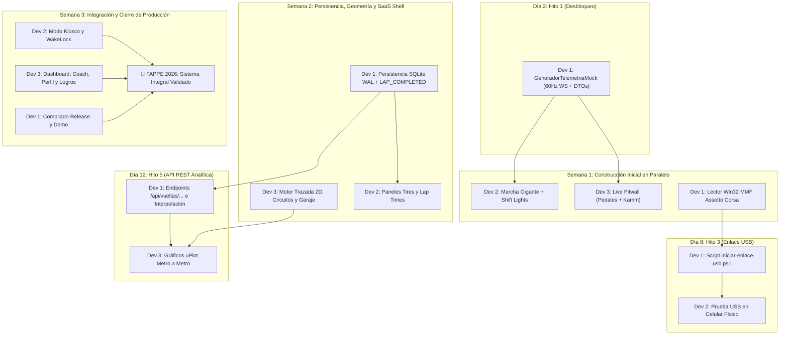

# 📊 Control Maestro de Fases, Tareas y Gantt Multi-Desarrollador (3 Capas: API · DDU · WEBAPP)

> **Proyecto:** ApexLink — Ecosistema Distribuido de Telemetría SimRacing en Tiempo Real y Análisis de Rendimiento (FAPPE 2026)  
> **Plazo Global:** Sprint Intensivo de 3 Semanas (15 Días Hábiles)  
> **Equipo:** 3 Desarrolladores en Paralelo (Dev 1: Backend/API · Dev 2: DDU Volante · Dev 3: Plataforma Web SaaS)  
> **Fuentes de Verdad:**  
> - `CONTRATOS_TELEMETRIA_Y_API.md` (Contratos de Red y DTOs)  
> - `DOCUMENTACION_TECNICA.md` y `CONTROL_FASES_Y_TAREAS.md` (Capa 1 - Backend)  
> - `DOCUMENTACION_TECNICA_MODULO2_DASHBOARD.pdf` (Capa 2 - DDU Móvil)  
> - `DOCUMENTACION_TECNICA_MODULO3_WEBAPP.md` (Capa 3 - WebApp SaaS)  
> - `BRIEF_INTEGRAL_SISTEMA_3_CAPAS.md` (Brief Maestro)

---

## 📑 Tabla de Contenidos

1. [Resumen Ejecutivo de Esfuerzo Global y Distribución por Rol](#1-resumen-ejecutivo-de-esfuerzo-global-y-distribución-por-rol)
2. [Hitos Críticos de Desbloqueo Cruzado (Milestones)](#2-hitos-críticos-de-desbloqueo-cruzado-milestones)
3. [Diagrama de Gantt Multi-Carril del Sprint de 3 Semanas (Mermaid)](#3-diagrama-de-gantt-multi-carril-del-sprint-de-3-semanas-mermaid)
4. [Carril Dev 1: Core Relay, Adquisición Win32 MMF, SQLite WAL y API REST](#4-carril-dev-1-core-relay-adquisición-win32-mmf-sqlite-wal-y-api-rest)
5. [Carril Dev 2: DDU — Instrumental Digital Móvil para Volante (apex-link-display)](#5-carril-dev-2-ddu--instrumental-digital-móvil-para-volante-apex-link-display)
6. [Carril Dev 3: WebApp SaaS — Hub, Pitwall, Perfil y Laboratorio (apex-link-web)](#6-carril-dev-3-webapp-saas--hub-pitwall-perfil-y-laboratorio-apex-link-web)
7. [Matriz de Dependencias Cruzadas y Puntos de Integración](#7-matriz-de-dependencias-cruzadas-y-puntos-de-integración)
8. [Matriz de Riesgos Técnicos y Planes de Contingencia para FAPPE 2026](#8-matriz-de-riesgos-técnicos-y-planes-de-contingencia-para-fappe-2026)

---

## 1. Resumen Ejecutivo de Esfuerzo Global y Distribución por Rol

El proyecto se dimensiona en un total de **145 tareas atómicas** distribuidas equitativamente entre los 3 ingenieros, con una carga promedio de **6.5 a 7.0 horas diarias** por desarrollador a lo largo de 15 días hábiles:

| Rol de Ingeniería | Desarrollador | Plataforma / Repositorio | Tareas Totales | Horas Estimadas | Carga Diaria Promedio | Estado Global |
| :--- | :---: | :--- | :---: | :---: | :---: | :---: |
| **Dev 1: Core Relay & API** | Dev 1 | `backend` (.NET 8 Clean Architecture) | **95** | **105.5 hs** | 7.0 hs / día | 🔄 En Ejecución (Fase 4) |
| **Dev 2: DDU Cockpit Móvil** | Dev 2 | `apex-link-display` (Vite + React 19 + Zustand) | **25** | **98.0 hs** | 6.5 hs / día | 🎯 Listo para Iniciar |
| **Dev 3: Plataforma Web SaaS** | Dev 3 | `apex-link-web` (Next.js 15 + uPlot + Canvas 2D) | **25** | **102.0 hs** | 6.8 hs / día | 🎯 Listo para Iniciar |
| **TOTAL ECOSISTEMA** | **3 Devs** | **ApexLink (3 Capas Integradas)** | **145** | **305.5 hs** | **~20.3 hs / día (Equipo)** | 🚀 **En Marcha** |

---

## 2. Hitos Críticos de Desbloqueo Cruzado (Milestones)

```
HITO 1 (Día 2): CONTRATOS SAGRADOS Y MOCK RELAY A 60 HZ
└─ Dev 1 congela DTOs y levanta GeneradorTelemetriaMock. Dev 2 y Dev 3 quedan 100% desbloqueados.

HITO 2 (Día 5): MVP DE COCKPIT VOLANTE Y LIVE PITWALL
└─ Dev 2 tiene columna central operativa (Marcha + Shift Lights). Dev 3 tiene pedales 60Hz y Kamm Circle.

HITO 3 (Día 7): HARDWARE REAL WIN32 MMF Y ENLACE USB DETERMINÍSTICO
└─ Dev 1 conecta con Assetto Corsa real y túnel adb reverse. Dev 2 valida latencia < 0.8ms en celular físico.

HITO 4 (Día 10): PERSISTENCIA SQLITE WAL Y DETECCIÓN AUTOMÁTICA DE VUELTAS
└─ Dev 1 persiste ~4.800 muestras por vuelta en SQLite. El evento LAP_COMPLETED se emite al cruzar la meta.

HITO 5 (Día 12): API REST ANALÍTICA Y TRAZADA 2D CON HEATMAPS
└─ Dev 1 expone endpoints por distancia e interpolación. Dev 3 dibuja Monza 2D con mapas de frenada.

HITO 6 (Día 14): GRÁFICOS MULTI-EJE UPLOT Y SINCRONIZACIÓN DE CURSOR
└─ Dev 3 completa comparativa de vueltas metro a metro con cursor vinculado a la posición en el mapa 2D.

HITO 7 (Día 15): ENSAYO GENERAL DE PUESTA EN ESCENA FAPPE 2026
└─ Simulador en vivo + Celular en volante + Laptop del jurado en boxes funcionando 100% offline.
```

---

## 3. Diagrama de Gantt Multi-Carril del Sprint de 3 Semanas (Mermaid)

```mermaid
gantt
    title Cronograma Integral Multi-Desarrollador ApexLink (3 Semanas / 15 Días Hábiles)
    dateFormat  YYYY-MM-DD
    axisFormat  %d/%m

    section Dev 1: Backend Relay & API (.NET 8)
    Fase 0: Auditoría y Especificación (12h)         :done,    d1_f0, 2026-10-22, 2d
    Fase 1: Mock Engine Monza y Relay WS 60Hz (19h)  :done,    d1_f1, 2026-10-24, 3d
    Fase 2: Adaptador Win32 MMF Assetto Corsa (15h)  :done,    d1_f2, 2026-10-27, 2d
    Fase 3: Scripts USB adb reverse y Build (8h)     :done,    d1_f3, 2026-10-29, 1d
    Fase 4: Persistencia SQLite WAL y Repos (17h)    :active,  d1_f4, 2026-10-30, 2d
    Fase 5: API REST Analítica e Interpolación (14h) :         d1_f5, after d1_f4, 2d
    Fase 6: Sincronización Store-and-Forward (8.5h)  :         d1_f6, after d1_f5, 1d
    Fase 7: Suite Testing 100% y Release (12h)       :         d1_f7, after d1_f6, 2d

    section Dev 2: DDU Móvil Volante (apex-link-display)
    Fase D1: Base Vite, Zustand Atómico y WS 60Hz (18h) :done, d2_f1, 2026-10-26, 3d
    Fase D2: Marcha Gigante, Shift Lights y Tacómetro (20h):active, d2_f2, after d2_f1, 3d
    Fase D3: Paneles Laterales (Tires + Lap Times) (22h):      d2_f3, after d2_f2, 3d
    Fase D4: Alertas, Chasis, Fuel y Delta Bicolor (20h):      d2_f4, after d2_f3, 3d
    Fase D5: WakeLock, Modo Kiosco y Enlace USB Real (18h):   d2_f5, after d2_f4, 3d

    section Dev 3: WebApp SaaS (apex-link-web)
    Fase W1: Next.js 15, Landing, Steam Auth y Hub (18h):done, d3_f1, 2026-10-26, 3d
    Fase W2: Live Pitwall 60Hz (Pedales, Kamm, Gomas) (22h):active, d3_f2, after d3_f1, 3d
    Fase W3: Trazada 2D, Heatmaps, Circuitos y Garaje (20h):  d3_f3, after d3_f2, 3d
    Fase W4: Gráficos uPlot Metro a Metro y Overlay (24h)  :  d3_f4, after d3_f3, 3d
    Fase W5: Dashboard, AI Coach, Perfil, Logros y FAPPE (18h):d3_f5, after d3_f4, 3d
```

---

## 4. Carril Dev 1: Core Relay, Adquisición Win32 MMF, SQLite WAL y API REST

*Detalle exhaustivo de las 95 tareas atómicas disponible en [CONTROL_FASES_Y_TAREAS.md](file:///C:/Users/Alejo%20Garlati/Documents/Facultad/apex-link/docs/spec-driven-docs/CONTROL_FASES_Y_TAREAS.md).*

### Resumen de Fases Dev 1:
* **Fase 0 (Completada - 12h):** Análisis y corrección de especificaciones Win32 MMF, WebSockets, SQLite WAL y protocolo ADB USB.
* **Fase 1 (Completada - 19h):** Andamiaje Clean Architecture (.NET 8), DTOs tipados camelCase, motor sintético determinístico de Monza (9 sectores) y servidor WebSocket RFC 6455 a 60 Hz (`DropOldest`, capacidad 2).
* **Fase 2 (Completada - 15h):** Lector Win32 MMF (`unsafe fixed`, `Pack = 4`) con protocolo optimista *SeqLock* sobre `Local\acpmf_physics`, `acpmf_graphic` y `acpmf_static`.
* **Fase 3 (Completada - 8h):** Scripts de infraestructura Windows (`iniciar-enlace-usb.ps1`, `ejecutar-backend.bat`, `compilar-release.bat`).
* **Fase 4 (En Curso - 17h):** Persistencia SQLite local en modo WAL, interceptores de pragmas y auditoría, repositorios EF Core y `ServicioGestionVueltas` para emisión post-commit de `LAP_COMPLETED`.
* **Fase 5 (Pendiente - 14h):** API REST analítica post-sesión, algoritmo de interpolación trapezoidal por distancia cada $5.0\text{ m}$, autorización RBAC `[HasPermission]` y middleware RFC 7807.
* **Fase 6 (Pendiente - 8.5h):** Sincronización asíncrona *Store-and-Forward* hacia PostgreSQL central con `NpgsqlBatch`.
* **Fase 7 (Pendiente - 12h):** Modo Demo continuo (`--demo`), cobertura de pruebas unitarias/integración al 100% y validación del binario compilado Release.

---

## 5. Carril Dev 2: DDU — Instrumental Digital Móvil para Volante (apex-link-display)

*Detalle exhaustivo de arquitectura disponible en [DOCUMENTACION_TECNICA_MODULO2_DASHBOARD.pdf](file:///C:/Users/Alejo%20Garlati/Documents/Facultad/apex-link/docs/spec-driven-docs/DOCUMENTACION_TECNICA_MODULO2_DASHBOARD.pdf).*

### Desglose Atómico de Tareas de Dev 2 (25 Tareas / 98.0 hs):

#### Fase D1: Andamiaje Vite, Tipos y Capa de Red WebSocket (18.0 hs)
* **T-D1.1:** Inicialización del proyecto con Vite 6, React 19, TypeScript 5.7 y Tailwind CSS v4. (3.0 hs)
* **T-D1.2:** Creación de `src/types/telemetria.ts` replicando 1:1 los contratos DTO de `CONTRATOS_TELEMETRIA_Y_API.md`. (3.0 hs)
* **T-D1.3:** Implementación del almacén reactivo `useTelemetriaStore.ts` con Zustand 5 y selectores atómicos. (4.0 hs)
* **T-D1.4:** Desarrollo del hook `useTelemetriaWebSocket.ts` con descarte de paquetes rezagados, reconexión exponencial y heartbeats. (4.0 hs)
* **T-D1.5:** Implementación del generador mock procedural local `useMockTelemetria.ts` para pruebas offline. (4.0 hs)

#### Fase D2: Columna Central Instrumental Primaria (20.0 hs)
* **T-D2.1:** Construcción del contenedor maestro `ColumnaCentral.tsx` respetando las proporciones visuales de SimHub GT3/F1. (4.0 hs)
* **T-D2.2:** Implementación de `MarchaGigante.tsx` (selector atómico `car.gear`, soporta R, N, 1..8, color cian/rojo). (4.0 hs)
* **T-D2.3:** Implementación de `TacometroDigital.tsx` (5 dígitos tabulares `car.rpms` con `tnum`). (3.0 hs)
* **T-D2.4:** Implementación de `ShiftLightsBar.tsx` (15 LEDs progresivos: verde al 80%, naranja al 88%, rojo al 92% y destello estroboscópico azul/blanco a 15 Hz al superar el 96% de corte mediante bypass CSS directo). (5.0 hs)
* **T-D2.5:** Implementación de `VelocimetroDigital.tsx` y widget de clima/banderas de pista `MeteoBanderas.tsx`. (4.0 hs)

#### Fase D3: Paneles Laterales de Telemetría (Tires y Lap Times) (22.0 hs)
* **T-D3.1:** Implementación de `PanelNeumaticos.tsx` (cuadrante de 4 ruedas dividido entre tren delantero y trasero). (4.0 hs)
* **T-D3.2:** Construcción de `RuedaItem.tsx` con lecturas de presión PSI en cian e interpolación continua de temperatura (°C). (5.0 hs)
* **T-D3.3:** Implementación de `BarraDiscoFreno.tsx` con simulación térmica vertical e incandescencia si $T > 650^\circ\text{C}$. (4.0 hs)
* **T-D3.4:** Implementación de `PanelTiemposVuelta.tsx` con 3 bloques: *Predicted Lap* (cian), *Last Lap* (amarillo oro) y *Best Lap* (magenta púrpura). (5.0 hs)
* **T-D3.5:** Desarrollo de funciones puras en `src/utils/formateadoresTiempo.ts` ("mm:ss.fff") y `coloresTermicos.ts`. (4.0 hs)

#### Fase D4: Alertas, Chasis, Combustible y Delta Bicolor (20.0 hs)
* **T-D4.1:** Construcción de `BarraTestigos.tsx` (Zona A1: Faros, Pit Limiter con parpadeo a 4 Hz, Wipers y Check Engine). (4.0 hs)
* **T-D4.2:** Implementación de `CajaDeltaTiempo.tsx` (Zona A2: fondo dinámico verde/rojo según signo de delta). (4.0 hs)
* **T-D4.3:** Implementación de `BarraDeltaDinamica.tsx` (barra horizontal segmentada proporcional a las décimas ganadas/perdidas). (4.0 hs)
* **T-D4.4:** Implementación de `BotoneraChasis.tsx` (Zona E: tarjetas de TC, TC Cut, ABS, Brake Bias y Mapa Motor). (4.0 hs)
* **T-D4.5:** Implementación de `PanelCombustible.tsx` (Zona F: litros en tanque, consumo medio y autonomía proyectada). (4.0 hs)

#### Fase D5: Adaptabilidad Universal Android, Kiosco y Enlace USB Real (18.0 hs)
* **T-D5.1:** Implementación de layout responsive con auto-centrado y letterboxing negro en `App.tsx` (16:9 a 21:9). (4.0 hs)
* **T-D5.2:** Implementación del hook `useScreenWakeLock.ts` (`navigator.wakeLock.request('screen')`). (3.0 hs)
* **T-D5.3:** Implementación del hook `useModoKiosco.ts` (Fullscreen API y bloqueo de gestos). (3.0 hs)
* **T-D5.4:** Configuración de `public/manifest.json` para ejecución PWA Standalone y almacenamiento de fuentes locales WOFF2. (3.0 hs)
* **T-D5.5:** Pruebas en pista sobre smartphone Android real conectado por cable USB mediante `adb reverse tcp:8080 tcp:8080`, verificando 60 FPS clavados y latencia $< 1\text{ ms}$. (5.0 hs)

---

## 6. Carril Dev 3: WebApp SaaS — Hub, Pitwall, Perfil y Laboratorio (apex-link-web)

*Detalle exhaustivo de arquitectura disponible en [DOCUMENTACION_TECNICA_MODULO3_WEBAPP.md](file:///C:/Users/Alejo%20Garlati/Documents/Facultad/apex-link/docs/spec-driven-docs/DOCUMENTACION_TECNICA_MODULO3_WEBAPP.md).*

### Desglose Atómico de Tareas de Dev 3 (25 Tareas / 102.0 hs):

#### Fase W1: Andamiaje Next.js, Contratos, Auth Local y Landing Page (18.0 hs)
* **T-W1.1:** Inicialización del proyecto con Next.js 15 (App Router), React 19, TypeScript 5.7 y Tailwind CSS. (3.0 hs)
* **T-W1.2:** Creación de interfaces en `src/types/telemetria.ts`, `api.ts`, `usuario.ts` y `simulador.ts` sincronizadas 1:1 con `CONTRATOS_TELEMETRIA_Y_API.md`. (3.0 hs)
* **T-W1.3:** Implementación del cliente HTTP tipado `apiClient.ts`, autenticación local y modo rápido "Piloto Invitado FAPPE" (`auth.ts`). (4.0 hs)
* **T-W1.4:** Construcción de la Landing Page pública (`/`) con propuesta de valor de hardware ($1.200 USD vs $0 USD con Android) y showcase FAPPE 2026. (4.0 hs)
* **T-W1.5:** Implementación del Hub multi-simulador (`/hub`) con selector de simuladores (Assetto Corsa activo y demás títulos en estado *"Próximamente"*). (4.0 hs)

#### Fase W2: Shell de Boxes y Módulo Live Pitwall a 60 Hz (22.0 hs)
* **T-W2.1:** Creación del shell autenticado con Sidebar colapsable de boxes y header con indicador de ping y estado del backend. (4.0 hs)
* **T-W2.2:** Implementación de `PedalMeters.tsx` en `/app/live` (barras verticales de acelerador en verde y freno en rojo a 60 Hz con *Peak Hold*). (5.0 hs)
* **T-W2.3:** Implementación de `KammCircleCanvas.tsx` (diagrama G-G en Canvas 2D con estela dinámica de desvanecimiento). (5.0 hs)
* **T-W2.4:** Implementación de `MatrizTermicaGomas.tsx` (temperaturas de núcleo en °C con colores térmicos reactivos y presiones PSI). (4.0 hs)
* **T-W2.5:** Implementación de `LiveTimingStrip.tsx` y listener de eventos `LAP_COMPLETED` con notificación flotante (Toast). (4.0 hs)

#### Fase W3: Trazada Geométrica Canvas 2D, Heatmaps, Circuitos FAPPE y Garaje (20.0 hs)
* **T-W3.1:** Implementación del motor Canvas 2D en `useTrackGeometry.ts` con modo dual: Overlay oficial Kunos (`map.png` + `map.ini`) y proyección isométrica 3D matemática con normalización topográfica adaptativa de elevación (1.0x para $\ge 50$m, 1.25x para 25-50m, 2.0x para $<25$m). (4.0 hs)
* **T-W3.2:** Construcción del lienzo `Track2DViewer.tsx` con dibujo continuo acelerado por GPU, alimentado por el dataset de Monza F1 2025 (para el Live Pitwall @ 60 Hz), Red Bull Ring GP e Imola F1 2025. (4.0 hs)
* **T-W3.3:** Implementación del mapa de calor por velocidad y fuerza de frenada, rotulado en vivo de curvas oficiales (`sections.ini`) y baliza de activación DRS (`drs_zones.ini`). (4.0 hs)
* **T-W3.4:** Implementación de `CarPositionMarker.tsx` con flecha de orientación angular (*yaw*), anillo de brillo y halo de contacto con el asfalto. (4.0 hs)
* **T-W3.5:** Implementación del Catálogo de Circuitos (`/app/circuitos`) con cálculo de *Ideal Lap* (Monza F1 2025 principal para FAPPE, Red Bull Ring e Imola explorables) y Garaje de autos (`/app/garaje`). (4.0 hs)

#### Fase W4: Laboratorio uPlot Metro a Metro, Overlay y Corner Inspector (24.0 hs)
* **T-W4.1:** Integración y configuración base de **uPlot** en `uplotConfig.ts` con temas oscuros de competición y escalas métricas. (4.0 hs)
* **T-W4.2:** Construcción de `MultiAxisTelemetryChart.tsx` en `/app/analysis` con 4 paneles apilados en el **Dominio de Distancia ($0 \to L_{\text{pista}}$ metros)**. (6.0 hs)
* **T-W4.3:** Implementación de `ComparadorDeltasOverlay.tsx` superponiendo dos vueltas con áreas sombreadas de delta temporal. (5.0 hs)
* **T-W4.4:** Sincronización bidireccional de cursor (*Crosshair Bridge*) entre las 4 gráficas uPlot y el marcador en el mapa 2D. (5.0 hs)
* **T-W4.5:** Implementación de la herramienta didáctica `CornerDeltaInspector.tsx` para cálculo interactivo de frenada, velocidad mínima y décimas ganadas. (4.0 hs)

#### Fase W5: Dashboard, AI Race Coach, Perfil, Gamificación y Ensayos (18.0 hs)
* **T-W5.1:** Implementación del Dashboard principal (`/app`) con radar de 5 habilidades de pilotaje y sugerencias del *AI Race Coach*. (4.0 hs)
* **T-W5.2:** Implementación del Perfil de Piloto (`/app/perfil`) con algoritmo de Pace Rating (0-100), Safety Rating (S a D) y vitrina de trofeos. (4.0 hs)
* **T-W5.3:** Implementación del Explorador de Sesiones (`/app/sessions`) y el ranking en vivo del stand (`/app/leaderboards`). (4.0 hs)
* **T-W5.4:** Implementación de la pantalla de Ajustes (`/app/ajustes`): unidades métricas, vinculación con Steam y configuración de red. (3.0 hs)
* **T-W5.5:** Ensayo general de integración y calibración de contraste en pantalla grande / laptop para el jurado de la FAPPE. (3.0 hs)

---

## 7. Matriz de Dependencias Cruzadas y Puntos de Integración



---

## 8. Matriz de Riesgos Técnicos y Planes de Contingencia para FAPPE 2026

| Riesgo Técnico Identificado | Nivel de Severidad | Probabilidad | Medida Preventiva Implementada en la Arquitectura | Plan de Contingencia en Vivo durante la Demostración |
| :--- | :---: | :---: | :--- | :--- |
| **Saturación o caída del Wi-Fi en el auditorio** | `Crítico` | Alta | Enlace 100% físico por cable USB mediante túnel determinístico `adb reverse` (Dev 1 y Dev 2). | El sistema opera completamente aislado de redes inalámbricas; no requiere Internet. |
| **Assetto Corsa se cuelga o no arranca en la PC** | `Crítico` | Media | Modo Mock sintético determinístico de Monza incorporado en el backend y flag `--demo`. | El jurado presiona el botón "Alternar Modo Mock" y el sistema continúa emitiendo datos a 60 FPS. |
| **El cable USB se desconecta durante el manejo** | `Alto` | Media | Hook `useTelemetriaWebSocket` con reconexión automática en $< 1\text{ s}$ y monitor `adb wait-for-device`. | Al reconectar el cable USB, el DDU se reanuda instantáneamente sin recargar la página. |
| **La pantalla del celular se apaga por inactividad táctil** | `Medio` | Alta | `useScreenWakeLock` (`Screen WakeLock API`) y orden de kernel `adb shell svc power stayonusb true`. | La pantalla permanece encendida de forma indefinida mientras reciba corriente por el cable USB. |
| **Micro-stuttering en el navegador web por exceso de puntos** | `Alto` | Media | Uso estricto de **uPlot** sobre Canvas 2D en lugar de SVG pesados de DOM (Dev 3). | uPlot procesa 10.000 puntos en 3 ms con zoom fluido sin consumir memoria del navegador. |
| **Corte de energía eléctrica en el stand** | `Crítico` | Baja | SQLite en modo WAL (`journal_mode = WAL`) con `synchronous = NORMAL` (Dev 1). | Las vueltas completadas antes del corte quedan protegidas en el log WAL sin corrupción de archivo. |