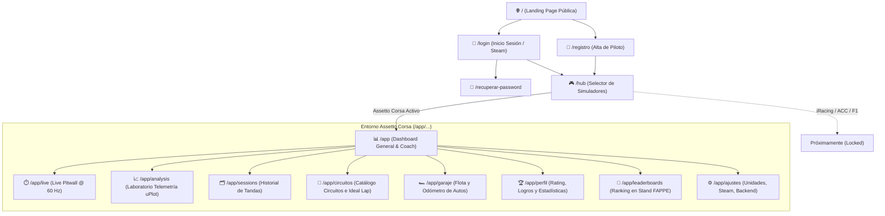
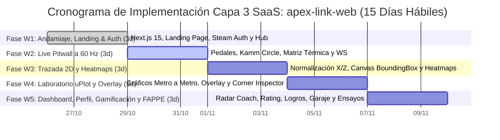

# 📚 Documentación Técnica Integral: Módulo 3 — Plataforma Web SaaS de Boxes, Telemetría y Gestión de Pilotos (apex-link-web)

> **Módulo:** Módulo 3 (Ecosistema Web SaaS de Ingeniería de Pista, Perfil de Piloto y Telemetría Distribuida)  
> **Nombre Oficial del Repositorio:** `apex-link-web`  
> **Modelo de Aplicación:** Plataforma SaaS Completa (Landing Page Pública $\to$ Autenticación Local & Invitado FAPPE [Steam TBD] $\to$ Hub Selector de Simulador $\to$ Dashboard de Ingeniería de Competición)  
> **Hardware Objetivo:** Laptops de boxes, Monitores de telemetría de pitwall (1080p / 1440p / 4K) y Tablets de alta resolución (Lenovo Tab P11 / iPad)  
> **Origen de Datos:** Módulo 1 (Backend de Telemetría C# .NET 8 @ `http://localhost:8080` y `ws://localhost:8080/ws/telemetry`)  
> **Tipo de Aplicación:** Web App Reactiva de Alto Rendimiento (Next.js 15 App Router + React 19 + TypeScript 5.7 + Tailwind CSS + uPlot + HTML5 Canvas 2D + Zustand 5)  
> **Metodología de Desarrollo:** Spec-Driven Development (SDD Intensivo) — Conforme 1:1 con `CONTRATOS_TELEMETRIA_Y_API.md`  
> **Estado del Documento:** Versión 2.0 (Arquitectura SaaS Expandida Oficial)

---

## 📑 Tabla de Contenidos

1. [Visión General del Producto SaaS y Propuesta de Valor](#1-visión-general-del-producto-saas-y-propuesta-de-valor)
2. [Arquitectura de Navegación y Flujo de Usuario (Information Architecture)](#2-arquitectura-de-navegación-y-flujo-de-usuario-information-architecture)
3. [Módulo 0: Landing Page Pública y Presentación FAPPE 2026](#3-módulo-0-landing-page-pública-y-presentación-fappe-2026)
4. [Módulo 1: Autenticación, Seguridad y Conexión con Steam](#4-módulo-1-autenticación-seguridad-y-conexión-con-steam)
5. [Módulo 2: Hub Central y Selector de Simuladores (Sim Racing Gateway)](#5-módulo-2-hub-central-y-selector-de-simuladores-sim-racing-gateway)
6. [Módulo 3: Dashboard General del Piloto & AI Race Coach](#6-módulo-3-dashboard-general-del-piloto--ai-race-coach)
7. [Módulo 4: Perfil de Piloto, Sistema de Rating y Logros Gamificados](#7-módulo-4-perfil-de-piloto-sistema-de-rating-y-logros-gamificados)
8. [Módulo 5: Catálogo de Circuitos Rodados y Garaje de Monoplazas](#8-módulo-5-catálogo-de-circuitos-rodados-y-garaje-de-monoplazas)
9. [Módulo 6: Live Pitwall (Muro de Boxes en Tiempo Real @ 60 Hz)](#9-módulo-6-live-pitwall-muro-de-boxes-en-tiempo-real--60-hz)
10. [Módulo 7: Laboratorio Analítico Post-Sesión & Trazada 2D con Heatmaps](#10-módulo-7-laboratorio-analítico-post-sesión--trazada-2d-con-heatmaps)
11. [Módulo 8: Explorador Histórico de Tandas y Clasificación](#11-módulo-8-explorador-histórico-de-tandas-y-clasificación)
12. [Módulo 9: Ajustes, Personalización y Preferencias de Hardware](#12-módulo-9-ajustes-personalización-y-preferencias-de-hardware)
13. [Estructura Completa de Archivos del Repositorio (`apex-link-web`)](#13-estructura-completa-de-archivos-del-repositorio-apex-link-web)
14. [Plan de Fases de Construcción y Criterios de Aceptación (DoD)](#14-plan-de-fases-de-construcción-y-criterios-de-aceptación-dod)

---

## 1. Visión General del Producto SaaS y Propuesta de Valor

### 1.1. De un Visualizador Aislado a una Plataforma SaaS Integral
La versión original de `apex-link-web` fue concebida como un monitor de telemetría de boxes. Sin embargo, para maximizar el rigor académico y el impacto en la feria **FAPPE 2026**, la plataforma evoluciona a un **Software as a Service (SaaS) completo de rendimiento automovilístico**:
* **Experiencia de Entrada Profesional:** Una Landing Page pública de alto impacto visual que comunica el problema, la propuesta técnica y la democratización de periféricos.
* **Identidad y Trazabilidad del Conductor:** Acceso autenticado mediante credenciales locales o modo rápido *"Piloto Invitado FAPPE"* (con campo manual opcional de Steam ID; el protocolo de autenticación Steam OpenID 2.0 se clasifica como **TBD / Post-MVP** para erradicar dependencias de internet en la feria), permitiendo que cada evaluador o piloto tenga su propio perfil de telemetría registrado.
* **Hub Multi-Simulador (Extensibilidad):** Selector central de títulos de simulación; en este MVP opera de forma nativa con **Assetto Corsa**, manteniendo los demás títulos líderes de la industria (*iRacing*, *Assetto Corsa Competizione*, *F1 24*, *Le Mans Ultimate*) catalogados como *"Próximamente"*.
* **Gamificación y Formación de Pilotos:** Algoritmos de puntuación de seguridad y ritmo (*Pace & Safety Rating*), vitrina de trofeos y sugerencias algorítmicas de ingeniería (*AI Race Coach*) basadas en telemetría real.

---

## 2. Arquitectura de Navegación y Flujo de Usuario (Information Architecture)



---

## 3. Módulo 0: Landing Page Pública y Presentación FAPPE 2026

* **Ruta:** `/`
* **Público:** Jurado evaluador, docentes universitarios, patrocinadores y comunidad SimRacing.
* **Secciones Clave:**
  1. **Hero Section Impactante:** Renderizado 3D / mockup interactivo del volante con smartphone acoplado junto a la laptop de boxes. Titular de propuesta de valor: *"Telemetría SimRacing de Nivel F1 sin Barreras de Costo"*. Botones de acción principales: *"Iniciar Demostración en Vivo"* y *"Acceso a Boxes"*.
  2. **Democratización de Periféricos (El Hardware vs ApexLink):** Tabla comparativa directa mostrando un volante comercial ($1.200 USD + $150 USD de licencia de software) frente a ApexLink ($0 USD en periféricos adicionales utilizando un smartphone Android convencional con túnel USB determinístico $< 0.8\text{ ms}$).
  3. **Los 3 Pilares del Ecosistema:**
     - *In-Cockpit DDU:* 60-144 FPS acelerados por GPU, fondo negro AMOLED puro y Shift Lights estroboscópicos.
     - *Live Pitwall:* Muro de boxes en vivo para jurado e ingenieros con pedales, fuerzas G dinámicas y desgaste térmico.
     - *Post-Session Telemetry Lab:* Normalización en el dominio de distancia métrica, desmitificando MoTeC.
  4. **Ficha Técnica Académica FAPPE 2026:** Especificación del stack (.NET 8 Clean Architecture, Win32 MMF, Next.js 15, uPlot, SQLite WAL) y equipo de desarrollo.
  5. **Footer:** Enlaces a documentación de especificaciones, repositorio de GitHub y aviso de compatibilidad con simuladores.

---

## 4. Módulo 1: Autenticación Local, Modo Invitado FAPPE y Perfil Steam (TBD)

* **Rutas:** `/login`, `/registro`, `/recuperar-password`
* **Mecanismos de Autenticación Implementados:**
  1. **Autenticación Local Autónoma (Email + Password):**
     - Alta e inicio de sesión local rápido sin dependencias externas de servidores de terceros.
     - Sesión persistida mediante tokens JWT / cookies HTTP-only de corta duración.
  2. **Modo Rápido "Piloto Invitado FAPPE" (1-Clic, 100% Offline):**
     - Botón de acceso inmediato en la pantalla de login con perfiles temporales predefinidos (*"Piloto Evaluador FAPPE"*, *"Profesor Invitado"*, *"Estudiante Stand"*).
     - Permite que el jurado docente o los visitantes comiencen a probar el simulador en 2 segundos sin rellenar formularios ni requerir conexión a internet.
  3. **Conexión con Steam OpenID (Estado: TBD / Post-MVP — Desactivado en este sprint):**
     - *Justificación Técnica de Exclusión:* El protocolo OpenID 2.0 de Steam exige redirecciones externas a servidores de Valve (`steamcommunity.com`), lo cual introduce un punto único de falla ante caídas o inestabilidad del Wi-Fi en el stand de la feria.
     - *Implementación en MVP:* El botón *"Iniciar sesión con Steam"* se visualiza con badge `🔒 PRÓXIMAMENTE (TBD)`. En la sección de `/app/perfil` y `/app/ajustes`, el usuario dispone de un campo de texto simple y opcional para ingresar manualmente su `SteamID64` o `Gamertag` con fines estéticos para su carnet de piloto, sin intermediación de APIs complejas.

---

## 5. Módulo 2: Hub Central y Selector de Simuladores (Sim Racing Gateway)

* **Ruta:** `/hub`
* **Propósito:** Actuar como portal central del ecosistema multi-simulador.
* **Componentes Visuales:**
  - Grilla de tarjetas interactivas de simulación con arte gráfico oficial y badges de estado:
    * **Assetto Corsa (Kunos Simulazioni):** Estado `🟢 CONECTADO / ACTIVO`. Muestra latencia de telemetría, versión de MMF detectada y botón *"Entrar a Boxes"*.
    * **iRacing (iRacing.com):** Estado `🔒 PRÓXIMAMENTE`. Indicador de compatibilidad con telemetría `.ibt` y memoria de 360 Hz.
    * **Assetto Corsa Competizione (ACC):** Estado `🔒 PRÓXIMAMENTE`. Enfoque especializado en normativa GT3 / SRO.
    * **EA Sports F1 24:** Estado `🔒 PRÓXIMAMENTE`. Arquitectura UDP Telemetry Packet.
    * **Le Mans Ultimate (Studio 397):** Estado `🔒 PRÓXIMAMENTE`. Telemetría WEC Hypercar.

---

## 6. Módulo 3: Dashboard General del Piloto & AI Race Coach

* **Ruta:** `/app`
* **Propósito:** Panel de control de mando integral para el piloto e ingeniero de pista al ingresar al ecosistema de Assetto Corsa.
* **Desglose de Secciones:**

```
┌────────────────────────────────────────────────────────────────────────────────────────┐
│ [BIENVENIDA Y ESTADO DE CONEXIÓN]                                                      │
│ PILOTO: Alejo Garlati │ SIMULADOR: Assetto Corsa v1.16 │ ENLACE BACKEND: 60 Hz OK (1ms)│
├────────────────────────────────────────────────┬───────────────────────────────────────┤
│ [RESUMEN DE ÚLTIMA SESIÓN RODADA]              │ [RADAR DE HABILIDADES DEL PILOTO]     │
│ Circuito: Monza (Grand Prix)                   │              Frenada (88/100)         │
│ Auto: Ferrari SF70H (F1)                       │                     ▲                 │
│ Mejor Vuelta: 01:21.240 (🏆 Récord Personal)   │                     │                 │
│ Vueltas Completadas: 18 (17 Válidas - 94.4%)   │  Trail-Braking ◄────┼────► Aceleración│
│ [Ver Análisis de la Tanda] [Reanudar Pitwall]  │     (75/100)        │        (92/100) │
│                                                │                     ▼                 │
│                                                │            Consistencia (85/100)      │
├────────────────────────────────────────────────┴───────────────────────────────────────┤
│ [AI RACE COACH: DIAGNÓSTICO INTELIGENTE DE CONDUCCIÓN]                                 │
│ 💡 Puntos Fuertes: Excelente tracción y apertura de acelerador al salir de Ascari.     │
│ ⚠️ Oportunidad de Mejora: Bloqueo leve en la frenada de la Variante del Rettifilo.    │
│    Estás frenando con 100% de pedal hasta el apex. Aplicar un 20% más de trail-braking│
│    te permitirá ganar aproximadamente ~0.240 s en el Sector 1.                         │
├────────────────────────────────┬───────────────────────────────────────────────────────┤
│ [COMBOS AUTO / PISTA FAVORITOS]│ [LEADERBOARD EN VIVO DEL STAND FAPPE]                 │
│ 1. Monza GP + Ferrari SF70H    │ 1. 🥇 Alejo Garlati      — 01:21.240 (Ferrari SF70H)  │
│ 2. Spa + Porsche 911 GT3 R     │ 2. 🥈 Prof. Evaluador    — 01:22.450 (Ferrari SF70H)  │
│ 3. Imola + Formula Hybrid      │ 3. 🥉 Estudiante UTN     — 01:24.110 (Ferrari SF70H)  │
└────────────────────────────────┴───────────────────────────────────────────────────────┘
```

1. **AI Race Coach (Diagnóstico Heurístico de Ingeniería):** Analiza automáticamente las telemetrías de freno, acelerador y aceleración lateral para generar retroalimentación técnica pedagógica en lenguaje natural de competición.
2. **Radar de Rendimiento de 5 Ejes:** Evalúa cuantitativamente: Potencia de Frenada, Trail-Braking, Tracción a la Salida, Cuidado de Neumáticos y Consistencia Cronometrada.
3. **Leaderboard del Stand:** Tabla de récords locales para fomentar la competencia sana y el enganche durante la feria universitaria.

---

## 7. Módulo 4: Perfil de Piloto, Sistema de Rating y Logros Gamificados

* **Ruta:** `/app/perfil`
* **Propósito:** Seguimiento de la trayectoria, reputación y evolución deportiva del usuario.
* **Componentes Nucleares:**

### 7.1. Sistema de Calificación y Ratings Deportivos
* **Pace Rating (Ritmo Puro - Escala 0 a 100):** Determinado por la velocidad escalar alcanzada en vértices y la proximidad al récord mundial/local del circuito.
* **Safety Rating (Seguridad y Respeto a Límites - Grado S, A, B, C, D):** Proporción matemática de vueltas limpias:
  $$\text{Safety} = \frac{\text{Vueltas Válidas}}{\text{Vueltas Totales}} \times 100$$
  Penaliza salidas de pista (`NumberOfTyresOut >= 4`), roces contra muros y trompos.
* **Consistency Index (% Consistencia):** Desviación estándar promedio entre vueltas limpias consecutivas en una misma tanda.

### 7.2. Vitrina de Logros y Trofeos (Achievements)

| Icono | Nombre del Logro | Condición de Desbloqueo Telemétrico |
| :---: | :--- | :--- |
| 🏁 | **Bautismo de Asfalto** | Completar la primera vuelta válida en cualquier circuito. |
| ⚡ | **Club de los 300** | Superar los $300\text{ km/h}$ en la recta principal de cualquier trazado. |
| 🎯 | **Metrónomo de Pista** | Registrar 5 vueltas consecutivas con una variación temporal inferior a $\pm 0.150\text{ s}$. |
| 🟣 | **Dominio Púrpura** | Marcar los tres mejores sectores (S1, S2, S3) en una misma vuelta. |
| 🛑 | **Maestro del Trail-Braking** | Mantener desaceleración combinada con más de $1.4\text{ G}$ lateral en la entrada a curva. |
| 🛡️ | **Piloto Limpio (Fair Play)** | Completar un stint de más de 12 vueltas con 100% de vueltas reglamentarias. |
| 🏆 | **Rey de Monza** | Romper la barrera del $01:21.500$ en Monza con el monoplaza de Fórmula 1. |

---

## 8. Módulo 5: Catálogo de Circuitos Rodados y Garaje de Monoplazas

### 8.1. Explorador de Circuitos (`/app/circuitos`)
* **Alcance Oficial para la Exhibición FAPPE 2026:**
  - **Circuito Principal de Retransmisión en Vivo (Live Pitwall @ 60 Hz):**
    - ⚡ **`Autodromo Nazionale Monza (F1 2025)` (`monza_f1_2025`):** Circuito principal de demostración en el stand. Longitud: **5.757 m**, 11 curvas oficiales (*Prima Variante, Curva Biassono, Variante della Roggia, Lesmo 1 & 2, Serraglio, Ascari, Parabolica*) y 2 zonas DRS activas. Conectado al stream en tiempo real del simulador y al motor de simulación mock determinístico.
  - **Circuitos Explorables en el Catálogo y Análisis:**
    - 🐂 **`Red Bull Ring (Layout GP)` (`ks_red_bull_ring`):** Trazado alpino de Spielberg con marcado desnivel de **+63.5 m** (fuerte trepada hacia *Remus* y descenso técnico hacia *Rauch*), 10 curvas oficiales y 2 zonas DRS. Longitud: **4.285 m**.
    - 🏎️ **`Autodromo Enzo e Dino Ferrari (Imola F1 2025)` (`fn_imola`):** Trazado técnico clásico de Emilia-Romaña con **34.3 m** de altimetría, 19 curvas (*Tamburello, Villeneuve, Tosa, Piratella, Acque Minerali, Variante Alta, Rivazza*) y 1 zona DRS. Longitud: **4.867 m**.
* **Métricas por Trazado:**
  - Longitud oficial de pista en metros (`trackSPlineLength`).
  - Total de vueltas rodadas y distancia métrica acumulada en kilómetros.
  - **Vuelta Récord Personal (PB):** Tiempo absoluto registrado con fecha y vehículo utilizado.
  - **Vuelta Óptima Teórica (*Ideal Lap*):** Cálculo matemático automático sumando los mejores sectores históricos individuales:
    $$\text{Tiempo Ideal} = \min(\text{S1}) + \min(\text{S2}) + \min(\text{S3})$$
  - **Delta de Potencial de Mejora:** Diferencia entre la Mejor Vuelta Real y la Vuelta Óptima Teórica (ej. *"Tenés un margen de mejora de $-0.430\text{ s}$ uniendo tus mejores sectores"*).

### 8.2. Garaje de Vehículos (`/app/garaje`)
* **Flota de Monoplazas y GTs:** Tarjetas técnicas para cada vehículo rodado en el simulador (`Ferrari SF70H`, `Porsche 911 GT3 R`, `BMW M2 CS Racing`, etc.).
* **Ficha Técnica Telemétrica:**
  - Régimen de corte máximo de revoluciones (`maxRpm`).
  - Capacidad máxima de combustible en litros (`maxFuel`).
  - Kilómetros recorridos acumulados en el odómetro virtual del simulador.
  - Consumo medio de combustible por kilómetro.
  - Velocidad punta absoluta registrada con ese modelo.

---

## 9. Módulo 6: Live Pitwall (Muro de Boxes en Tiempo Real @ 60 Hz)

* **Ruta:** `/app/live`
* **Propósito:** Consola central de monitoreo en tiempo real durante la conducción en pista, consumiendo `ws://localhost:8080/ws/telemetry`.
* **Circuito Oficial en Vivo para Demostración FAPPE:** **Monza F1 2025** (con fallback determinístico mediante generador mock).
* **Widgets de Pista en Vivo:**
  1. **Barras Verticales de Pedales:** Indicador ultra-reactivo de acelerador (verde neón `#00FF00`) y freno (rojo neón `#FF1744`) con retención de picos de presión (*Peak Hold*).
  2. **Círculo de Fricción Dinámico de Kamm (Diagrama G-G):** Canvas 2D cuadrado con retícula de aceleración lateral vs longitudinal con estela de desvanecimiento dinámico.
  3. **Matriz Térmica Cuádruple de Neumáticos:** Presiones en PSI y temperaturas de núcleo en °C con gradiente de color reactivo (azul frío $<75^\circ\text{C}$, verde óptimo $75-100^\circ\text{C}$, rojo calor $>105^\circ\text{C}$) y porcentaje de vida útil restante.
  4. **Panel de Cronometraje de Boxes:** Tiempo transcurrido de tanda, vuelta en curso, split del sector transitado y delta instantáneo con fondo dinámico.
  5. **Auto-Recepción de `LAP_COMPLETED`:** Notificación instantánea tipo Toast al cruzar meta con botón directo *"Analizar Vuelta Ahora"*.
  6. **Motor de Mapa y Telemetría en Vivo (HTML5 Canvas 2D):** Renderizador oficial de alta eficiencia con soporte para modo dual (Overlay Oficial Kunos con `map.png` + `map.ini` o Proyección Isométrica Matemática 3D con altimetría y pastilla de DRS).

---

## 10. Módulo 7: Laboratorio Analítico Post-Sesión & Trazada con Heatmaps

* **Ruta:** `/app/analysis`
* **Propósito:** Ingeniería de pista profunda basada en el **Dominio de Distancia Métrica ($0 \to L_{\text{circuito}}$ metros)**.
* **Componentes de Ingeniería:**
  1. **Motor Gráfico uPlot Multi-Eje Sincronizado:** 4 paneles apilados con más de 4.800 muestras trazadas en $<3\text{ ms}$:
     - Panel 1: Velocidad escalar ($km/h$) y curva de Delta Temporal acumulado ($ms$).
     - Panel 2: Recorrido porcentual de Acelerador y Freno.
     - Panel 3: Marcha engranada y revoluciones del motor (RPM).
     - Panel 4: Fuerzas $G$ laterales y longitudinales del chasis.
  2. **Comparador Overlay de Vueltas:** Superposición milimétrica de Vuelta Rápida (trazo continuo) vs Vuelta de Referencia (trazo punteado) con áreas coloreadas de ganancia (verde) o pérdida (rojo) de tiempo.
  3. **Motor de Renderizado de Circuito (Decisión de Diseño Oficial: HTML5 Canvas 2D):**
     Se adopta oficialmente **HTML5 Canvas 2D** como el estándar de renderizado de circuitos y trazada en ApexLink (descartando dependencias pesadas de 3D como Three.js para garantizar 0 KB de sobrecarga en bundles y 144 FPS estables en laptops educativas). Dispone de dos modos de conmutación en caliente:
     - **Modo Broadcast Oficial Kunos (`map.png` + `map.ini`):** Dibuja la silueta transparente oficial del asfalto servida desde el backend o catálogo local, proyectando las coordenadas $(X, Z)$ mediante la fórmula de calibración nativa de Assetto Corsa:
       $$\text{NormX} = \frac{X + \text{X\_OFFSET} + \text{MARGIN}}{\text{SCALE\_FACTOR} \times \text{WIDTH}}, \quad \text{NormY} = \frac{Z + \text{Z\_OFFSET} + \text{MARGIN}}{\text{SCALE\_FACTOR} \times \text{HEIGHT}}$$
       $$\text{PixelX} = \text{OffsetX} + \text{NormX} \times \text{RenderW}, \quad \text{PixelY} = \text{OffsetY} + \text{NormY} \times \text{RenderH}$$
       Permite un calce milimétrico de la trazada sobre el asfalto oficial independiente de la resolución nativa de la imagen.
     - **Modo Isométrico 3D Matemático con Altimetría Real:** Proyección trigonométrica pura sobre Canvas 2D con rotación de azimut $(\theta)$ e inclinación $(\phi)$ libres con el ratón. Proyecta las 3 coordenadas $(X, Y, Z)$ con sombra en el suelo, columnas de suspensión (*drop-pins*) y **Normalización Topográfica Adaptativa de Altura**:
       - **Desnivel Extremo ($\ge 50\text{ m}$, ej. Red Bull Ring con 63.5m):** Multiplicador $\mathbf{1.0\times}$ (escala real 1:1, evitando distorsiones desproporcionadas en circuitos de montaña).
       - **Desnivel Moderado ($25\text{ m} \to 50\text{ m}$, ej. Imola con 34.3m):** Multiplicador $\mathbf{1.25\times}$.
       - **Desnivel Plano ($< 25\text{ m}$, ej. Monza con 12.8m):** Multiplicador $\mathbf{2.0\times}$ (garantiza que pendientes sutiles como Lesmo o Ascari sean perceptibles por el piloto).
     - **Heatmaps Dinámicos de Conducción:** Coloreado continuo del trazado por Aceleración/Frenada (Verde = fondo, Rojo = frenada crítica, Cian = coasting) o por Gradiente de Velocidad escalar.
     - **Detección Dinámica de Curvas:** El motor consulta `sections.ini` para rotular en pantalla la curva en tránsito (*Prima Variante, Curva Biassono, Variante Ascari, Parabolica*).
     - **Baliza de DRS en Vivo:** Estado activo/inactivo del alerón móvil contrastado con `drs_zones.ini`.
  4. **Herramienta "Regla de Curva" (*Corner Delta Inspector*):** Selección interactiva de un tramo de curva para calcular instantáneamente metros de frenada, velocidad mínima en el vértice y décimas ganadas.

---

## 11. Módulo 8: Explorador Histórico de Tandas y Clasificación

* **Rutas:** `/app/sessions`, `/app/sessions/[sessionId]`
* **Propósito:** Navegación y consulta de todas las tandas persistidas en el backend local (SQLite).
* **Capacidades:**
  - Listado paginado con filtros por circuito, auto, fecha y tipo de tanda (Práctica, Clasificación, Carrera).
  - Tabla de tiempos de vuelta con distintivos visuales: 🏆 **BEST** (vuelta récord en púrpura) y ⚠️ **INVALID** (vuelta fuera de límites en rojo).
  - Desglose de parciales de Sector 1, Sector 2 y Sector 3.
  - Exportación de telemetría a formato JSON estándar para proyectos de investigación.

---

## 12. Módulo 9: Ajustes, Personalización y Preferencias de Hardware

* **Ruta:** `/app/ajustes`
* **Opciones de Configuración:**
  1. **Preferencias de Unidades Métricas:**
     - Velocidad: Kilómetros por hora ($km/h$) vs Millas por hora ($mph$).
     - Presión de neumáticos: Libras por pulgada cuadrada ($PSI$) vs Bares ($bar$).
     - Temperatura: Grados Celsius ($^\circ\text{C}$) vs Grados Fahrenheit ($^\circ\text{F}$).
  2. **Integración con Cuentas Externas:**
     - Vinculación y desvinculación de cuenta de **Steam**.
  3. **Diagnóstico y Enlace de Red:**
     - Configuración de URL base del backend Kestrel (por defecto `http://localhost:8080`).
     - Botón de testeo de latencia y ping contra el WebSocket.
     - Conmutador en caliente del Motor Mock (`POST /api/mock/alternar`) para pruebas sin simulador.
  4. **Personalización del Perfil:**
     - Edición de nombre de piloto, número dorsal favorito y biografía.

---

## 13. Estructura Completa de Archivos del Repositorio (`apex-link-web`)

```
apex-link-web/
├── public/                               # Recursos estáticos públicos
│   ├── favicon.ico
│   ├── images/                           # Imágenes de simracing, logos y mockups
│   │   ├── hero-cockpit.webp
│   │   ├── steam-badge.svg
│   │   └── games/                        # Portadas de simuladores
│   │       ├── assetto-corsa.webp
│   │       ├── iracing.webp
│   │       ├── acc.webp
│   │       └── f1-24.webp
│   └── tracks/                           # Geometrías vectoriales de circuitos
├── src/
│   ├── app/                              # Rutas oficiales Next.js 15 App Router
│   │   ├── globals.css                   # Tailwind v4, variables CSS y tipografía tnum
│   │   ├── layout.tsx                    # Root Layout con tema Cockpit Dark
│   │   ├── page.tsx                      # Landing Page pública de alto impacto
│   │   ├── (auth)/                       # Grupo de rutas de autenticación
│   │   │   ├── login/page.tsx            # Inicio de sesión clásico y Modo Invitado FAPPE (Steam TBD)
│   │   │   ├── registro/page.tsx         # Alta de nuevos pilotos
│   │   │   └── recuperar/page.tsx        # Reseteo de credenciales
│   │   ├── hub/                          # Hub selector de simuladores
│   │   │   └── page.tsx                  # Gateway multi-simulador (Assetto Corsa activo)
│   │   └── app/                          # Espacio de trabajo autenticado del simulador
│   │       ├── layout.tsx                # Layout con Sidebar de navegación de boxes
│   │       ├── page.tsx                  # Dashboard principal & AI Race Coach
│   │       ├── live/page.tsx             # Módulo Live Pitwall @ 60 Hz
│   │       ├── analysis/page.tsx         # Laboratorio uPlot Post-Sesión & Trazada 2D
│   │       ├── sessions/                 # Explorador histórico de tandas
│   │       │   ├── page.tsx              # Listado paginado de sesiones
│   │       │   └── [sessionId]/page.tsx  # Detalle de vueltas y tabla de clasificación
│   │       ├── circuitos/page.tsx        # Catálogo de circuitos rodados e Ideal Lap
│   │       ├── garaje/page.tsx           # Odómetro virtual y flota de vehículos
│   │       ├── perfil/page.tsx           # Rating de piloto, estadísticas y trofeos
│   │       ├── leaderboards/page.tsx     # Tabla de clasificación local del stand FAPPE
│   │       └── ajustes/page.tsx          # Unidades, Steam (TBD) y configuración de red
│   ├── components/                       # Componentes visuales organizados por dominio
│   │   ├── landing/                      # Componentes de la Landing Page pública
│   │   │   ├── HeroSection.tsx
│   │   │   ├── HardwareComparison.tsx
│   │   │   ├── FeaturesGrid.tsx
│   │   │   └── FappeBanner.tsx
│   │   ├── layout/                       # Estructura del shell de la aplicación
│   │   │   ├── SidebarBoxes.tsx          # Menú lateral deportivo colapsable
│   │   │   ├── HeaderStatus.tsx          # Estado del simulador, ping y perfil activo
│   │   │   └── TarjetaContenedor.tsx     # Contenedor Glassmorphism para widgets
│   │   ├── dashboard/                    # Widgets del Dashboard central
│   │   │   ├── ResumenUltimaSesion.tsx
│   │   │   ├── RadarRendimiento.tsx      # Canvas/SVG de 5 ejes de habilidad
│   │   │   ├── AiRaceCoachCard.tsx       # Consejos heurísticos de telemetría
│   │   │   └── LeaderboardStandWidget.tsx
│   │   ├── live/                         # Widgets del Live Pitwall a 60 Hz
│   │   │   ├── PedalMeters.tsx           # Acelerador y Freno reactivos con Peak Hold
│   │   │   ├── KammCircleCanvas.tsx      # Fuerzas G dinámicas con estela
│   │   │   ├── MatrizTermicaGomas.tsx    # Cuadrante de 4 ruedas con PSI y °C
│   │   │   └── LiveTimingStrip.tsx       # Tiempos, parciales y delta en vivo
│   │   ├── analysis/                     # Widgets del Laboratorio Post-Sesión
│   │   │   ├── MultiAxisTelemetryChart.tsx # Gráficas uPlot apiladas por distancia
│   │   │   ├── ComparadorDeltasOverlay.tsx # Overlay con áreas sombreadas
│   │   │   └── CornerDeltaInspector.tsx  # Inspector didáctico de curva
│   │   ├── track/                        # Componentes geométricos de circuito
│   │   │   ├── Track2DViewer.tsx         # Canvas 2D con mapas de calor
│   │   │   └── CarPositionMarker.tsx     # Marcador neón sincronizado
│   │   └── profile/                      # Componentes del perfil y gamificación
│   │       ├── DriverRatingBadge.tsx     # Píldora de Pace & Safety Rating
│   │       └── LogrosGrid.tsx            # Cuadrícula de trofeos y badges
│   ├── hooks/                            # Custom Hooks reactivos
│   │   ├── useLiveTelemetryWebSocket.ts  # Stream WS a 60 Hz con auto-reconexión
│   │   ├── useTrackGeometry.ts           # Algoritmo de normalización (X, Z)
│   │   ├── useLapTelemetry.ts            # Fetch de muestras densas métricas
│   │   └── useLapComparison.ts           # Fetch de comparativa interpolada
│   ├── lib/                              # Clientes de red y configuraciones
│   │   ├── apiClient.ts                  # Cliente REST tipado para C# Kestrel
│   │   ├── auth.ts                       # Gestión de sesión local y modo invitado FAPPE
│   │   └── uplotConfig.ts                # Configuraciones de estilos de uPlot
│   ├── store/                            # Almacenes Zustand
│   │   ├── useLiveStore.ts               # Estado instantáneo a 60 FPS
│   │   ├── useAnalysisStore.ts           # Vueltas activas y metro de cursor
│   │   └── useConfigStore.ts             # Unidades métricas y preferencias
│   ├── types/                            # Contratos TypeScript sincronizados con C#
│   │   ├── telemetria.ts                 # DTOs de FRAME, LAP_COMPLETED y Muestra
│   │   ├── api.ts                        # RespuestaApi, Sesion y Vuelta
│   │   ├── usuario.ts                    # Perfil, Rating, Logros y SteamID
│   │   └── simulador.ts                  # Estado de simuladores y pistas
│   └── utils/                            # Funciones puras de cálculo matemático
│       ├── formateadoresTiempo.ts        # Conversión milisegundos a "mm:ss.fff"
│       ├── interpoladorColores.ts        # Gradientes térmicos y mapas de calor
│       └── calculoRatings.ts             # Algoritmo de Pace y Safety Rating
├── next.config.ts
├── package.json
├── tailwind.config.ts
└── tsconfig.json
```

---

## 14. Plan de Fases de Construcción y Criterios de Aceptación (DoD)

La construcción de la plataforma web SaaS se divide en 5 fases secuenciales:



### Criterios de Aceptación Globales (Definition of Done):
1. **Flujo de Navegación Fluido:** El usuario puede navegar desde la Landing pública hasta el análisis de telemetría sin recargas bruscas ni bloqueos de interfaz.
2. **Compatibilidad Estricta de Contratos:** Todas las llamadas consumen los DTOs definidos en `CONTRATOS_TELEMETRIA_Y_API.md` sin modificaciones no autorizadas.
3. **Cero Dependencia Externa en Demostración:** Todos los activos visuales (iconos, fuentes, portadas) residen localmente; la plataforma opera 100% desconectada de Internet durante la exhibición en el stand.
4. **Rendimiento Visual Impecable:** Las gráficas uPlot y el Canvas 2D mantienen 60 FPS estables con más de 10.000 puntos vectoriales en memoria.