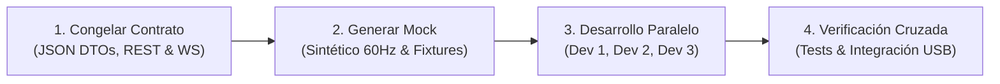
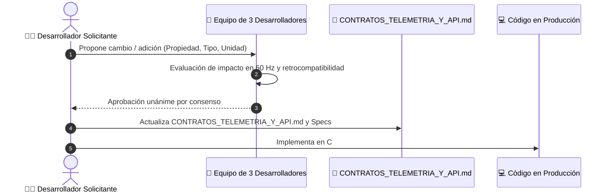

# 📖 Manual y Protocolo de Gobernanza: Spec-Driven Development (SDD Intensivo)

> **Proyecto:** ApexLink — Telemetría SimRacing en Tiempo Real y Análisis de Rendimiento (FAPPE 2026)  
> **Destinatarios:** Los 3 Desarrolladores del Equipo (Dev 1: Backend/API · Dev 2: DDU Móvil · Dev 3: WebApp)  
> **Principio Rector:** *"Las Especificaciones son Sagradas; el Código es un Derivado Descendente".*  
> **Objetivo:** Garantizar el desarrollo autónomo en paralelo de los tres ingenieros sin bloqueos, sin inconsistencias de datos y con cero regresiones durante el sprint de 3 semanas.

---

## 📑 Tabla de Contenidos

1. [¿Qué es el Desarrollo Dirigido por Especificaciones (Spec-Driven Development)?](#1-qué-es-el-desarrollo-dirigido-por-especificaciones-spec-driven-development)
2. [Jerarquía Inmutable de Fuentes de Verdad](#2-jerarquía-inmutable-de-fuentes-de-verdad)
3. [El Ciclo de Vida Contract-First (Del Contrato a la Implementación)](#3-el-ciclo-de-vida-contract-first-del-contrato-a-la-implementación)
4. [Política de Cero Divergencia y Sanitización de Tipos](#4-política-de-cero-divergencia-y-sanitización-de-tipos)
5. [Estrategia de Desacoplamiento Absoluto mediante Motor Mock](#5-estrategia-de-desacoplamiento-absoluto-mediante-motor-mock)
6. [Gestión y Aislamiento del Código Prototipo en la Carpeta `/old`](#6-gestión-y-aislamiento-del-código-prototipo-en-la-carpeta-old)
7. [Puertas de Calidad, Definition of Ready (DoR) y Definition of Done (DoD)](#7-puertas-de-calidad-definition-of-ready-dor-y-definition-of-done-dod)
8. [Protocolo de Gestión de Cambios de Especificación (RFC Interno)](#8-protocolo-de-gestión-de-cambios-de-especificación-rfc-interno)

---

## 1. ¿Qué es el Desarrollo Dirigido por Especificaciones (Spec-Driven Development)?

En el desarrollo de software convencional, los equipos suelen precipitarse a escribir código prematuramente, descubriendo desajustes de contratos, campos faltantes o problemas de concurrencia a mitad del proyecto. Cuando esto ocurre en un entorno distribuido en tiempo real (60 Hz) con hardware físico (Win32 MMF, túneles USB Android y sockets web), el resultado es desastroso: horas perdidas depurando desalineaciones de red y culpas cruzadas entre desarrolladores.

El **Desarrollo Dirigido por Especificaciones (*Spec-Driven Development* - SDD)** invierte esta dinámica:
1. **La Especificación es el Contrato Sagrado:** La totalidad de las firmas de métodos, DTOs de red, unidades físicas, rangos numéricos, esquemas de persistencia y layouts visuales se definen, auditan y congelan **antes de escribir una sola línea de código de producción**.
2. **El Código es un Artefacto Derivado:** El código fuente en C#, TypeScript, HTML o CSS no es más que la materialización fidedigna y computable del documento rector.
3. **Paralelismo Real sin Fricción:** Al contar con contratos y datos sintéticos inmutables, los tres desarrolladores pueden programar al 100% de velocidad desde el Día 1 sin esperar que los demás terminen sus módulos.

---

## 2. Jerarquía Inmutable de Fuentes de Verdad

Para resolver cualquier duda o discrepancia técnica durante el desarrollo, rige la siguiente **Pirámide de Jerarquía de Verdad**:

```
                  ▲
                 / \
                / 1 \       Nivel 1: CONTRATOS_TELEMETRIA_Y_API.md
               /-----\      (Esquemas JSON, Tipos, Rangos, Endpoints REST)
              /   2   \
             /---------\    Nivel 2: DOCUMENTACION_TECNICA.md (Capa 1 - Backend)
            /     3     \            DOCUMENTACION_TECNICA_MODULO2_DASHBOARD.pdf (Capa 2 - DDU)
           /-------------\           DOCUMENTACION_TECNICA_MODULO3_WEBAPP.md (Capa 3 - WebApp)
          /       4       \
         /-----------------\ Nivel 3: BRIEF_INTEGRAL_SISTEMA_3_CAPAS.md y CONTROL_FASES_Y_TAREAS
        /         5         \
       /---------------------\ Nivel 4: Código Fuente en Producción (C# .NET, React 19, Next.js 15)
      /           6           \
     /─────────────────────────\ Nivel 5: Prototipos Históricos de Referencia (/old)
```

1. **Nivel 1 (Máxima Autoridad):** `docs/spec-driven-docs/CONTRATOS_TELEMETRIA_Y_API.md`. Define con precisión matemática cada propiedad JSON, unidad física (°C, PSI, km/h, G) y endpoint REST. Si un desarrollador nota que un campo en su código difiere de este archivo, **el código está equivocado y debe corregirse**.
2. **Nivel 2 (Especificaciones Técnicas por Capa):** 
   - Backend Relay: `docs/spec-driven-docs/DOCUMENTACION_TECNICA.md`
   - DDU Volante: `docs/spec-driven-docs/DOCUMENTACION_TECNICA_MODULO2_DASHBOARD.pdf`
   - WebApp Boxes: `docs/spec-driven-docs/DOCUMENTACION_TECNICA_MODULO3_WEBAPP.md`
3. **Nivel 3 (Visión y Cronograma):** `BRIEF_INTEGRAL_SISTEMA_3_CAPAS.md` y `CONTROL_FASES_Y_TAREAS_INTEGRAL.md`.
4. **Nivel 4 (Implementación):** Proyectos compilables bajo los estándares de Clean Architecture y React atómico.
5. **Nivel 5 (Referencia Pasada):** Prototipos exploratorios almacenados en `/old`.

---

## 3. El Ciclo de Vida Contract-First (Del Contrato a la Implementación)

Todo flujo de trabajo en ApexLink sigue estrictamente las cuatro fases del ciclo de vida *Contract-First*:



### 3.1. Fase 1: Congelamiento de Contrato
Antes de codificar una funcionalidad, sus DTOs deben quedar definidos en español e inglés:
* **En C#:** Decorados obligatoriamente con `[JsonPropertyName("...")]` en `camelCase`.
* **En TypeScript:** Declarados en `src/types/telemetria.ts` con tipos primitivos equivalentes (`number`, `string`, `boolean`, tuplas `[number, number, number, number]`).

### 3.2. Fase 2: Provisión del Mock Engine y Golden Fixtures
Dev 1 provee el motor mock (`GeneradorTelemetriaMock`) que emite la vuelta sintética de Monza a 60 Hz. Simultáneamente, se generan archivos JSON con muestras reales (*Golden Master Fixtures*) para pruebas offline de los desarrolladores frontend.

### 3.3. Fase 3: Construcción Independiente
* Dev 1 implementa la lectura Win32 MMF y la persistencia SQLite WAL.
* Dev 2 construye los widgets del volante en React 19 consumiendo el stream del mock.
* Dev 3 construye las gráficas uPlot y el mapa 2D consumiendo los endpoints REST del mock.

### 3.4. Fase 4: Integración y Conmutación en Caliente
Con los clientes frontend completados, se activa la conmutación a datos reales (`POST /api/mock/alternar` o inicio de Assetto Corsa). Debido a que ambos lados respetaron el contrato al 100%, la integración ocurre de manera **inmediata y sin errores de parseo**.

---

## 4. Política de Cero Divergencia y Sanitización de Tipos

Para erradicar inconsistencias entre el ecosistema .NET (PascalCase por convención) y TypeScript/JavaScript (camelCase), se fijan las siguientes reglas inviolables:

### 4.1. Nombres y Serialización de Propiedades
* **C#:** Las clases y registros utilizan PascalCase (`VelocidadKmh`, `PresionPsi`), pero **siempre** deben incluir el atributo de serialización System.Text.Json con el nombre exacto en camelCase:
  ```csharp
  [JsonPropertyName("speedKmh")]
  public float VelocidadKmh { get; init; }
  ```
* **TypeScript:** Las propiedades se tipan directamente en camelCase, coincidiendo exactamente con el JSON:
  ```typescript
  export interface DatosAutoDto {
    speedKmh: number;
    rpms: number;
    // ...
  }
  ```

### 4.2. Vector Canónico de Neumáticos
El orden de los 4 elementos en arreglos de neumáticos (`pressurePsi`, `tempCoreC`, `wear`) es **invariable**:
* Índice `[0]`: Delantero Izquierdo (**FL** - Front Left).
* Índice `[1]`: Delantero Derecho (**FR** - Front Right).
* Índice `[2]`: Trasero Izquierdo (**RL** - Rear Left).
* Índice `[3]`: Trasero Derecho (**RR** - Rear Right).

Cualquier inversión o reordenamiento en frontend o backend está terminantemente prohibido.

### 4.3. Marchas Engranadas
* `-1`: Marcha atrás / Reversa (`R`).
* `0`: Punto muerto / Neutral (`N`).
* `1` a `8`: Primera a Octava marcha hacia adelante.

---

## 5. Estrategia de Desacoplamiento Absoluto mediante Motor Mock

Uno de los mayores riesgos en proyectos de SimRacing es la dependencia del hardware: para probar el software, los desarrolladores tendrían que tener una computadora con tarjeta gráfica potente, volante físico conectado por USB y Assetto Corsa abierto rodando en pista.

### 5.1. La Solución Mock Determinística
ApexLink desacopla el desarrollo mediante el `GeneradorTelemetriaMock` integrado en el backend:
1. **Trayectoria Matemática de Monza:** Simula con precisión física una vuelta al Autodromo Nazionale Monza dividida en 9 tramos (Recta principal, Variante del Rettifilo, Curva Grande, Variante della Roggia, Curvas de Lesmo, Serraglio, Variante Ascari, Recta trasera y Parabólica).
2. **Dinámica Cinemática Realista:**
   - Aceleración y frenada calculadas mediante ecuaciones diferenciales de movimiento rectilíneo y circular uniforme.
   - Círculo de fricción de Kamm que modula el reparto de adherencia entre tracción y dirección.
   - Curvas térmicas de neumáticos que calientan la goma progresivamente en apoyos fuertes y la enfrían en rectas.
3. **Mocks Locales de Respaldo en Clientes:** Tanto `apex-link-display` (Dev 2) como `apex-link-web` (Dev 3) incluyen un generador mock procedural local (`useMockTelemetria.ts`) para maquetar interfaces incluso si el backend de C# no está levantado.

---

## 6. Gestión y Aislamiento del Código Prototipo en la Carpeta `/old`

Durante la fase de exploración y prueba de concepto inicial, los tres desarrolladores escribieron prototipos rápidos para comprobar la factibilidad técnica de cada rol:
* Prototipo inicial de DDU móvil: Aislado en `/old/dash-mobile`.
* Prototipo de servidor inicial en Node.js: Aislado en `/old/server`.
* Prototipo inicial de plataforma web: Aislado en `/old/web`.

### 6.1. Reglas de Operación sobre `/old`
1. **Preservación Histórica:** El código en `/old` **no se borra ni se modifica**. Sirve como testimonio de factibilidad técnica y prueba de concepto previa ante los docentes evaluadores de FAPPE 2026.
2. **Cero Importaciones desde `/old`:** Ningún componente de producción en `backend/`, `apex-link-display/` o `apex-link-web/` puede realizar `import` ni enlazar archivos ubicados dentro de `/old`.
3. **Reconstrucción Limpia:** Los módulos definitivos se construyen desde cero bajo la arquitectura Clean Architecture (.NET) y React atómico/Zustand según las especificaciones técnicas sagradas.

---

## 7. Puertas de Calidad, Definition of Ready (DoR) y Definition of Done (DoD)

### 7.1. Definition of Ready (DoR) — Cuándo se puede empezar a programar
Una tarea o módulo puede iniciar su implementación únicamente cuando:
1. Su especificación técnica detallada se encuentra escrita y aprobada en `docs/spec-driven-docs/`.
2. Sus DTOs, métodos, rutas de API y eventos WebSocket están catalogados en `CONTRATOS_TELEMETRIA_Y_API.md`.
3. Las dependencias previas en la matriz de fases se encuentran completadas al 100%.

### 7.2. Definition of Done (DoD) — Cuándo se considera completada
Una tarea o módulo se marca como `Completada` únicamente cuando:
1. **Conformidad de Contrato:** Pasa todas las validaciones de tipo sin recurrir a tipos dinámicos o *casts* inseguros.
2. **Compilación Limpia:** Compila en modo Release (`dotnet build -c Release` / `pnpm build`) con **cero errores y cero advertencias (0 warnings)**.
3. **Pruebas Automatizadas:** Cuenta con pruebas unitarias o de integración pasando al 100%.
4. **Verificación en Caliente:** Ejecuta a 60 FPS estables sin caídas de cuadros, sin fugas de memoria y con latencia $< 1\text{ ms}$ vía USB.
5. **Auditoría Documental:** El avance se registra en el panel de control de fases correspondiente.

---

## 8. Protocolo de Gestión de Cambios de Especificación (RFC Interno)

Si durante el desarrollo un programador detecta que se requiere un nuevo campo (por ejemplo, nivel de combustible o temperatura de discos de freno):



1. **Prohibición de Cambios Unilaterales:** Ningún desarrollador puede añadir o renombrar propiedades por su cuenta.
2. **Evaluación de Impacto en Red:** Se evalúa si el campo afecta el ancho de banda del WebSocket a 60 Hz.
3. **Actualización Documental Primero:** Primero se actualiza el contrato en `docs/spec-driven-docs/CONTRATOS_TELEMETRIA_Y_API.md`.
4. **Despliegue Simultáneo:** Se aplican las modificaciones en C# y TypeScript en el mismo commit de Git.

---

## 9. Resumen de Compromiso del Equipo

Los tres desarrolladores de ApexLink asumen formalmente este manual como su **código deontológico de ingeniería**:
* **Dev 1 (Backend Relay & API):** Se compromete a emitir datos 100% conformes al contrato, con latencia mínima y persistencia confiable.
* **Dev 2 (DDU Volante):** Se compromete a mantener 60-144 FPS estables, con ergonomía de alta competición y cero re-renders innecesarios.
* **Dev 3 (Plataforma Web Boxes):** Se compromete a normalizar la telemetría en el dominio métrico, renderizar gráficos uPlot fluidos y proveer un mapa 2D de trazadas de nivel profesional.