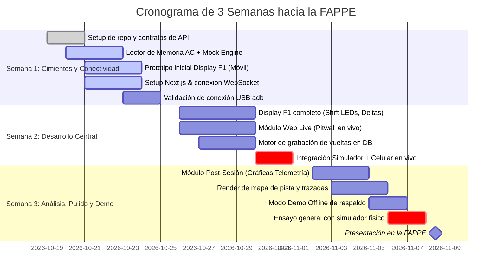

# 📅 Cronograma de 3 Semanas (Sprint Urgente FAPPE)

Plan de acción día por día con metas semanales verificables para llegar con holgura a la presentación.

---

## Resumen del Calendario de Sprints

---

## 🏁 Semana 1: Cimientos, Mock Engine y Enlace USB

| Día | Dev 1 (Core & Relay) | Dev 2 (F1 Display) | Dev 3 (Web Next.js) |
| :--- | :--- | :--- | :--- |
| **Día 1** | Configuración del monorepo / paquetes. Definir contrato JSON final. | Boceto en Figma/CSS del layout de volante F1. | Setup proyecto Next.js 15, TailwindCSS y Lucide. |
| **Día 2** | Desarrollar el **Mock Telemetry Engine** emitiendo datos por WS a 60Hz. | Maquetar estructura de volante (Gear central, RPM bar, Speed). | Crear estructura de rutas (`/live`, `/analysis`, `/sessions`). |
| **Día 3** | Implementar lector MMF de Assetto Corsa en PC con el juego abierto. | Conectar UI al WebSocket mock y animar barra de RPMs. | Implementar cliente WebSocket en Next.js para escuchar el stream. |
| **Día 4** | Integrar lector real con servidor WebSocket. | Implementar lógica de Shift LEDs (cambio de color según % RPM). | Construir componentes de acelerador y freno en tiempo real. |
| **Día 5** | Configurar y probar `adb reverse` con el cable USB en celular Android. | Probar la PWA en el teléfono físico por USB con pantalla completa. | Crear widget de G-Force bidimensional en vivo. |
| **Fin de Semana 1** | **Hito Semanal 1:** El teléfono montado al volante ya muestra marchas y RPMs en vivo saliendo del simulador por USB. |

---

## ⚡ Semana 2: Desarrollo Central y Grabación de Vueltas

| Día | Dev 1 (Core & Relay) | Dev 2 (F1 Display) | Dev 3 (Web Next.js) |
| :--- | :--- | :--- | :--- |
| **Día 6** | Detección de paso por meta (`lapCompleted`) y cálculo de deltas. | Añadir widget de neumáticos (temperaturas y presiones de 4 ruedas). | Diseñar dashboard completo de Boxes (Live Pitwall). |
| **Día 7** | Sistema de almacenamiento en SQLite o JSON para cada vuelta. | Añadir banderas de pista (Yellow flag, Green flag, Box flag). | Incorporar mapa 2D esquemático del circuito con posición del auto. |
| **Día 8** | Guardar muestras de telemetría (Throttle, Brake, Speed, Coords X/Z). | Añadir indicador de delta en tiempo real (+0.3s rojo / -0.2s verde). | Armar listado de vueltas registradas y selector de sesiones. |
| **Día 9** | Endpoints REST (`/api/sessions`, `/api/laps/:id/telemetry`). | Optimizar rendimiento: asegurar 60 FPS estables sin tirones. | Integrar librería de gráficos (uPlot o Recharts) para curvas de datos. |
| **Día 10** | Pruebas de estrés y reconexión automática tras desenchufar cable USB. | Incorporar botón de pantalla completa y WakeLock API. | Primera prueba de renderizado de gráfica multieje (Speed vs Distancia). |
| **Fin de Semana 2** | **Hito Semanal 2:** El sistema completo graba vueltas y el display del volante está 100% terminado y pulido. |

---

## 🏆 Semana 3: Análisis Post-Sesión, Pulido y Ensayos de Stand

| Día | Dev 1 (Core & Relay) | Dev 2 (F1 Display) | Dev 3 (Web Next.js) |
| :--- | :--- | :--- | :--- |
| **Día 11** | Empaquetar todo el backend en script ejecutable de 1 clic. | Ajustes de contraste para ambientes de mucha luz en la feria. | Desarrollar comparador de vueltas (Superposición Vuelta A vs Vuelta B). |
| **Día 12** | Desarrollar **Modo Demo Offline** (reproduce una vuelta grabada en bucle). | Soporte para cambiar de pantalla (modo Qualifying vs modo Carrera). | Algoritmo de dibujo de trazada con Canvas a partir de coordenadas X/Z. |
| **Día 13** | Pruebas de consumo de CPU mientras Assetto Corsa corre a 1080p/4K. | Pruebas de calentamiento del teléfono con brillo al máximo. | Colorear la trazada según frenada (rojo) y aceleración a fondo (verde). |
| **Día 14** | Ensayo general con el volante y pedalera conectados en la PC de feria. | Revisar que la app no se cuelgue ante ningún evento inesperado. | Revisión visual de toda la suite web; preparar modo presentación. |
| **Día 15** | Armado de maletín técnico y backups en pendrive. | Checklist de hardware (cables, soporte). | Guión de explicación para el jurado. |
| **Día FAPPE** | **¡PRESENTACIÓN Y DEFENSA DEL PROYECTO! 🏎️💨** |

---

## 🛡️ Plan de Contingencia para el Día del Evento

1. **¿Qué pasa si la PC del simulador se queda sin internet?**
   - El sistema opera 100% de manera local (`localhost:8080`). No requiere conexión a internet externa.
2. **¿Qué pasa si el simulador no puede correr por problemas de hardware o falta de espacio?**
   - Se activa el comando `npm run start:demo`, que ejecuta el **Mock Telemetry Engine** reproduciendo una vuelta grabada de Monza a 60 FPS. Tanto el volante en el teléfono como la plataforma web funcionarán con total fidelidad visual ante el jurado.
3. **¿Qué pasa si el cable USB se desconecta durante una vuelta?**
   - El display en el móvil muestra un banner de reconexión y se reengancha en menos de 1 segundo al reconectar el cable sin necesidad de reiniciar la app.
