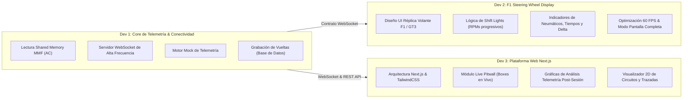

# 👥 Matriz de Roles y Asignación del Equipo (3 Desarrolladores)

Dado el plazo estricto de **3 semanas**, el proyecto está estructurado para que los 3 integrantes trabajen en paralelo sin bloquearse mutuamente.

---

## 1. Asignación de Roles y Responsabilidades

---

## 2. Detalle de Tareas por Desarrollador

### 👤 Desarrollador 1: Core de Telemetría, Relay & Conectividad
* **Objetivo:** Garantizar que los datos salgan de Assetto Corsa y lleguen de forma limpia, rápida y estructurada a los clientes.
* **Tareas concretas:**
  1. Implementar el módulo de lectura de Memoria Compartida de Windows (`acpmf_physics`, `acpmf_graphic`, `acpmf_static`).
  2. Desarrollar el **Mock Telemetry Engine**: generar datos matemáticos de vueltas virtuales para que Dev 2 y Dev 3 puedan trabajar sin el juego.
  3. Crear el servidor WebSocket con serialización optimizada a 60 Hz.
  4. Desarrollar el sistema de persistencia (guardar cada vuelta completada con sus puntos de acelerador, freno, velocidad y coordenadas en SQLite o JSON).
  5. Crear los scripts de automatización USB (`adb reverse`) y empaquetar el relay en un comando de un solo clic.

---

### 👤 Desarrollador 2: F1 Steering Wheel Display (Android)
* **Objetivo:** Construir una pantalla de instrumentos digital que parezca el display de un volante de Fórmula 1 real, fluida y legible mientras se conduce.
* **Tareas concretas:**
  1. Diseñar el layout réplica de monoplaza (marcha gigante en el centro, velocidad digital en km/h, tiempos de vuelta).
  2. Implementar los **Rev LEDs (Shift Lights)**: barra superior de 15 luces LED que se encienden progresivamente (Verde -> Rojo -> Azul intermitente en el punto óptimo de cambio según `maxRpm`).
  3. Crear el widget de neumáticos (4 ruedas con indicador de presión en PSI y degradé de color según temperatura de goma).
  4. Implementar el cálculo visual del **Delta de Tiempo** (+0.23s en rojo, -0.45s en verde) y las banderas de pista (Yellow flag, Green flag).
  5. Asegurar 60 FPS estables con CSS accelerated o HTML5 Canvas, y bloqueo de apagado de pantalla (`WakeLock API`).

---

### 👤 Desarrollador 3: Plataforma Web Next.js (Live Pitwall & Post-Session)
* **Objetivo:** Desarrollar el centro de mando de ingeniería que se mostrará en una pantalla grande o laptop al jurado y visitantes.
* **Tareas concretas:**
  1. Inicializar la app en Next.js (App Router) con TailwindCSS y componentes visuales atractivos tipo cockpit de competición.
  2. **Módulo Live:** Conectarse al WebSocket para mostrar el estado en vivo del auto cuando alguien esté manejando en el simulador (barras dinámicas de pedal de freno y acelerador, diagrama G-Force, panel de alarmas).
  3. **Módulo Post-Sesión:** 
     - Selector de vueltas grabadas por Dev 1.
     - Gráficos interactivos sincronizados: curva de **Velocidad**, **Throttle** y **Brake** a lo largo de la distancia del circuito.
  4. **Mapa de Trazada:** Renderizar en un Canvas 2D el dibujo de la pista a partir de las coordenadas $X, Z$ registradas y dibujar la línea de carrera con mapa de calor (puntos de frenada en rojo y aceleración en verde).

---

## 3. Protocolo de Integración entre Desarrolladores

- **Sin dependencias bloqueantes:** Dev 2 y Dev 3 no tienen que esperar a que Dev 1 termine el lector de memoria de Assetto Corsa. Dev 1 provee el **Mock Telemetry Generator** el Día 2, lo que permite a Dev 2 y Dev 3 programar contra el flujo de datos simulado desde el primer momento.
- **Canal de sincronización diario:** Reunión diaria de 15 minutos (Daily Standup) para revisar estado de sockets y formatos de campos.
