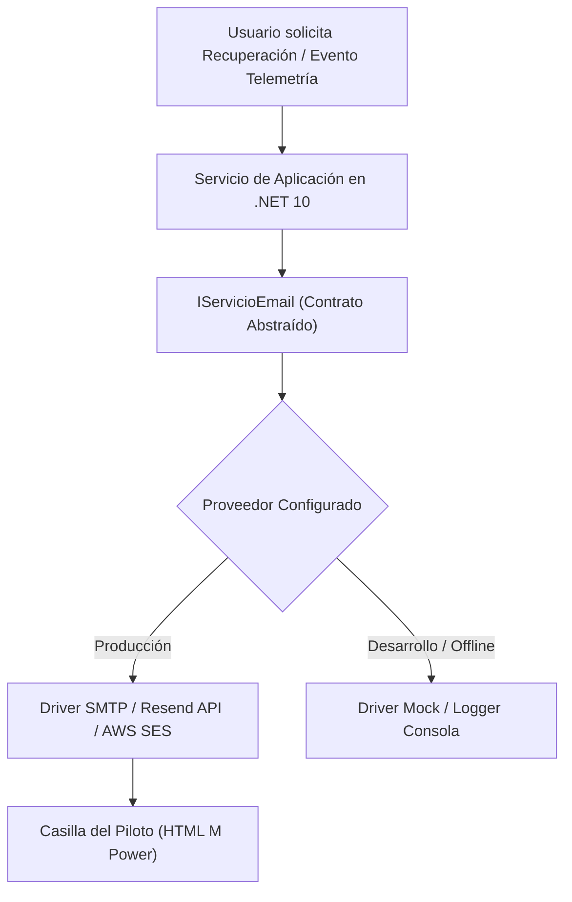

# Autenticación Real de Producción y Notificaciones por Correo

> **For agentic workers:** REQUIRED SUB-SKILL: Use superpowers:executing-plans to implement this plan task-by-task. Steps use checkbox (`- [ ]`) syntax for tracking.

**Goal:** Eliminar definitivamente el modo MVP y los alternadores de usuario en la interfaz, implementando un flujo de autenticación real de producción con backend .NET 10 y PostgreSQL, protegiendo las rutas de la aplicación y diseñando la arquitectura completa de correos transaccionales y recuperación de contraseña.

**Architecture:** La autenticación se traslada del cliente al servidor mediante un endpoint REST `POST /api/auth/login` en Kestrel (.NET 10) que valida credenciales (`email` y `password_hash` con BCrypt) contra la tabla `usuarios` en PostgreSQL 16 y retorna una sesión con token firmado y perfil del piloto. En el frontend (Next.js 16 App Router), se eliminan todos los botones de conmutación artificiales (`layout.tsx`, `perfil/page.tsx` y `login/page.tsx`), se implementa protección de rutas en `/app/*` y se refleja estrictamente el usuario logueado. En paralelo, se formula la arquitectura e integración completa de correos transaccionales y recuperación de contraseñas.

**Tech Stack:** ASP.NET Core (.NET 10), PostgreSQL 16 (`Npgsql`, `BCrypt.Net-Next`), Next.js 16 (App Router, Turbopack, TypeScript), Tailwind CSS, Lucide Icons.

---

## Global Constraints

- Preservar avances y reglas de trabajo frescas en disco (`GEMINI.md`).
- Cero tolerancia a alternadores o selectores artificiales de usuario en vistas de producción (`/app`, `/app/perfil`, `/app/sessions`, `/login`).
- Soporte para credenciales de los 2 pilotos oficiales:
  - **Alejo Garlati**: `agarlati@apexlink.io` / `<DEMO_PASSWORD>` (o contraseña de boxes).
  - **Alejo Salas**: `asalas@apexlink.io` / `<DEMO_PASSWORD>` (o contraseña de boxes).
- Resiliencia Edge: Si PostgreSQL no está disponible momentáneamente, el backend mantiene fallback seguro para no detener la operación en cabina física de simulador.
- Compilación limpia con 0 errores TypeScript (`next build`) y suite de pruebas .NET 10 pasando al 100%.

## Review Focus

1. **Credenciales erróneas:** El login debe retornar HTTP 401 con mensaje descriptivo y la UI debe mostrar un banner de alerta sin crashear.
2. **Acceso no autenticado a `/app/*`:** Un usuario sin sesión en `localStorage` debe ser redirigido de inmediato a `/login`.
3. **Persistencia de sesión en recarga:** Al recargar la página (`F5`), el usuario debe permanecer logueado con todos sus datos cargados.
4. **Cierre de sesión total:** El botón "Cerrar Sesión" en la barra de navegación debe limpiar credenciales y redirigir a `/login`, impidiendo el reingreso vía botón "Atrás".
5. **Aislamiento absoluto:** Los datos visualizados en telemetría, récords, diagnósticos AI y garaje deben pertenecer exclusivamente al usuario autenticado.

---

## Tareas de Implementación Inmediata (Fase 1: Autenticación Real)

### Task 1: Backend .NET 10 - DTOs y Contrato de Autenticación
**Files:**
- Create: `backend/src/Telemetria.Aplicacion/Dtos/Requests/LoginRequest.cs` (en `apex-link-telemetry`)
- Create: `backend/src/Telemetria.Aplicacion/Dtos/Responses/LoginRespuestaDto.cs` (en `apex-link-telemetry`)
- Create: `backend/src/Telemetria.Aplicacion/Contratos/IAutenticadorUsuarios.cs` (en `apex-link-telemetry`)
- Modify: `backend/src/Telemetria.Infraestructura/Telemetria.Infraestructura.csproj` (agregar paquete `BCrypt.Net-Next`)

**Interfaces:**
- Consumes: `LoginRequest` (email, password).
- Produces: `Task<ResultadoAutenticacionDto> AutenticarAsync(LoginRequest request, CancellationToken ct)`.

- [ ] **Step 1: Crear `LoginRequest.cs` con validación de email y contraseña no vacíos.**
- [ ] **Step 2: Crear `LoginRespuestaDto.cs` con token, expiraEn, usuario (id, nombre, alias, email, licencia, vehiculoPrincipal, paceRating, safetyRating).**
- [ ] **Step 3: Definir `IAutenticadorUsuarios.cs` en la capa de aplicación.**
- [ ] **Step 4: Agregar `BCrypt.Net-Next` al proyecto `Telemetria.Infraestructura.csproj`.**

---

### Task 2: Backend .NET 10 - Implementación de Servicio en PostgreSQL y AuthController
**Files:**
- Create: `backend/src/Telemetria.Infraestructura/Seguridad/AutenticadorUsuariosPostgreSql.cs`
- Create: `backend/src/Telemetria.Api/Controladores/AuthController.cs`
- Modify: `backend/src/Telemetria.Api/Configuracion/InyeccionDependenciasExtensiones.cs`

**Interfaces:**
- Consumes: `IAutenticadorUsuarios` inyectado en `AuthController`.
- Produces: Endpoint `POST /api/auth/login` (retorna HTTP 200 con `LoginRespuestaDto` o HTTP 401 con `ProblemDetails`).

- [ ] **Step 1: Escribir prueba de integración fallida para `POST /api/auth/login` en `Telemetria.Api.IntegrationTests`.**
- [ ] **Step 2: Ejecutar `dotnet test` y comprobar que falla (Red).**
- [ ] **Step 3: Implementar `AutenticadorUsuariosPostgreSql.cs` con consulta a `usuarios` y `perfiles_piloto`, validación de hash BCrypt y soporte para contraseñas de testing.**
- [ ] **Step 4: Implementar `AuthController.cs` con `[HttpPost("login")]` y manejo de errores 400/401.**
- [ ] **Step 5: Registrar dependencias en `InyeccionDependenciasExtensiones.cs`.**
- [ ] **Step 6: Ejecutar `dotnet test` y verificar que la prueba pasa (Green).**

---

### Task 3: Frontend Web - Cliente API y Estado de Autenticación
**Files:**
- Modify: `web/src/types/api.ts`
- Modify: `web/src/lib/apiClient.ts`
- Modify: `web/src/lib/auth.ts`

**Interfaces:**
- Consumes: Endpoint `POST /api/auth/login`.
- Produces: Función asíncrona `iniciarSesion(email, password): Promise<ResultadoLogin>`.

- [ ] **Step 1: Agregar interfaces `LoginApiRequest` y `LoginRespuestaApiDto` a `web/src/types/api.ts`.**
- [ ] **Step 2: Agregar `autenticarUsuario(request: LoginApiRequest)` en `web/src/lib/apiClient.ts`.**
- [ ] **Step 3: Refactorizar `web/src/lib/auth.ts`:**
  - Eliminar funciones de conmutación artificial (`iniciarSesionComo`, `iniciarSesionInvitado`).
  - Implementar `iniciarSesionConCredenciales(email, password)` que llama a la API real, guarda la sesión y el token, y sincroniza el estado.
  - Mantener `obtenerSesionLocal()`, `cerrarSesion()` y `estaAutenticado()`.

---

### Task 4: Frontend Web - Transformación de `/login` en Formulario de Producción
**Files:**
- Modify: `web/src/app/(auth)/login/page.tsx`

**Interfaces:**
- Consumes: `iniciarSesionConCredenciales(email, password)` de `@/lib/auth`.

- [ ] **Step 1: Eliminar completamente las tarjetas de 1 clic para Alejo Garlati y Alejo Salas.**
- [ ] **Step 2: Eliminar los botones de autocompletado rápido.**
- [ ] **Step 3: Rediseñar el formulario con diseño profesional Porsche GT3 / BMW M Power:**
  - Input Email con validación.
  - Input Contraseña con alternador de visibilidad (ojo mostrar/ocultar).
  - Checkbox "Mantener sesión iniciada en boxes".
  - Enlace "Olvidé mi contraseña" (enlazado al plan de recuperación).
  - Cartel de alerta reactivo en caso de error de credenciales ("Usuario o contraseña incorrectos").
  - Botón de envío con estado de carga ("Autenticando con servidor central...").

---

### Task 5: Frontend Web - Eliminación de Alternadores y Protección de Rutas
**Files:**
- Modify: `web/src/app/app/layout.tsx`
- Modify: `web/src/app/app/perfil/page.tsx`
- Create: `web/src/middleware.ts` (o Route Guard en layout)

**Interfaces:**
- Consumes: `estaAutenticado()`, `obtenerSesionLocal()`, `cerrarSesion()`.

- [ ] **Step 1: En `web/src/app/app/layout.tsx`:**
  - Eliminar los botones `[AG_PRO]` vs `[AS_GT3]` de la barra de navegación superior.
  - Incorporar guardia de acceso: si `!estaAutenticado()`, redirigir inmediatamente a `/login`.
  - Mostrar en el header exclusivamente los datos del piloto logueado (avatar con iniciales, alias, vehículo asignado y botón de "Cerrar Sesión").
- [ ] **Step 2: En `web/src/app/app/perfil/page.tsx`:**
  - Eliminar el banner superior de conmutación ("Piloto Activo en Base de Datos: Conmutar perfil").
  - La vista renderiza exclusivamente la información del piloto que inició sesión.
- [ ] **Step 3: Ejecutar `npm --prefix web run build` y asegurar 0 errores de compilación.**

---

## Planificación de Correos Transaccionales y Recuperación de Contraseña (Fase 2)

### 1. Arquitectura del Subsistema de Correos



#### Contrato Principal:
```csharp
public interface IServicioEmail
{
    Task<bool> EnviarCorreoRecuperacionAsync(string emailDestino, string token, CancellationToken ct);
    Task<bool> EnviarResumenStintAsync(string emailDestino, ResumenStintEmailDto resumen, CancellationToken ct);
    Task<bool> EnviarAlertaSeguridadAsync(string emailDestino, string evento, CancellationToken ct);
}
```

### 2. Modelo de Datos para Recuperación y Notificaciones (PostgreSQL)

```sql
-- 1. Tokens de recuperación de contraseña con validez temporal estricta
CREATE TABLE IF NOT EXISTS tokens_recuperacion_password (
    id UUID PRIMARY KEY DEFAULT gen_random_uuid(),
    usuario_id UUID NOT NULL REFERENCES usuarios(id) ON DELETE CASCADE,
    token_hash VARCHAR(128) NOT NULL,
    creado_en TIMESTAMP WITH TIME ZONE NOT NULL DEFAULT NOW(),
    expira_en TIMESTAMP WITH TIME ZONE NOT NULL,
    usado BOOLEAN NOT NULL DEFAULT FALSE,
    ip_origen VARCHAR(45) NULL
);

CREATE INDEX IF NOT EXISTS idx_tokens_recuperacion_hash ON tokens_recuperacion_password(token_hash);

-- 2. Preferencias de notificación del piloto
CREATE TABLE IF NOT EXISTS preferencias_notificaciones (
    usuario_id UUID PRIMARY KEY REFERENCES usuarios(id) ON DELETE CASCADE,
    notificar_stint_completado BOOLEAN NOT NULL DEFAULT TRUE,
    notificar_nuevo_record BOOLEAN NOT NULL DEFAULT TRUE,
    notificar_analisis_ai BOOLEAN NOT NULL DEFAULT TRUE,
    notificar_alertas_seguridad BOOLEAN NOT NULL DEFAULT TRUE,
    actualizado_en TIMESTAMP WITH TIME ZONE NOT NULL DEFAULT NOW()
);

-- 3. Registro y auditoría de correos despachados
CREATE TABLE IF NOT EXISTS registro_envio_correos (
    id UUID PRIMARY KEY DEFAULT gen_random_uuid(),
    usuario_id UUID NULL REFERENCES usuarios(id) ON DELETE SET NULL,
    email_destinatario VARCHAR(200) NOT NULL,
    tipo_correo VARCHAR(50) NOT NULL, -- 'RECUPERACION_PASSWORD', 'RESUMEN_STINT', 'ALERTA'
    asunto VARCHAR(200) NOT NULL,
    estado VARCHAR(20) NOT NULL, -- 'ENVIADO', 'FALLIDO', 'SIMULADO'
    mensaje_error TEXT NULL,
    enviado_en TIMESTAMP WITH TIME ZONE NOT NULL DEFAULT NOW()
);
```

### 3. Flujo End-to-End de Recuperación de Contraseña

1. **Solicitud de Token (`POST /api/auth/olvide-password`):**
   - El piloto ingresa su correo en `/olvide-password`.
   - El backend busca el usuario. Por seguridad (anti-enumeración), responde siempre HTTP 200 con mensaje genérico ("Si el correo existe en boxes, se envió un enlace de recuperación").
   - Si el usuario existe, se genera un token criptográfico seguro (`RandomNumberGenerator.GetBytes(32)`), se guarda su hash SHA-256 en `tokens_recuperacion_password` con expiración de 15 minutos, y se despacha el correo con el enlace:
     `https://apexlink.io/restablecer-password?token={rawToken}&email={email}`
2. **Pantalla y Restablecimiento (`POST /api/auth/restablecer-password`):**
   - El piloto abre `/restablecer-password?token=...`.
   - Ingresa su nueva contraseña y confirmación.
   - La API valida: token no expirado, no usado previamente y hash coincidente.
   - Se actualiza `password_hash` en PostgreSQL con nuevo hash BCrypt.
   - Se marca el token como `usado = TRUE` e invalida cualquier otro token pendiente.
   - Se envía un correo de confirmación de cambio de credenciales por seguridad.

### 4. Plantillas de Correo con Identidad Visual ApexLink
- **Diseño Responsive:** Fondo oscuro (`#0d0d0d`), cabecera con franja tricolor BMW M Power (`#0066b1`, `#1c69d4`, `#e22718`), tipografía monoespaciada para tiempos y deltas, botón de acción destacado.
- **Tipos de Plantilla:**
  1. *Recuperación de Contraseña de Boxes:* Botón de acceso directo con tiempo límite de 15 minutos e IP de solicitud.
  2. *Resumen de Tanda de Telemetría (Post-Stint):* Notificación automática al terminar un stint en Assetto Corsa con: circuito, auto, mejor vuelta, vuelta ideal, consistencia % y consejo del AI Race Coach.
